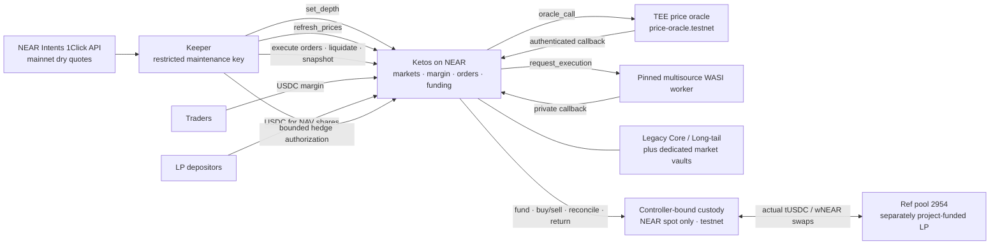

# Ketos — technical details and evidence

Full mechanism description, verification evidence and operations notes. The short overview is the [README](README.md).

Ketos is a native perps exchange on NEAR testnet, built for Unstoppable DeFi. New markets have dedicated LP vaults; existing Core and Long-tail pools retain their shared capital. Each market's open-interest limit and maximum leverage come from measured exit liquidity on [NEAR Intents](web/lib/intents/oneclick.ts), rather than a listing committee. Margin, orders, funding and settlement live in [one Rust contract](contracts/ketos/src/lib.rs).

**Trust model:** permissionless listing, price refresh, order execution and liquidation; trusted depth reports from one keeper; upgradeable code controlled by the testnet deployer. The contract checks the reported curve, freshness and capital limits, not the authenticity of solver quotes. Prices depend on authenticated oracle callbacks or the pinned enclave signing key. No administrator freeze/seizure method is implemented, but upgrades can change that code.

**Release boundary:** the hosted deployment uses schema 6: bounded trading, isolated-market vaults, `/launch`, and a vault-funded NEAR spot hedge on Ref Finance testnet. The state-preserving upgrade and real fund→buy→unwind→return lifecycle are verified. Liquidity is project-funded, coverage is partial, and the keeper depends on this Mac. Supported CLI-wallet browser signing is verified; Meteor/Ledger signing and continuous availability are not claimed.

The first dedicated testnet vault is [AAVE / market-0](https://ketos-three.vercel.app/vaults/market-0): [25 USDC registration](https://testnet.nearblocks.io/txns/6CEnBGJFK8d79cr6H8GSXH2zhuYziju7shKJ4qfmJXtW), then a separate [100 USDC LP deposit](https://testnet.nearblocks.io/txns/DAwmrYZFXDJa5N9QpHHdmtugV4LFxWo2xEhZxZLvR4on). These transactions use the existing local operator signer, not a retail-wallet browser session.

## The problem

A vault can inherit more exposure than the underlying market can absorb. In March 2025, Hyperliquid's HLP temporarily showed about $13.5M of unrealized losses during the JELLY squeeze before forced settlement ([CoinDesk](https://www.coindesk.com/markets/2025/03/26/hyperliquid-delists-jellyjelly-after-vault-squeezed-in-usd13m-tussle)). In September 2022, a reference-market manipulation extracted about $565,000 from GMX's AVAX market at GLP holders' expense ([Cointelegraph](https://cointelegraph.com/news/decentralized-exchange-gmx-suffers-565k-price-manipulation-exploit)). An oracle price alone does not establish executable depth.

Why measure [NEAR Intents](web/lib/intents/depth.ts)? Its solvers quote asset sales into USDC on NEAR, giving a reproducible indication of exit depth. **Assumption, not verified by the contract:** solver hedges overlap the venues behind the oracle, so quoted size is a useful proxy for the market behind the price. Solvers may use different venues, inventories or incentives. These quotes neither measure exact oracle-manipulation cost nor reserve liquidity. Vault capital is a separate binding constraint; the small Ref testnet hedge is a distinct execution route, not execution of those mainnet quotes.

### Two dated depth observations

Both measurements sell into USDC on NEAR with `dry: true`, net of the configured 20 bps partner fee. The older [November 3 fixture](web/e2e/fixtures/depth-2026-11-03.json) starts at **17:05:47 UTC**; the new [November 6 fixture](web/e2e/fixtures/depth-2026-11-06.json) starts at **08:09:34 UTC**. Each sweep spans multiple requests, not an atomic market snapshot.

| Asset | Nov 3: measured capacity | Nov 3: first failing size | Nov 6: measured capacity | Nov 6: first failing size | Nov 6: net impact at capacity |
|---|---:|---|---:|---|---:|
| BTC | $100,000 | $250,000: no quote | $1,000,000 | $2,500,000: no quote | 24 bps |
| ETH | $100,000 | $250,000: no quote | $1,000,000 | $2,500,000: no quote | 92 bps |
| NEAR | $100,000 | $250,000: no quote | $500,000 | $1,000,000: no quote | 18 bps |
| ZEC | $100,000 | $250,000: no quote | $1,000,000 | $2,500,000: no quote | 76 bps |

In both snapshots every cutoff was a missing quote, not impact above 1%. Capacity here is the last contiguous acceptable ticket, not proof of a hard market boundary. The new sampler retries unavailable sizes once and publishes a nondecreasing impact envelope; the historical fixture retains its original observations. Net impact floors at zero after subtracting the fee, so zero is not a promise of costless execution.

Reproduce with `pnpm depth:sample --fixture`; inspect the dated JSON, not just the CLI's derived leverage/open columns. Those columns describe raw depth tiers and the default hard cap, **not** vault backing, admission ramping, the Long-tail 5× ceiling or price freshness. This command submits no transaction and does not update deployed limits. `/risk` shows the separately published onchain curves.

## Demo

**Live app: https://ketos-three.vercel.app** — testnet contracts, faucet USDC, no real-money trading.

The full transaction journey is reproducible with `pnpm --dir web exec playwright test`. It deploys a local NEAR sandbox, connects a test wallet and runs [12 demo steps](web/e2e/demo.spec.ts), including keeper fills and liquidation. Prices are mocked locally; new depth measurements still use real, read-only mainnet quotes and need internet access.

**Video:** a new 12-scene V4 recording is assembled locally: 137.273 seconds, 1440×900 H.264/AAC, using the original voice workflow. Persistent labels distinguish controlled-price local transactions from public Ref receipts and synthetic replay. Public footage retains the observed stale-price warnings rather than concealing them. The historical V3 file is preserved separately; no video has been published.

**Current availability caveat (November 13, 08:31 UTC):** the previously stuck OutLayer call has terminated with `failed / Timeout`, and the keeper has resumed publications without a reset. Recovery remains intermittent: 58 of 180 recent risk cycles observed active prices older than 30 seconds, with a maximum age of 126.102 seconds. The hosted availability check still fails on stale BTC/ETH. Payment-key credit was $1.293089 at 08:30 UTC; the earlier healthy thirty-minute observation does not override these later gaps. Final autonomous-availability acceptance remains open.

Activity on the hosted app comes from our own test accounts, not independent users. The [real session script](scripts/demo-session.ts) funds three dedicated accounts and sends actual transactions to the deployed contracts: [ETH long with TP/SL](https://testnet.nearblocks.io/txns/7HepDCWwveH4efesbfJHmmvvqzPMhZSzyLZywXZWA67g), [XRP short](https://testnet.nearblocks.io/txns/B4UPb5LE6QkiPB4xdDWC61fJi1HqFEDvdNH5YUofiW5T) and [BTC limit order](https://testnet.nearblocks.io/txns/8tzC4MotZofkphL5Tu7nUNHZ6NFjwbD8yFY6QujS4Us9). Markets can still close and orders can remain unfilled. The app never overrides safety checks to reproduce a screenshot.

The completed November 6 session also includes a [200-USDC Core deposit](https://testnet.nearblocks.io/txns/DfsmzQ38ymR7eZCoofMYHW5Fh74Cobh21HPFE7bd77Wj), [200-USDC Long-tail deposit](https://testnet.nearblocks.io/txns/6XEUWkU6KNhi6MuXxgJXyn4drasQRimDuaw5GhjVGHUN), [25-USDC UNI listing](https://testnet.nearblocks.io/txns/3yyouKdx2SZhi4KCeQ2srYBE3jdNUd4Mrbyq9BHzdnnR) and [XRP close](https://testnet.nearblocks.io/txns/f5Hj3vGQMFwzrz12JgNaitTh797wd7yL2hvN6miomXx). That close returned 111.687594 USDC against 100 USDC committed: **11.687594 USDC net gain** after recorded entry/exit fees, borrow and funding. This is our test activity, not customer traction or an LP return. No real-price liquidation was eligible during the session.

### Try it on the hosted app (5 minutes)

No wallet is needed for steps 1–2 or 5–6. To sign, use an existing **NEAR testnet** account in a wallet offered by **Connect → Connect a wallet**; the connector filters for testnet support. Public browser signing has been exercised with the NEAR CLI connector; automated tests use a local sandbox signer. Other wallet brands are not claimed as tested. If you need an account or sponsor funding is unavailable, use the [NEAR testnet faucet](https://near-faucet.io/); never send real funds.

1. Open **https://ketos-three.vercel.app → Start trading** — see market limits and timestamps beside the order ticket. **Refresh on trade** means the stored mark cannot authorize entry: the action must obtain a fresh price. It is not a closed market or permission to ignore freshness.
2. Open **More → Markets** (the `/markets` registry) — compare **measured**, **effective** and **Vault-limited** caps. Select ETH or another supported market with at least $10,000 admission capacity. A keeper tick cannot guarantee an Open badge: surveillance refreshes only active feeds.
3. **Connect → Fund** — see 1,000 USDC from the hourly faucet. Funding is sponsored without a signature and adds 0.5 NEAR when available gas is below 0.1 NEAR. The sponsor can refuse when its budget is exhausted; trading still needs gas.
4. Enter **Market → Long → 2× → Amount 20 USDC** — inspect 10 USDC margin plus the displayed fees. If the reference is older than 30 seconds, select **Review fresh price**, inspect the new estimate and execution ceiling/floor, then sign once. Review requests a project-sponsored signed observation but sends no transaction and never automatically opens a position. If no fresh verified price is available, market entry stays unavailable until a review or keeper publication succeeds. No Deposit step is needed. Submission still obtains a fresh signed observation or pulls the price while preserving the reviewed execution bound. Depth and capital must qualify. Close the position when finished; released collateral returns to the wallet by default.
5. Open **More → Risk** — inspect trader stress, then **Executed protection** for actual custody, realized hedge PnL and independently checked receipt links. A missing transaction locator stays unverified. **What protection costs** is a separate synthetic comparison; expand its assumptions and rerun `pnpm exec tsx scripts/hedge-replay.ts`. Neither view changes a price or submits a hedge.
6. Return to the public **From another chain** card — enter **1 SOL** and read the dated USDC quote, cost and estimated time. This preview does not fund testnet trading.

Limit fills, an onchain oversized-order refusal, a new listing and controlled liquidation are exercised in the local journey below. They are not guaranteed five-minute hosted outcomes.

### Try without a wallet

The hosted app exposes **From another chain** on the landing page and below `/trade`, before connecting. Open https://ketos-three.vercel.app or use the [frontend-only quickstart](#run-locally).

1. Enter **1 SOL**, **0.1 ETH on Base**, or **0.01 BTC** in the public route card.
2. Read the live 1Click quote: USDC on NEAR, route cost, estimated time and quote timestamp. Unavailable liquidity or a failed request is shown explicitly.
3. Change the origin asset with the arrow keys or select another amount. No connection, signature, deposit address or transfer is requested.

This is a read-only mainnet route preview, not a way to fund the testnet trading account. The landing also shows four onchain markets and a selectable impact-versus-size curve with a 100 bps threshold. Measured liquidity, ramp-limited admission and vault-backed effective caps are distinct; timestamps identify old observations.

### Reproduce the full local journey — 12 steps

Run `pnpm --dir web exec playwright test` after the [local setup](#run-locally). This journey uses mock prices, a sandbox wallet and extra test collateral, while depth requests remain real. The same screens can be inspected on the hosted app, but its real prices, existing listings and hourly faucet cannot force these outcomes.

1. **Open the landing page** — see measured capacity, open/listed markets, total open interest, vault TVL and 24-hour volume, with observation times. Use the main trading action to enter the app.
2. **Connect → Fund → Trade** — connect a testnet wallet and request **1,000 USDC** from the hourly faucet. Fund also sends **0.5 NEAR** when your available balance is below **0.1 NEAR**; no NEAR or wallet signature is needed to fund. Trade directly from the wallet, without a margin-deposit step. Deposit/Withdraw remain in the account menu for advanced use.
3. **More → Markets → search ETH** — the market registry shows price, spot 24-hour change where available, funding per hour, open interest/cap, leverage and vault. Click its row to open ETH-USD. If it is Measuring or Closed, wait for a qualifying measurement or choose an open market; a keeper tick does not guarantee liquidity.
4. **Open an ETH long at 5× with TP/SL** — when the live leverage limit permits, enter **Amount 500 USDC** (100 USDC margin), add take-profit and stop-loss prices, then confirm once. The wallet transfers position collateral and the two separate keeper reservations directly; there is no preceding deposit transaction. See the position, PnL and liquidation price; the exits appear in **Open Orders**. Local prices start at 2,292.595, with targets 2,750 and 2,000.
5. **Place a BTC Limit short above the current mark** — see reserved collateral and a resting order. A sell limit below the mark would already be triggered. The local journey places it at 78,000, moves the mock price to 78,200, then observes the keeper fill in **Trade History**. Execution enforces the sell limit as a minimum acceptable price; a resting order does not guarantee a fill.
6. **Try a ZEC order above its displayed cap** — with sufficient collateral, sign and see the contract refuse excess open interest with the live cap. **Use max size** adjusts the ticket without submitting it. The local journey adds test collateral so insufficient margin cannot mask this refusal; the hosted faucet alone may not cover it.
7. **Launch → create → fund** — select an eligible source-bound asset and pay 25 USDC. The new isolated vault starts empty; a separate LP deposit mints its shares. See Measuring/Funded/Ready reflect capital, depth and price observations. The local journey lists UNI through the worker, funds its vault, waits for the independent keeper, and withdraws the LP capital. Paying the fee does not guarantee that a market can open.
8. **Earn → Core → deposit 500 USDC** — see shares minted at NAV, your holding, hourly NAV/share-price observations, the revenue breakdown and exposure against market capacity. Core and Long-tail retain their historical shared portfolios; new market vaults have independent capital and shares. The local journey tops up test funds after trading and listing.
9. **Open Risk and select ETH** — move the shock slider from −10% to −50%. See affected positions, liquidatable notional and estimated bad debt per vault beside the last measured capacity. Inspect the heatmap, retained 24-hour observations and any **Market tightened** alert. This calculation sends no transaction and does not predict post-shock liquidity.
10. **Observe stop loss and liquidation on Trade** — the local journey opens two NEAR longs, touches the second position's stop at $3.80 within its signed execution bound, and waits for the keeper fill. It then moves the mock oracle below the first position's onchain liquidation threshold; history distinguishes the outcomes. A gap beyond a stop's execution bound does not guarantee a fill. There is no public price-control button, and this scene cannot be forced on the hosted app.
11. **Open Portfolio** — inspect equity, realized/unrealized PnL, positions, orders, trade/funding history and confirmed collateral transfers. Switch the BTC position from Isolated to Cross after the risk confirmation, then close. Released collateral returns to the wallet unless **Keep on Ketos** is checked; advanced Withdraw retrieves any remaining free margin. Cross cash still backs surviving legs and is released only after the last leg closes. Conversion to Cross cannot be reversed.
12. **Open Leaderboard** — see the trading account highlighted with all-time realized PnL, ROI, volume and executed trades. Sort by volume, then return home to see the trades reflected in 24-hour volume. With no executed trades, the live leaderboard correctly stays empty.


## How it works



### Liquidity rules

The live deployment uses storage schema 6. The [November 12 schema-5→6 migration](https://testnet.nearblocks.io/txns/Ud7h6qCUSG91jyfKuhdwAYQZnW3ZytwMfms7gFC6KP2) preserved all 281 non-root Ketos entries and all 20 token entries; the old root prefix was checked separately against the exact schema extension. Positions, orders, LP claims, vault accounting, token custody and supply were preserved. Contract hash: `BVbduTK6nJEwYPF3KUppUmr1RyPWPgwqWkGj2uS4G9ru`. Hosted trading builders require schema 6. Historical migrations remain recorded in the deployment evidence.

The [sampler](web/lib/intents/depth.ts) requests seven sizes: $1k, $10k, $50k, $100k, $250k, $500k and $1M. It subtracts the configured platform fee from gross quoted impact: 20 bps with the current partner configuration, 25 bps without a key. These are implementation settings, not a guarantee that an external fee schedule never changes.

The [contract](contracts/ketos/src/depth.rs) enforces:

- **Measured capacity:** the last size in the contiguous acceptable prefix, with every sample up to it quoted at ≤100 bps net impact. The first missing quote or impact above 100 bps ends the prefix. Submitted impacts must be nondecreasing across all quoted sizes, including after a missing quote. The sampler publishes a running-maximum envelope and preserves the unmodified quotes separately in `details`.
- **Admission capacity:** `exit_capacity` falls to the measurement immediately but rises by at most 2× its previous value per accepted update. From zero it can bootstrap only to `min(measured, $10k)`; subsequent nonzero reports obey the doubling rule. This exception lets a new or closed market recover without granting an unmeasured allowance. History records and the depth event's `exit_capacity_usd` report the smoothed limit; `measured_exit_capacity_usd` in the event reports the raw curve's capacity.
- **Open interest per side:** `min(market hard cap, exit capacity, vault-backed cap)`. The default hard cap is $500,000. With `L = k × NAV` and `E = Σ max(long OI, short OI)` across a vault's markets, a market's vault-backed ceiling is its current largest side plus `max(L − E, 0)`. Core uses `k = 2`; Long-tail uses `k = 1`. Every entry must leave total exposure at or below `L`, including cross and triggered entries. Upcoming entry fees do not count toward admission.
- **Leverage:** target tiers are 20× at admission capacity ≥$1M, 10× at ≥$250k, 5× at ≥$50k, otherwise 2×, further limited by the market's configured ceiling. Every Long-tail market, including ZEC, is capped at 5×. Increases advance at most one tier per hour of block time; the first increase starts that clock, unused hours do not accumulate, and decreases do not reset it. Decreases apply immediately.
- **Entry admission:** capacity below $10k or depth older than 30 minutes closes the market. Execution requires a price no older than 30 seconds; an action with a cache older than 15 seconds first requests a new observation.
- **Enforcement at execution:** market entries and triggered entries recheck remaining capacity. Lower caps constrain new entries; they do not forcibly resize existing positions.

Market views expose `vault_backed_cap_usd` and `effective_max_oi_per_side` in micro-USDC, like `exit_capacity`. The existing `max_oi_per_side` is the hard/depth ceiling. `is_open` reports depth/capital eligibility to request a trade, not a guarantee that its subsequent price pull succeeds; `close_only` identifies a cached mark too old for entry. `measured_cap_is_grid_max` identifies a raw measured capacity equal to the largest probed size, even while admission is still ramping; that observation is a lower bound, not proof of deeper liquidity.

The slow keeper cycle measures the complete registry every ten minutes, with at most six assets sampled concurrently and one retry for an unavailable quote at each size. A default curve passing through $1M also probes $2.5M and $5M. Exhausted request errors leave that market's previous depth untouched; genuine missing liquidity is published as a missing sample. Raw quotes remain separate from the nondecreasing impact envelope.

The independent fast cycle targets a ten-second cadence and refreshes active markets whose observations are at least five seconds old. A newly verified quote wakes risk surveillance immediately, including when it arrives during the preceding cycle; this does not postpone the regular deadline or shorten the ten-second paid-request spacing per canonical asset set. It covers open interest, positions and pending orders; idle markets incur no periodic price request. It publishes verified signed observations through `submit_signed_prices`, without buying an onchain adapter request. Source timestamps remain the oldest contributing exchange observation, never worker execution time. A transaction that does not advance a fresh observation is reported as degraded. Unavailable signed prices do not silently fall back to the older paid surveillance path.

The fast cycle executes triggered orders, re-reads positions and liquidates unhealthy isolated positions/cross accounts. Slow quote sampling cannot block that cycle. Funding checkpoints for active markets and hourly snapshots belong to the slow cycle. Both share a serialized restricted signer; the local process holds an OS-owned loopback socket on port 43817 to prevent duplicate standalone runners. Failed position reads never reuse a pre-execution liquidation list. Both cycles retain the 2-NEAR spendable-contract reserve guard.

App visits perform no maintenance writes. The [HTTP endpoint](web/app/api/keeper/tick/route.ts) rejects anonymous requests. It is an explicit operator fallback, disabled unless `KEEPER_HTTP_ENABLED=1`, and also requires `Authorization: Bearer $CRON_SECRET`. Stop the standalone owner before enabling it; the local runner refuses that setting. The GitHub workflow is manual-only. A failed or degraded pass returns HTTP 503, not a false healthy result. The app status bar distinguishes RPC connectivity from active price freshness; neither proves keeper uptime.

### Trading, funding and orders

[Positions](contracts/ketos/src/position.rs) support long/short and isolated/cross margin. Opening and closing each cost 0.1% of notional **plus measured impact** paid to the assigned vault. The latest depth curve is linearly interpolated at the actual position size, rounding the USDC fee up. Sizes below the first sample pay its impact; missing depth, a quote hole or sizes beyond the supported curve use at least 100 bps, without blocking exits. Older nonmonotone samples use a nondecreasing envelope; effective impact is bounded at 100%. Hourly borrow fees are 0.001% + 0.009% × utilization. Maintenance is notional divided by twice the market maximum leverage at entry; that requirement stays locked for the position. Integer math uses 6-decimal USDC and 8-decimal prices, rounding in the vault's favour.

[Funding](contracts/ketos/src/funding.rs) is `0.05% × (long OI − short OI) / max(total OI, 1)` per hour, bounded at ±0.05%. The majority side pays, the minority receives and the unmatched amount accrues to its vault. Cumulative indexes checkpoint before OI changes, so new positions do not inherit earlier funding.

[Limit, Stop Market, Take Profit and Stop Loss orders](contracts/ketos/src/orders.rs) are stored onchain. Each reserves an executor reward of 0.05% of notional, rounded up, with a 0.1 USDC minimum; entry orders also reserve their position margin. Cancellation, rejection and sibling cleanup release unused reservations. Successful execution pays its reward once, without adding executor income to trading PnL. Bounded entries require a positive execution price limit and an expiry: buys cannot exceed the ceiling, sells cannot fall below the floor, and equality is allowed. Triggers and execution limits are separate; crossing a stop never overrides its limit. Expired orders can refund without a fresh price. Migrated orders have no invented authorization: they remain cancel-only until their owner resubmits. TP/SL still closes the full position and cancels its sibling; there is no order book or guaranteed fill.

[Cross margin](contracts/ketos/src/cross.rs) pools committed collateral and signed settlement cash, excluding free margin, isolated positions and pending entry reservations. Health includes all cross legs. Permissionless liquidation closes the riskiest whole positions until health recovers. An underwater leg of a healthy account is not independently liquidatable. Closing a leg settles into the pool; free collateral is released after the last leg exits. [Isolated liquidation](contracts/ketos/src/liquidation.rs) charges up to 1% of notional to the vault and 0.2% to the executor, limited by remaining equity.

[Trading actions pull their own prices](contracts/ketos/src/pull_prices.rs). A cache at most 15 seconds old executes immediately; otherwise the contract requests only the affected markets, grouping TEE assets and worker batches. A successful pull must acknowledge every requested price with a strictly advancing source timestamp, no future timestamp, and at most 30 seconds of age. The callback rechecks balances, caps, ownership, execution limits and expiry against current state. A consumed callback nonce cannot execute or refund twice. Direct asynchronous refusals return an explicit `error` result, which the client treats as failure; token actions return the full unused USDC through the resolver.

The [signed-price path](contracts/ketos/src/signed_prices.rs) can replace that pull with an exact-byte Ed25519 batch. The worker signs sorted, domain-separated prices with a key generated inside the enclave, never on a developer machine. The contract pins its public key once through a private deployment call; each required market needs a strictly newer observation no older than 15 seconds and at least two distinct supported venues. Verification and coverage are atomic: invalid, replayed, incomplete or expired batches update no prices and retain the original pull path. The reserved registry source `signed` remains unused; signed batches supplement the existing market adapters.

The [server route](web/app/api/signed-prices/route.ts) and keeper obtain batches through the payment-key API, pinned to the recorded worker version, with a five-second bounded cache. Wallet builders retain the maximum oracle deposit because approval can outlive a signed batch; valid signed execution consumes no oracle deposit and refunds that funding. A direct caller with a valid fresh batch can attach zero. This is not a promise of zero gas or free offchain execution.

After a failed pull, owners can still close isolated or cross positions at the last known price with an adverse spread: 50 bps per started 10 minutes of age, capped at 300 bps. There is no additional outage grace period. Existing exit orders may use this fallback only if the last observed price already crossed their trigger; the spread cannot invent a trigger. Entries, liquidations and LP writes never use fallback prices.

The [oracle adapter](contracts/ketos/src/oracle.rs) timestamps TEE prices conservatively as reply time minus `recency_duration_sec`, capped at the current block time. A 300-second oracle window cannot qualify for an entry, liquidation or LP pull: a new reply does not make an insufficiently bounded observation safe. `refresh_prices` is payable and globally limited to one request per 30 seconds. Non-keeper callers fund adapter deposits: currently 0.02 NEAR per TEE request and per worker batch of 12. Only the keeper may draw on unreserved contract funds. Deposit views quote a cache-independent upper bound so wallet approval cannot underfund an expired cache; execution refunds the unused excess.

NEP-141 forwards no NEAR to its receiver. The test USDC contract therefore extends `ft_transfer_call`: attach 1 yoctoNEAR plus oracle funding, and it first credits the sender through `fund_transfer_price_requests`, then invokes the standard USDC receiver/resolver chain. The token resolver runs even if the intermediate funding callback fails. Exactly 1 yocto retains the standard NEP-141 behavior. Without this token extension, callers must prepay sender-owned `fund_price_requests` credits separately; the current LP builder still does so. Ketos accepts only its configured USDC contract. Credits cannot subsidize keeper requests and can be reclaimed with `withdraw_price_deposit` if a transfer is abandoned or rejected before consuming them. Adapter fees already spent are not refundable.

#### Wallet-funded trading API — schema 6

The [USDC receiver](contracts/ketos/src/wallet_trading.rs) accepts `open:<json>` and `order:<json>` for `limit` or `stop_market` entries. Both require `market_id`, `side`, `leverage` and `execution`; `margin_mode`, `margin`, `brackets` and `signed_prices` are optional. Every configured bracket requires matching `bracket_bounds`. Orders additionally require `kind` and `trigger_price`. USDC uses 6 decimals; prices use 8. This illustrative 50-USDC entry authorizes a $4 buy ceiling, with separately bounded exits:

```ts
const now = Date.now();
const request = {
  market_id: "NEAR", side: "long", margin: "50000000", leverage: 2,
  execution: { limit_price: "400000000", expires_at_ms: now + 120_000 },
  brackets: { take_profit: "500000000", stop_loss: "300000000" },
  bracket_bounds: {
    take_profit: { limit_price: "500000000", expires_at_ms: now + 86_400_000 },
    stop_loss: { limit_price: "298500000", expires_at_ms: now + 86_400_000 },
  },
};
const message = `open:${JSON.stringify(request)}`;
```

Sending 60 USDC with that message commits 50 USDC plus two execution rewards and returns the unused transfer. If `margin` is omitted, the contract derives the largest collateral covered after reserving rewards. A resting wallet order reserves its future TP/SL rewards immediately; existing free margin never subsidizes an underfunded wallet entry. Signed prices can execute with the token's one-yocto deposit; otherwise attach oracle funding or prepay a price credit. Price limits exclude separately charged fees and do not guarantee a fill through a gap.

Pending oracle funds are not spendable USDC margin. Price failures, expired authorizations and admission refusals return unused USDC through the token resolver; rejected wallet-funded resting entries return collateral and unused rewards by token transfer. `close_position(position_id, execution, to_wallet?, signed_prices?)` and `cancel_order(order_id, to_wallet?)` default to wallet settlement. Explicit `to_wallet: false` retains proceeds in free margin. Only funds released by that action are sent; cross cash remains committed until the last leg closes. Failed outgoing token transfers restore withdrawable margin. Close-price fallback also respects the user's signed floor or ceiling.

`reduce_position(request, execution, to_wallet?, signed_prices?)` binds `{ position_id, expected_size, size }` through the oracle callback. It realizes only the requested notional, preserves entry/accrual indexes for the remainder, resizes bracket rewards without changing their price bounds/expiry, and rejects dust or unsafe remaining health. Cross proceeds stay behind surviving cross legs. An equal-size request uses full-close accounting. Failed wallet transfers restore free margin. The API is [deployed on testnet](https://testnet.nearblocks.io/txns/EnvB9EBwUFzSP2nDKY9h5LchwQ6B6ZyvBGPUukPpYPKR), with all 181 Ketos storage entries and 17 token entries preserved exactly. The published Close dialog offers 25/50/75/100% or an exact notional; its complete wallet journey is verified on the local chain.

The wallet-funded flow predates schema-4 execution bounds. Its predecessor was deployed on November 6, 2026; the historical [5-USDC wallet entry](https://testnet.nearblocks.io/txns/623JM31hEiD944Jmu8q3bo2XBp4c97qm9imxcT6131oh) and [wallet settlement](https://testnet.nearblocks.io/txns/4F4dMxk4GGwoCFhyXDK6LubumgDHRDzy1KHMwbBD5GMC) are project test-account transactions, not external-user activity or evidence of the new bounds. The deployed [browser ticket](web/components/trade/order-ticket.tsx) defaults to wallet funding and offers existing free margin separately; it never combines them in one order. The new controls were inspected on the public site; that inspection did not exercise retail-wallet signing.

On November 11, the hosted signed-price endpoint and production transaction builders were exercised with the project's local test-account key: a [price-bound rejection](https://testnet.nearblocks.io/txns/C4yio27GEDarNRoAxkPL9ZpknKfuMKW7SpMwiE1UvDiz) refunded the full 2-USDC transfer, followed by a [5-USDC BTC entry](https://testnet.nearblocks.io/txns/GgXHhmM7raDcy8x9WxGdwF4YV5nxQ5W6n4YGvyu86g7u) and [bounded wallet settlement](https://testnet.nearblocks.io/txns/6DDaJuNTr3fyYnDHkdU1kj6wu5TmGNRSiG1j7iCg6Rit). Position 5 was closed; free and reserved margin returned to their initial values. The wallet lost 0.032362 test USDC across entry and exit. This is a real testnet lifecycle, not retail-wallet signing, hedging evidence or a performance claim.

### Markets, vaults and account records

The [registry](contracts/ketos/src/market.rs) initializes 14 markets: BTC, ETH, NEAR, ZEC, SOL, DOGE, XRP, LTC, ADA, SUI, TRX, BNB, AVAX and LINK, with at most 32 active entries. AURORA and RHEA remain excluded. In schema 5, the [listing flow](contracts/ketos/src/listing.rs) takes exactly 25 USDC through `ft_transfer_call`, credits the fee to Long-tail and creates an empty `market-N` vault. Funding is a separate `deposit_vault:market-N` transfer; the fee never counts as market backing. TEE and worker listings require the contract's exact symbol/oracle/Intents bindings; the reserved `signed` source is refused. A creator-funded `pull_market_price` remains independent of the keeper's bulk refresh lease. A failed price request does not undo a confirmed registration or invent an observation.

The [November 6 retirement](https://testnet.nearblocks.io/txns/EqAL97j3GTLXJM9Z9TrmKie3gmm632r7YQ7fRqTdFUTh) removed AURORA and RHEA from the existing testnet registry, leaving 15 markets including the separately listed UNI. Exact raw-storage comparison preserved all other contract entries and all token entries; token supply and custody were unchanged. This was a state-preserving upgrade, not a reset.

The pinned worker also supports UNI, AAVE, BCH, APT and ARB. The listing picker matches their exact token routes against `get_worker_assets` from the deployed contract, so a new worker upload alone cannot advertise unsupported onchain assets. Origin-chain labels in the token catalog do not exclude these NEAR token representations.

Anyone can call `delist_dead_market(market_id)` after 7 days without a depth observation, measured from creation if no report exists, with zero open interest on both sides. The fee stays in Long-tail; the symbol, oracle index and depth storage are released for reuse. Resting entry orders remain cancellable and are rejected with their margin and executor reward refunded on execution, including after the same symbol is relisted. Delisting never scans the global order book.

Market-vault IDs are never reused. Delisting retains the old LP shares and vault for withdrawals; relisting the same symbol creates a new empty vault. New isolated-market entries, resting entries and conversion to cross margin are rejected on every cross path.

[Legacy Core/Long-tail and isolated market vaults](contracts/ketos/src/vault.rs) have independent shares, NAV, reserves and revenue counters. Trader results affect only the assigned vault. NAV marks each position separately: losses and collectible funding/borrow charges cannot exceed that position's collateral, while winning claims remain liabilities. Settled cross receivables are excluded until collected. This conservative calculation scans open positions rather than valuing uncollectible debt as LP capital.

Reserves cover each market's largest side plus 10%, outstanding funding credits and cross receivables, rather than adding both gross sides. `available_to_withdraw` (also returned as `available`) is capped by cash less reserves and the NAV required for backing. Core uses a 2× NAV exposure multiplier; Long-tail and new isolated vaults use 1×. Shared-pool LP operations require prices no older than 120 seconds for every assigned market. An isolated vault with zero open interest can accept deposits or withdrawals without prices because it has no trader exposure to value; retired vaults reject new deposits.

A zero-NAV recapitalization invalidates the old share epoch; former shares cannot regain a claim on new deposits. Positive ownerless NAV receives protocol-owned shares before the next LP deposit. If an earlier withdrawal transfer fails after an epoch change, its cash is returned as the claimant's free margin, not resurrected shares. Hourly snapshot rings retain up to 168 actual observations; missed hours are not invented.

`get_vaults({from_index, limit})` paginates the full registry, including retired claims (default 50, maximum 100). `snapshot_vaults({vault_ids})` accepts 1–8 distinct vault IDs and enforces each vault's own hourly clock. The keeper discovers due vaults independently; one shared pool's snapshot cannot suppress a new market's first observation.

[Account history](contracts/ketos/src/history.rs) retains 200 events per account; all-time trading aggregates survive eviction. Portfolio uses confirmed margin transfers and trading records. The all-time leaderboard indexes at most 500 recently trading accounts; ROI is realized PnL divided by cumulative entry collateral. Landing 24-hour volume is a lower bound when the retained cohort/history cannot cover the window.

Every margin and LP deposit must be at least 1 USDC, including repeat deposits. Smaller transfers are refunded before account, share or history writes. Withdrawals and genuine trade settlements can still return dust; the minimum does not trap an existing balance.

The [risk model](web/components/risk/stress.ts) reprices actual positions for a single-asset shock, including shared cross health and creditor-vault debt. It freezes fees/funding at the read and excludes pending orders, future quotes and accrual. Capacity history retains at most 48 samples, which may cover much less than 24 hours.

## Design

The app separates explanation on `/` from trading on `/trade`, with **Connect → Fund → Trade** onboarding. The schema-4 ticket exposes a price ceiling/floor, tolerance and finite order/TP/SL expiry. Market opens and voluntary closes expire after two minutes; resting authorizations offer one hour, 24 hours or seven days. Limit entries and take-profit exits preserve their limit price, while market and stop executions apply the selected tolerance. Fee estimates remain separate. The Nova-inspired terminal, bracket editor and partial-close controls are published. The complete wallet lifecycle was verified in sandbox; hosted desktop/mobile inspection did not exercise retail-wallet signing.

The landing embeds the actual spot chart, timestamped protocol mark, market selection and onchain limits rather than a decorative screenshot. It shares Earn/Launch navigation with the app, labels testnet demo activity, and keeps stale-price restrictions visible. The mobile order sheet scrolls its fields independently of the persistent primary action.

The entry ticket labels its cached value **Stored Mark**. Expired references do not populate market entry, liquidation estimates or limit-order defaults. Fresh-price acquisition is an explicit funded-user action, never a page-load effect. The exit-liquidity ladder shows quote availability, measured size and impact; it does not manufacture average execution prices by combining observations from different timestamps.

The schema-5 `/launch` flow separates the 25 USDC registration fee from the LP deposit and shows each confirmed transaction separately. A new market waits for the keeper's ten-minute depth schedule plus quote processing; funding is not an instant trading guarantee. Idle markets obtain execution prices on trade, not on page visits. After funding, the primary action opens market inspection or trading rather than repeating the LP deposit. Earn filters separate dedicated market capital from legacy shared pools, and Portfolio includes all registry-backed LP claims.

On phones, persistent **Long / Short** actions open the ticket as a sheet; Escape closes it and restores focus without losing the amount. On desktop the same ticket sits beside the chart. The listing picker excludes the retired AURORA/RHEA symbols and their token-route aliases, without confusing ETH's `aurora` price identity with the retired token.

Position TP/SL prices open an atomic bracket editor. Dragging a visible chart exit produces a labelled preview, then requires confirmation; it never silently submits. The editor exposes trigger prices, execution tolerance, expiry and the exact keeper reserve change. Existing rewards are reused, released rewards return to the wallet by default, and adding an exit may require a separate collateral deposit before the amendment. A changed position invalidates the review. The sandbox wallet journey verifies a chart-confirmed price, keyboard amendments and exact reward refunds. The hosted BCH journey also confirmed an actual [chart-drag amendment](https://testnet.nearblocks.io/txns/2vLmfogXaGeZKMhFvWbDQv5MmN1g92MVde26ArHDrUxL): the active TP remained $255 during preview and changed to $259.95120122 only after confirmation.

Market, vault and leaderboard tables keep their row identity visible while scrolling horizontally on phones, with a swipe hint above the data. Thin and closed markets follow the active rows directly rather than sitting below an empty panel.

Market rows and open counts share one status rule: depth must be within 30 minutes, vault backing must admit entry, and the displayed mark must be within 30 seconds with no close-only flag. A cold stored mark is labelled for refresh, not treated as a permanent market closure: a trading action requests its execution price. Thin depth or unavailable backing disables Market, Limit and Stop entry; those markets remain inspectable in a collapsed group. Voluntary closes retain the contract's conservative stale-price fallback.

Displayed per-side allowances use `effective_max_oi_per_side`, not the deeper quote ceiling alone, and identify vault, liquidity or protocol limits. Admission depth can rise more slowly than measured liquidity. A raw curve that passes its entire grid shows `≥` and “largest size probed”; registry-only values instead disclose the potentially ramp-limited admission depth. Market capacities are never summed into a protocol liquidity total. Each observation carries its own timestamp; the app footer explicitly labels its newest observation as “latest of N markets.” A completed browser-requested pass gets its own keeper timestamp; a recent depth update is not claimed as proof that a whole pass completed.

The landing uses a read-only provider and shared cached activity statistics. Wallet code loads only in the trading app; browsing the landing does not fetch every trader's history. Desktop and phone surfaces were inspected. On November 12, 2026, the hosted NEAR CLI connector completed BCH listing, a separate 100 tUSDC LP deposit, a 40 tUSDC isolated entry, keyboard/chart TP/SL amendments, half-close, full close and complete LP withdrawal. Final wallet and custody balances matched the post-listing checkpoint exactly; the dedicated vault had zero remaining cash/shares and no BCH position/order remained. This is an operator-controlled testnet journey, not Meteor/Ledger coverage. The half-close was locally signed through the SDK after CLI rejection. Ambiguous RPC confirmations were reconciled by transaction hash and state, never blindly resubmitted; dRPC still returned internal confirmation errors for several successful transactions.

After the schema-6 frontend update, the same supported browser connector completed a [1-tUSDC BCH vault deposit](https://testnet.nearblocks.io/txns/47R2V4UPMzcwook4mMoL1e1cvHjsQqnAbsKjRGxQ2J5q) and [full withdrawal](https://testnet.nearblocks.io/txns/H72ziU7Lr2A2KcGY7zKXXaom7j2KqroibFx59vDuaxNS). Both wallet and main-contract token balances returned exactly to their starting values; isolated vault cash and shares returned to zero. No new account or faucet claim was needed.

## Why it matters

For traders, native perps keep positions, collateral and fees on NEAR. For LPs, entry allowance is a dated, reproducible measurement rather than an opaque risk limit. Dry quotes are nonbinding. A separate bounded Ref spot hedge now executes for NEAR, but limited capital, basis, fees and thin liquidity leave residual risk; it is not crash insurance.

Unstoppable DeFi here means [permissionless listing](contracts/ketos/src/listing.rs), [order execution](contracts/ketos/src/orders.rs) and liquidation, with no contract method that lets an administrator freeze or seize positions. Fresh prices, available collateral and reserves still constrain closes and withdrawals. The testnet accounts retain deployment keys; this is not a claim of immutable code.

## What's new

### Compared with existing venues

Vault counterparties and risk caps are not new. [GMX](https://docs.gmx.io/docs/providing-liquidity/) configures per-market/per-side open-interest limits and reserves. [Hyperliquid HLP](https://hyperliquid.gitbook.io/hyperliquid-docs/hypercore/vaults/protocol-vaults) makes markets and backstops liquidations; it is not simply a passive counterparty to every trade. [Jupiter JLP](https://docs.jup.ag/user-docs/earn/jlp) backs its supported markets and earns fees against trader PnL. Ketos does not claim to invent those models.

The obvious NEAR alternative is [near.com perps](https://perps.near.com/): its FAQ identifies a direct Hyperliquid integration and a dedicated trading account there. Derivatives positions and venue fees therefore belong to Hyperliquid's execution system, not a native NEAR counterparty vault. Ketos keeps collateral, settlement and LP fees in one NEAR contract. That is a different location and risk model, not evidence of better execution or deeper liquidity.

Three differences are checkable in this repository:

- **Measured admission:** [depth rules](contracts/ketos/src/depth.rs) compute an allowance from dated exit quotes, with slow increases and immediate reductions, bounded again by [LP capital](contracts/ketos/src/vault.rs). Hard caps and capital multipliers remain configured policy; the limit is not parameter-free.
- **Permissionless but constrained listing:** [listing](contracts/ketos/src/listing.rs) costs 25 USDC, binds the price identity to the measured token route and starts Measuring. Supported sources and at least $10,000 of depth are prerequisites, not a promise to support arbitrary assets.
- **Inspectable NEAR counterparty risk:** isolated-market capital, preserved Core/Long-tail claims, cross-aware liquidation, [trader stress](web/components/risk/stress.ts), and [receipt-verified hedging](web/components/risk/hedge-panel.tsx). A separately labelled [replay](web/lib/hedge/replay.ts) includes gaps and failed executions rather than extrapolating yield.

### What changed after review

Schema-6 implementation (deployed November 12): a controller-bound NEAR spot custody contract
limits allocated capital to 10 tUSDC at cost and each trade to 1 tUSDC of reference value.
Fresh-price and minimum-output checks bound execution; spot cannot hedge net-short trader
exposure. Unreconciled external assets contribute zero NAV and block affected LP share
issuance/redemption. Confirmed external assets never increase trading admission.

The integrated sandbox acceptance test uses pinned, deployed Ref Finance and wNEAR bytecode,
not a simulated DEX. It passed funding → buy → unwind → cash return, checking actual token
balances, Ref deposits, cost basis, realized loss, vault revenue and remaining trader claims.
Prices in that test are controlled fixtures, not live observations. The independent testnet
Ref round trip used separately funded project liquidity; integrated public acceptance is separate.
Schema-5 → 6 sandbox migration and token preservation tests also passed. Deployment state
exports now paginate at one pinned block and reject missing, duplicate or inconsistent pages.

#### Real hedge acceptance — November 12

The existing operator opened a 2-tUSDC NEAR long at 1×. Core allocated 1 tUSDC to the controller-bound custody; [a real 0.25-tUSDC Ref buy](https://testnet.nearblocks.io/txns/5Vmvt2VidkipJsyAHJGUs5Eqwzkf3dghXN2N4aX2hH2h) acquired 0.072826434662417787018383 NEAR. After the [trader closed](https://testnet.nearblocks.io/txns/9EviPd5VfMAhpnUjqA9H2EpGd493Pca7CGeVQf6ZiuNV), the keeper [sold the full inventory](https://testnet.nearblocks.io/txns/5rhnbrf4GafLomLMkP1iRKrgyhxhXrfGDiJyrHy3TJZp) for 0.248767 tUSDC and returned 0.998767 tUSDC to Core. Realized hedge PnL was **−0.001233 tUSDC**; final external cash, inventory, cost basis and pending operations were zero. Token supply was unchanged. This is a small correctness proof, not performance or full exposure coverage.

The two swap receipt chains burned **0.010571709666834 NEAR** combined and took 7.357/7.421 seconds from custody authorization to fill. Native gas is separate from tUSDC PnL; this subtotal excludes funding, synchronization, return, oracle and pool preparation. Shortfall versus the authorization mark includes fee, slippage and basis; subtracting it again from realized PnL would double-count.

Pool 2954 uses separately funded project liquidity, not third-party depth or vault LP capital. Its price initially drifted outside the 2% oracle bound and the keeper correctly refused. A bounded operator-funded alignment restored an executable quote; no bound was relaxed. A thin or stale demo pool can stop future coverage. Spot never creates naked short exposure.

A timeout lost the first buy's onchain receipt locator, not its accounting. Its exact transaction was recovered from immutable blocks and independently matched to the custody fill; the UI does not falsely mark that missing locator verified. The [keeper journal](web/lib/keeper/hedge-submission.ts) now fsyncs signed hashes before broadcast and reads the same transaction after timeout/restart instead of signing a replacement. Preserve `out/keeper/hedge-submissions.json` across keeper restarts; `KEEPER_HEDGE_JOURNAL` can set an absolute path. A journal entry whose transaction never reached chain requires explicit operator reconciliation, not deletion to retry.

Reproduce the counterfactual with `pnpm exec tsx scripts/hedge-replay.ts`. It anchors a dated signed NEAR observation, then applies **synthetic**, identical flat/up/down/gap paths with missed, reduced and delayed execution. Assumed gas/data/fees/funding are stated beside results. It is not a historical backtest or live performance. Live lifecycle receipts and conservation checkpoints are retained in `out/deployments/hedge-acceptance/`; public identifiers and amounts are in [the hedge manifest](deployments/hedge-testnet.json).

- Entry limits now account for vault-wide capital; NAV excludes uncollectible losses/claims and withdrawals retain the required backing.
- Depth increases ramp conservatively, listing identities are bound to routes, and unsupported AURORA/RHEA markets were retired without resetting balances or histories.
- Actions obtain fresh, action-scoped prices or verified enclave-signed batches; callers fund oracle requests, and voluntary exits have an explicit adverse-price fallback after a failed pull.
- Fees include measured impact; triggered orders reserve a separately visible executor reward. Wallet collateral can open a position in one transaction, with wallet payouts by default.
- Public APIs have bounded caches/quotas, funding has a dedicated sponsor, and scheduled maintenance is available but must be enabled and funded. The [state-preserving upgrade](https://testnet.nearblocks.io/txns/EqAL97j3GTLXJM9Z9TrmKie3gmm632r7YQ7fRqTdFUTh) and session links above provide deployed evidence, not just source changes.

## Business model and running costs

| Flow | Current rule | Recipient |
|---|---|---|
| Open / close | 0.1% of notional each, plus interpolated measured impact | Assigned LP vault |
| Borrow | 0.001% + 0.009% × utilization per hour | Assigned LP vault |
| Funding | Up to ±0.05% per hour | Opposite trader side; unmatched balance to its vault |
| Liquidation | Up to 1% of notional, plus up to 0.2% executor reward, limited by remaining equity | Vault / liquidator respectively |
| Listing | Exactly 25 USDC | Long-tail |
| Trigger execution | 0.05% of notional, minimum 0.1 USDC, reserved per order | Successful executor; unused reservation refunded |

These rules are implemented in [positions](contracts/ketos/src/position.rs), [funding](contracts/ketos/src/funding.rs), [liquidation](contracts/ketos/src/liquidation.rs), [listing](contracts/ketos/src/listing.rs) and [orders](contracts/ketos/src/orders.rs). LPs also absorb net trader gains/losses. There is **no protocol treasury fee** and no automatic conversion of LP revenue into an operating budget. Fee APR is backward-looking, can include assessed cross claims and is neither cash yield nor a forecast.

Who pays for operations:

- **Trader/LP actions:** the caller funds only the required adapters when the 15-second cache or signed batch cannot satisfy the action. The [quote](contracts/ketos/src/pull_prices.rs) reserves 0.02 NEAR per TEE request plus 0.02 NEAR per batch of up to 12 worker assets; surplus is refunded. These are attached adapter deposits, not a measured permanent charge: refunds and execution fees depend on the adapter. Valid signed execution consumes no onchain oracle deposit, but gas remains payable.
- **Server signed-price calls:** the project pays through `OUTLAYER_PAYMENT_KEY`. Its offchain USDC charges, API/hosting costs and faucet sponsorship are separate from onchain gas. A browser transaction's oracle-deposit refund does not make the offchain request free.
- **Maintenance:** the keeper pays transaction gas for signed-price publication, order execution, liquidations and depth updates. Signed-price API charges use `OUTLAYER_PAYMENT_KEY` separately; valid publication attaches no oracle deposit. Active surveillance targets ten-second cycles; idle markets are not periodically priced. This is a higher-frequency operating cost than the historical five-minute adapter path below, not a claim of free oracle access. The 2-NEAR spendable-balance guard remains.

**Measured example, November 6, 2026, 07:59:58 UTC:** the hosted pass took 110.799 seconds and submitted 15 depth updates, one BTC/ETH TEE refresh and one snapshot. Summing `tokens_burnt` from the 17 transaction outcomes and all their receipts gives **0.0083455108168543 NEAR** of gas. The [dated cost fixture](web/e2e/fixtures/keeper-cost-2026-11-06.json) records every transaction hash and its summed gas/NEAR units; reproduce using the transaction status RPC with all receipt outcomes. Explorer examples: [first depth update](https://testnet.nearblocks.io/txns/BCJgb4xtAfcWeJBV9uiqgTL1Vj5HUhWAeqkdjuq7UJw8), [refresh](https://testnet.nearblocks.io/txns/ATznbG2CNrzgXiyQP5Q1totrAg4zW6SsKXhRfr8d1nhG) and [snapshot](https://testnet.nearblocks.io/txns/D3jnA6uj4Azqfgi7M5nCc2CpanT1QQ98WKusbNNqRfW). This excludes attached-deposit flows, storage growth, paid HTTPS calls and hosting; it is one observed workload, not a fixed tick price or a daily budget.

The latest November 12 observation, 14:20–14:50 UTC, made read-only checks for 30 minutes without manual app tabs or forced price warmup. No sampled active price exceeded 30 seconds; the oldest was 28.935 seconds. Of 265 risk cycles, 162 reported no advancing BTC/ETH observation: unchanged source timestamps were refused, not relabelled as fresh. API credit decreased by $0.103309 and keeper balance by 0.0556063447593422 NEAR. Closing balances were $3.556826 of API credit and 2.5885206669631196 NEAR for the keeper. These are dated measurements under that workload, not an uptime guarantee or fixed future cost.

The macOS launch agent runs the standalone keeper continuously and restarts it after failure. It depends on this Mac being awake and logged in; deploying Vercel does not deploy that process. `pnpm keeper --once` is a diagnostic pass, not an uptime service. The project operator funds testnet NEAR and the payment key. Before real-money operation, a funded maintenance/oracle budget and a reviewed revenue policy are still required; neither is an autonomous treasury.

## Built with

- **NEAR Intents 1Click API** — server-only, read-only liquidity quotes and ETH (Base)/SOL/BTC route previews: [client](web/lib/intents/oneclick.ts), [preview endpoint](web/app/api/route-preview/route.ts).
- **OutLayer** — the TEE oracle and pinned multisource WASI worker provide authenticated callbacks; the deployed contract also accepts enclave-signed batches: [oracle adapter](contracts/ketos/src/oracle.rs), [signature verifier](contracts/ketos/src/signed_prices.rs), [worker](workers/ketos-prices/src/). Its [attested price key is pinned onchain](https://testnet.nearblocks.io/txns/DmeMToBNdVhbgazy89LFMmGimbbhRBeP9zB2d99xTmhq).
- **near-sdk 5.29.1** and `near-contract-standards` — the trading contract and NEP-141 faucet token: [contract](contracts/ketos/src/lib.rs), [token](contracts/mock-usdc/src/lib.rs).
- **@hot-labs/near-connect** — wallet discovery and transaction signing: [wallet](web/lib/near/wallet.ts).
- **Coinbase Exchange + TradingView Lightweight Charts** — spot candles and 24-hour changes for context, not the settlement mark: [candles endpoint](web/app/api/candles/route.ts), [chart](web/components/trade/price-chart.tsx).
- **Next.js 16, React 19, Tailwind v4, shadcn/ui, TanStack Query and Zod** — app and typed data layer: [web package](web/package.json). Rust/near-workspaces, Vitest and Playwright cover contract math, local-chain integration and the browser journey.

### Testnet contracts

| Component | Account / evidence |
|---|---|
| Trading, margin and both LP pools | [ketos.testnet](https://testnet.nearblocks.io/address/ketos.testnet) |
| Faucet USDC | [usdc.ketos.testnet](https://testnet.nearblocks.io/address/usdc.ketos.testnet) |
| TEE oracle | [price-oracle.testnet](https://testnet.nearblocks.io/address/price-oracle.testnet) |
| Worker execution host | [outlayer.testnet](https://testnet.nearblocks.io/address/outlayer.testnet) |
| Keeper signer | [keeper.ketos.testnet](https://testnet.nearblocks.io/address/keeper.ketos.testnet) |
| Funding sponsor | [faucet.ketos.testnet](https://testnet.nearblocks.io/address/faucet.ketos.testnet) |

Addresses are in [the deployment manifest](deployments/testnet.json); the worker project and pinned hash are in [its manifest](deployments/worker-testnet.json). A [November 4, 2026 refresh](https://testnet.nearblocks.io/txns/GWHGRdf2MezJJRmW9N2xKziHyGdt2ZAhU2AUuQfFXxos) returned 16 fresh prices after both adapters completed. This is a past execution, not an uptime claim.

## Run locally

Use Node 24, the pnpm version in `package.json`, Rust stable ≥1.95, the `wasm32-unknown-unknown` target and `cargo-near` 0.22. The worker additionally needs `wasm32-wasip2`. The project engine guard is Node ≥20.12 (`process.loadEnvFile`); `near-api-js` 7.4 declares Node ≥22.22.2, so the complete toolchain needs the newer runtime.

```bash
pnpm install --frozen-lockfile
pnpm contracts:build
pnpm --dir web exec playwright install chromium
pnpm --dir web exec playwright test
```

Without `BASE_URL`, Playwright starts the sandbox, deploys all three contracts, seeds both pools with 10,000 test USDC, starts the app at port 3100 with a local signer, then stops both processes. Five reports of the four recorded curves exercise the admission ramp; their impacts are conservatively enveloped without changing the recorded source file. Other markets await real quotes. The journey supplies extra test USDC where the initial faucet claim is insufficient. Do not enable the E2E signer outside the local sandbox.

### Use the hosted testnet contracts locally

No deployment key is needed just to run the frontend. Create `web/.env.local` with these public settings:

```dotenv
NEXT_PUBLIC_NEAR_NETWORK=testnet
NEXT_PUBLIC_RPC_URL=https://near-testnet.drpc.org
NEXT_PUBLIC_KETOS_CONTRACT=ketos.testnet
NEXT_PUBLIC_USDC_CONTRACT=usdc.ketos.testnet
```

Run `pnpm --dir web dev` and open `http://localhost:3000`. With the funding sponsor configured, Fund needs neither existing NEAR nor a wallet signature; subsequent trading actions still spend gas. Local funding needs server-only `FAUCET_PRIVATE_KEY` in `web/.env.local`. Local maintenance additionally needs `KEEPER_PRIVATE_KEY`, authorized on the configured contract; never copy someone else's key. `ONECLICK_JWT` is optional. `pnpm keeper --once` runs one tick; `pnpm keeper` repeats at most once a minute. `pnpm depth:sample` only measures and saves a dated JSON under `scripts/out/`; it does not publish depth or trade.

### Gasless funding

[`POST /api/faucet`](web/app/api/faucet/route.ts) accepts `{"accountId":"your-account.testnet"}`. The dedicated sponsor pays for [`faucet_for`](contracts/mock-usdc/src/lib.rs), which registers the token account, mints 1,000 test USDC and optionally transfers 0.5 NEAR in the same transaction. The response contains `usdc_tx` and, for a gas grant, `gas_tx` with that same hash. A [zero-NEAR test account received both assets](https://testnet.nearblocks.io/txns/A5vnjvHreovzKKu5vrtcZi5vbBhaGi3hVq7bxqd4NL7U); this is project-funded test activity, not an external user.

The token enforces one claim per recipient per hour, shared with the wallet-paid faucet, five sponsored claims per IP per sliding hour, and at most 20 NEAR of gas grants per UTC day. Only a secret-keyed IP hash is published. IP accounting requires trusted ingress headers; Vercel uses its overwritten header, while other hosting needs an equivalent proxy. Changing the sponsor key changes IP buckets, not recipient cooldowns or the global gas budget. Requests without an IP share one bucket. The server refuses funding when the sponsor has less than 2 NEAR available. These limits do not prevent Sybil abuse; the dedicated full-access key must never hold production funds.

The server sends once, waits for final receipts and does not retry an uncertain transaction. Cooldown/quota responses are HTTP 429 with `Retry-After`; an unavailable sponsor returns 503. A failed gas receipt after a successful mint is reported explicitly with its transaction hash, not as a complete success. Attempted gas grants still consume the daily budget if a later transfer fails. No response is cached.

Provision or upgrade just the funding token and sponsor, without redeploying the exchange:

```bash
bash scripts/deploy-testnet.sh --faucet
```

The [provisioner](scripts/deploy-faucet.ts) privately generates `FAUCET_PRIVATE_KEY`, saves it to root/web `.env.local`, creates `faucet.ketos.testnet` with 3 NEAR and preserves every existing token balance and cooldown through an atomic code/state migration. It rejects unknown layouts or mismatched keys and keeps the burner's 2-NEAR reserve. A healthy rerun sends no transaction. Only this dedicated faucet key belongs on the server; funding and contract-deployment keys stay local.

### Run a real testnet session

[`pnpm demo:session`](scripts/demo-session.ts) uses three dedicated subaccounts of `ketos-dev.testnet`. It creates each with 1 NEAR from the burner, claims faucet USDC and deposits margin, opens an ETH long with TP/SL and XRP/ETH shorts, places a BTC sell limit above the current price, attempts LP deposits into both vaults and lists UNI or a supported reserve asset only after a real $10,000 exit quote qualifies.

```bash
pnpm demo:session --wait-seconds=1800
pnpm demo:session --verify
```

This spends testnet funds and paid worker calls. Keep `NEAR_PRIVATE_KEY`, `KEEPER_PRIVATE_KEY` and `OUTLAYER_PAYMENT_KEY` local. The script generates `DEMO_TRADER_KEYS` only in the ignored root `.env.local` with mode 0600; never upload these trader keys to Vercel. It refuses existing accounts with unknown ownership and preserves the burner's 2-NEAR reserve.

Every broadcast is checkpointed with its public transaction hash. Confirmed steps are not replayed on rerun; an uncertain or failed broadcast stops the session for reconciliation rather than sending twice. A bounded observation window waits for a genuinely profitable close after entry/exit fees, borrow and funding. No gain is fabricated if prices do not move enough. A liquidation is submitted by the restricted keeper only when a real position becomes eligible; otherwise the evidence records that none was eligible. Existing positions and pending orders remain onchain after the command exits.

The resumable checkpoint is `out/demo-session.json` (ignored). Preserve it together with the original local trader keys; deleting it discards the transaction-replay guard. Deployment preflight and preservation reports are written separately under `out/deployments/`.

**Price availability:** Long-tail LP deposits require fresh supported prices for every market in the vault. AURORA/RHEA are retired through a private upgrade operation that refuses nonzero open interest or outstanding positions/orders and preserves balances, LP shares and histories; fresh deployments exclude them. The session still requires both LP holdings and a genuinely profitable close. Missing prices cause refunds or an explicit failure, never a relaxed freshness threshold or a substituted price.

### Keep maintenance running

The [operator workflow](.github/workflows/keeper.yml) is manual-only, not a risk-surveillance scheduler. Its authenticated HTTP fallback requires `KEEPER_HTTP_ENABLED=1` on the server and the standalone runner stopped. Configure GitHub secrets `KETOS_TICK_URL` (the full HTTPS URL ending in `/api/keeper/tick`) and `CRON_SECRET`, with the same server-only secret on Vercel. Generate it locally without displaying its value:

```bash
bash scripts/keeper-launchd.sh ensure-secret
```

For routine operation on macOS, the [launch agent helper](scripts/keeper-launchd.sh) runs the continuous `pnpm keeper` process:

```bash
bash scripts/keeper-launchd.sh install
bash scripts/keeper-launchd.sh uninstall
```

The helper captures Node/pnpm paths, keeps output under ignored `out/keeper/`, and uses launchd supervision to restart the owner after failure. `install --dry-run` writes the plist without registering it; `KEEPER_LAUNCHD_DIR` overrides its destination. Installing it does not deploy Vercel credentials. This is a single-machine service: sleep, logout, lost network or depleted API funding interrupt surveillance. Its ten-second target must be measured under actual load, not inferred from the timer.

On testnet the keeper uses the RPC in `deployments/testnet.json`, independently of the browser endpoint; `KEEPER_RPC_URL` overrides it for the operator. The continuous owner acquires signed observations outside the serialized transaction queue, with at most five distinct asset sets in flight and one start per canonical asset set every ten seconds. Pending canonical requests are coalesced. It selects the newest source timestamp per asset, verifies freshness again before publication, and drains local acquisition on shutdown. Execution requires a complete fresh signed envelope; unavailable prices do not trigger a slow oracle request inside the continuous owner's signer queue. Cold start and upstream outages remain visible as degraded cycles.

The default testnet endpoint is dRPC, listed in the [official NEAR RPC provider directory](https://docs.near.org/api/rpc/providers). Local keeper and hosted public overrides must also be updated when changing providers; changing a default alone does not replace an existing environment value. Public availability and quotas remain external dependencies.

Risk refresh uses the market snapshot already read for that cycle. A confirmed no-submission result reuses the initial market/position reads and remains degraded when observations do not advance; it avoids three redundant RPC reads per such cycle. A submitted transaction or an ambiguous refresh failure still forces reconciliation before scanning equity. No price-age limit or liquidation check is relaxed.

`--once` and authenticated HTTP ticks retain on-demand acquisition. In both modes, price publication rechecks signatures and source age after acquiring the signer. Signed observations must still be at most 15 seconds old when the contract receives them; the separate entry/pull limit is 30 seconds. Bounded acquisition is not proof of continuous availability: measure the running service independently with application tabs closed.

### Verification

```bash
pnpm -r typecheck
pnpm -r lint
pnpm -r test
pnpm -r build
pnpm contracts:test
cargo test --manifest-path workers/ketos-prices/Cargo.toml --locked
BASE_URL=https://ketos-three.vercel.app pnpm --dir web exec playwright test --grep @availability
BASE_URL=https://ketos-three.vercel.app pnpm --dir web exec playwright test --grep @smoke
```

Hosted checks must not refresh prices as preparation or depend on a browser-triggered maintenance write. The V3 smoke results below are historical, not current availability evidence. Read-only observations must distinguish active risk freshness, idle refresh-on-trade markets, source timestamps and expired depth. A degraded operator HTTP pass returns 503; a process-local overlap gate returns `state: "throttled"` and is not a health proof.

On November 12, the V4 hosted checks ran without a price warmup or wallet signature: six cases passed initially; two obsolete V3 navigation expectations failed. After updating the Markets→Launch and Trade→Launch checks, both targeted cases passed (1.7 seconds). Registry coverage now compares every displayed market ID, including the expanded closed group, with the actual RPC response rather than an arbitrary minimum count. All smoke cases reject browser-triggered maintenance or paid-price requests. This verifies the eight read-only scenarios, not continuous availability or retail-wallet signing.

The local journey labels all 12 scenes separately. It checks vault-backed refusal without losing margin and keeps the cap recovery action usable. The [wallet scenario](web/e2e/wallet-trading.spec.ts) waits for the stored mark to become close-only, then proves a one-transaction entry refreshes it; it also checks visible keeper reservations against actual wallet debits, cancellation refunds and wallet payouts.

Optional UX screenshots require both `UX_CAPTURE_PHASE=avant` or `apres` and an explicit `UX_CAPTURE_DIR`. Keep captures outside version control.

The [CI workflow](.github/workflows/ci.yml) runs frontend typecheck, lint, Vitest and production build on Node 24, plus the native contract-workspace and worker tests on Rust stable. Sandbox integration and hosted smoke are the separate commands above. The repository is licensed under [MIT](LICENSE).

Verified November 6, 2026: typecheck, lint and production/WASM builds passed; 463 Vitest cases, 299 contract unit tests, three sandbox integration cases, all 12 local browser cases and all eight hosted smoke cases passed. The hosted run followed real maintenance and a paid fresh UNI observation; it is not a continuous-availability guarantee. The history scan found no secrets.

### Public read APIs

- [`GET /api/stats`](web/app/api/stats/route.ts) computes 24-hour volume, trade and active-trader counts, both sides of open interest, vault NAV and open-market counts once per server instance per minute, with `s-maxage=60`. Monetary totals are decimal strings in micro-USDC. Opens, closes and liquidations count as trades; order-fill annotations do not count twice. Open counts use the same depth, capital and 30-second entry-mark policy as market rows. [`fetchStats`](web/lib/stats.ts) supplies the landing's activity/vault totals with their original snapshot timestamp; live registry and curve reads remain separate, without browser leaderboard/history fanout.
- Stats carry `fetchedAtMs` and coverage flags. The contract retains only 200 events per account and indexes at most 500 accounts; saturated recent histories or a full index make observed activity a lower bound. RPC failures return an unavailable response, not invented zero totals. Separate chain reads are not an atomic snapshot.
- [`GET /api/market-stats?symbols=BTC,ETH`](web/app/api/market-stats/route.ts) accepts only onchain or currently listable tickers. Its 60-second cache holds at most 500 entries, with four concurrent venue requests and at most 100 queued/in-flight symbols. Registry tickers remain usable if the listing providers fail.
- [`GET /api/route-preview?asset=SOL&amount=1.23456`](web/app/api/route-preview/route.ts) quotes **1.23 SOL**, rounded half-up to three significant figures with integer arithmetic before requesting 1Click. The returned amount is the normalized amount, not the exact typed amount. Quotes have `s-maxage=20`, a 500-entry cache and at most 20 in-flight amounts. The per-IP bucket allows a burst of 10 requests and refills one every six seconds; refusals return HTTP 429 with `Retry-After`.
- [`GET /api/listable-markets`](web/app/api/listable-markets/route.ts) offers only canonical contract-bound TEE or worker identities with their exact Intents route. A matching ticker, an arbitrary oracle/token pair, or a stablecoin depeg cannot make an asset eligible.
- [`GET /api/worker-prices?symbols=ETH,NEAR`](web/app/api/worker-prices/route.ts) executes the pinned OutLayer worker with server-only `OUTLAYER_PAYMENT_KEY`, verifies the pinned Ed25519 price signature, and returns integer prices, source names, publication times and that execution's `attestation_url`. Up to 12 supported symbols are canonicalized into one request. Five-second caches coalesce requests; four attempts per ten seconds and four concurrent executions bound paid work, including failures. The evidence URL is checked against the returned call ID and API origin; clients must verify the TDX attestation separately. A newly uploaded attestation can briefly return 404.

All quotas, queues and caches above are **per server instance**, not distributed rate limits. IP accounting requires an ingress that overwrites forwarded-IP headers; direct requests without one share an anonymous bucket. Cache hits preserve source timestamps and report their age. Unavailable/error responses are not CDN-cached.

Production metadata uses `NEXT_PUBLIC_SITE_URL`, or Vercel's production hostname when unset. The [response policy](web/next.config.ts) denies framing, disables MIME sniffing and restricts referrers. CSP permits inline application/wallet code and HTTPS wallet modules/connections, but not production `unsafe-eval`; it is not a nonce-based XSS boundary. Zod uses interpreted validators before hydration. Next's browser `util` shim can still report a caught generator-syntax eval feature probe, then falls back without enabling eval. `/vaults/longtail` permanently redirects to `/vaults/long-tail`.

These API/configuration changes are included in the hosted November 6 frontend deployment. Future source or environment edits still require a new deployment.

### Deployment and worker

[`scripts/deploy-testnet.sh`](scripts/deploy-testnet.sh) uses local dedicated testnet keys. Before writing it pins final-block code/state/key snapshots, checks configuration and LP claims, and rejects unknown code. Paginated state reads remain on one block and reject duplicate/missing pages. Schema 5 upgrades through atomic deployment plus private [`migrate`](contracts/ketos/src/migration.rs), preserving the existing root prefix and collection leaves while appending hedge state. The [offline regression](contracts/tests/src/migration_flow.rs) proves preservation, rollback, private access and replay refusal. Existing vaults are never reseeded; full-access funding/deployment keys stay local. The separate [custody deployment tool](scripts/deploy-hedge-custody.ts) verified empty custody after moving experiment cash/LP shares to the existing operator.

The [multisource worker](workers/ketos-prices/) builds with `cargo build --manifest-path workers/ketos-prices/Cargo.toml --target wasm32-wasip2 --release --locked`; `bash scripts/deploy-worker.sh` deploys it using `outlayer-cli`. Onchain requests pin its WASM hash; a changed binary requires a reviewed contract deployment. Direct HTTPS calls use a server-only `OUTLAYER_PAYMENT_KEY`, not a deployment key; the contract's onchain requests instead pay NEAR from its balance.

The price-signing secret is `PROTECTED_KETOS_PRICE_KEY`, generated by the keystore as `ed25519_seed` under `ketos.testnet/ketos-prices`, profile `price-signing`. It is readable only by the two project test accounts and locked to the approved worker build. Never create this key locally or upload a manually generated replacement. The manifest records the unchanged public key and the current [key-returning TDX attestation](https://testnet-api.outlayer.ai/attestations/by-call/8eb09c76-1615-4710-9332-c2695dd1e201), independently verified against Intel's certificate root and the onchain approved measurements. An attestation is not an availability guarantee.

After a worker rebuild, independently verify its key-returning execution and update the manifest evidence before deploying the trading contract. Install the official verifier with `cargo install --git https://github.com/out-layer/outlayer-verify outlayer-verify` (or install under `out/tools`). The deployment script moves only the protected profile's build lock, checkpoints the accepted asynchronous verification job before polling, checks the unchanged signer and exact executed hash, then verifies the TDX evidence before promoting the manifest. A verification failure restores the old build lock. If version registration already succeeded, resume with `pnpm exec tsx scripts/deploy-worker.ts --resume-version` rather than registering it twice; an accepted verification job is resumed, not repurchased. Never regenerate the secret. TEE origin does not establish market truth: source quality, agreement and observation-age checks remain separate assumptions.

The signed worker excludes observations older than eight seconds before forming its quorum; it never refreshes source timestamps locally. A [Coinbase level-one USD book](https://docs.cdp.coinbase.com/api-reference/exchange-api/rest-api/products/get-product-book) and Kraken USD trades are primary. Coinbase uses the midpoint and original exchange timestamp; auction books, missing or nonpositive liquidity, crossed books and spreads above 1% are rejected. If one primary source is unavailable, a [Bitstamp USD spot bid/ask snapshot](https://www.bitstamp.net/api/) supplies its midpoint and exchange timestamp; crossed books or spreads above 1% are rejected. Converted Binance trades remain the final fallback, never a way to override disagreement. The keeper may publish a verified fresh subset; user actions require every requested market.

On November 12, the thirty-minute run after quote-arrival wakeups recorded 281 completed cycles, 105 publications, 177 degraded cycles and no failed cycles or invalid-signed-price rejections. Two of 562 active observations exceeded thirty seconds; maximum observed source age was 41.171 seconds and maximum cycle duration 8.915 seconds. Both stale observations concerned BTC: the provider returned only ETH, then BTC recovered without intervention. These are end-of-cycle samples, not continuous uptime measurements. The earlier pre-wakeup run recorded 36/360 stale observations and eleven signature rejections. No freshness limit was relaxed; missing or stale prices cannot authorize entry.

That final run cost 0.105312 test USD in API credit and 0.0540579836672259 test NEAR. At 02:15:21 UTC, the remaining API and keeper balances represented approximately 128 and 398 minutes respectively at the measured rate, not guaranteed runtime. At 07:45 UTC, the existing operator successfully [minted another 5 test USDC](https://testnet.nearblocks.io/txns/4u7biNAW6HbuXYTUDviw8rsH4iSgpmkVRBxBRtKYkfbX) on `usdc.fakes.testnet` and [funded payment key 2](https://testnet.nearblocks.io/txns/4PNYxASKhDn3FhteT6QbVcrsxnTXSRm9saQQ6QpCxekv). The API confirmed 5.009171 test USD available. This corrects the earlier external-funding blocker: a second same-account mint worked, without establishing unlimited future allowance. No new account or mainnet funds were used. Keeper gas remains a separate budget; maintenance depends on this Mac and its logged-in launchd session, not a cloud availability guarantee.

Price acquisition submits an asynchronous OutLayer job and polls its result for up to 45 seconds. An accepted job ID survives local deadlines and result-lookup failures within the running process: later requests resume that job rather than buying another execution. An ambiguous submission without a returned ID is held and then reconciled against the payment-key ledger, as described below. The bounded job registry is process-local, not durable across restarts or shared across hosted instances. The browser permits 50 seconds and the hosted route 60 seconds. These are not freshness allowances: returned observations still pass the unchanged source-age and signature checks. A pending provider job is not a usable price or proof of continuous availability.

On November 13 a single ambiguous submission halted acquisition for about three hours: the payment-key ledger showed no billed call after 09:51:25 UTC, yet the process-local quarantine blocked every later request. Ambiguous submissions are now held for 120 seconds, then reconciled against the public payment-key usage ledger: a ketos-prices call created inside the submission window is resumed; only a readable ledger without one releases the set for a new submission; an unreadable ledger keeps the hold. Worst case is one duplicate execution per asset set per hold window. After deployment the keeper published fresh BTC/ETH observations within seconds (`56WAubYXDDNUQV6tx2w8C7jMmAXg2Hqkc9tbyfxzVGqT`, observations 10–13 s old). This repairs the local halt, not provider dispatch latency.
Credit recovery was verified on November 12 after fixing an HTTP 402 cache bug: an explicit insufficient-balance rejection is not an ambiguous accepted job, so a later request can retry after a top-up without restarting the process. The regression suite passed 23 tests; the restarted keeper then recorded 25 successful publications over 329 seconds (`out/keeper/credit-recovery-2026-11-12.json`). This is recovery evidence, not a replacement for the 30-minute availability measurement above. A separate 3 test NEAR gas top-up to `keeper.ketos.testnet` succeeded in transaction `3C9u1rkZxJnkzkS4D6bjy21v7QK6tumMA2oDzSaYnKsA`; API credit and NEAR gas remain distinct finite budgets.

The existing Vercel project uses `web/` as Root Directory. Deploy from the repository root with `vercel deploy --prod --yes`. Configure only the four public settings above and server-only `FAUCET_PRIVATE_KEY` plus maintenance/quote/payment credentials as needed. The dedicated faucet key is a server secret; it is not a contract-deployment key. Never upload `NEAR_PRIVATE_KEY`, `KETOS_PRIVATE_KEY` or E2E signer settings. Updating an environment variable alone does not redeploy the hosted frontend.

Public isolated-vault verification (November 11): the existing operator created AAVE, supplied 100 test USDC, waited for independent keeper admission, then opened and closed a 40-USDC isolated position at 2×. Entry and close RPC calls timed out; subsequent onchain reads established the position lifecycle and returned funds, not final receipt hashes. A [confirmed one-share withdrawal](https://testnet.nearblocks.io/txns/6Lzdr8vwGsQVDRYMYjBLL8ykMueUbhdLxRDbcbTi4Zvm) returned 1.004768 test USDC. Final wallet plus remaining LP claim reconciled exactly to the initial wallet minus the 25-USDC listing fee, with no AAVE positions or open interest. This is operator evidence, not a signed retail-browser journey or an oracle availability guarantee.

The hosted Earn page was subsequently exercised through near-connect's supported NEAR CLI wallet with the operator account, with keys remaining local: [deposit of 1 test USDC](https://testnet.nearblocks.io/txns/GxRkTeycbNgv4M8tVLBA93XqpGJXBsHgg43msg1ekrGi) minted 995254 share units, and the [matching withdrawal](https://testnet.nearblocks.io/txns/7cv45gpqKbk8tgMDGAzKggGcvraET6q3y7BSWwwDq1UQ) returned 999999 micro-USDC, retaining one micro-USDC in vault-favouring rounding. The wallet widget verified both receipts and the page displayed the updated balances. This verifies the CLI-wallet browser path, not Meteor/Ledger signing or the complete trade/bracket journey.

Wallet/RPC transport errors are not proof of transaction failure. Timeout and unknown-error messages ask users to check wallet activity, balances and positions before another submission; mutations refresh their affected reads on failure as well as success. This does not automatically reconcile a missing receipt or guarantee duplicate prevention.

## Limitations

- Testnet only, unaudited. Faucet USDC is not real USDC. No real-money use.
- No cross-chain deposits: the Deposit route preview only requests a quote. Trading and collateral settlement stay in one NEAR contract; no swap or hedge is sent to mainnet.
- Mainnet quotes are nonbinding observations, not reserved liquidity. The keeper is trusted to report depth honestly; the contract does not verify solver quotes. Asymmetric ramping limits a single report and leverage increases, but repeated dishonest reports can still grow capacity. Stale checks and caps do not eliminate manipulation, price gaps or LP losses.
- Existing exposure can exceed a newly lowered depth cap or capital budget after a price move. Such positions are not forcibly resized; new entries are refused when the vault-wide budget is exceeded. Maximum trader price profit is bounded by position notional; available counterparty cash can further cap payouts. Capital limits and the reserve buffer are not a solvency guarantee through arbitrary price gaps.
- The contract accepts enclave-signed prices as well as authenticated TEE/worker callbacks. The signing key and output are attested, but TEE origin does not prove market truth. The worker checks venue agreement within 1% and preserves exchange timestamps: Coinbase/Bitstamp spot bid/ask snapshots, or Kraken/Binance last trades. Snapshot midpoints are indicative quotes, not guaranteed execution prices. Old observations are unavailable, never retimestamped. Source outages prevent entries and liquidations, including signed batches without every required market. The close-only fallback permits voluntary exits after a failed pull, but an outdated mark plus a capped spread is not a current executable market price. The production TEE's observed 300-second recency bound cannot satisfy the action policy; that unsigned adapter fails closed rather than retimestamping it. Wallet actions request enclave-signed prices; a missing or expired batch can still leave an action dependent on the unavailable adapter.
- Local prices are mock-controlled. The 12-step demo requires live quote availability for ETH and its new UNI listing; an external outage can prevent those markets opening rather than silently substituting data.
- Triggered orders execute at the oracle price when an executor runs, not necessarily at the trigger. No guaranteed fills, latency or stop-loss protection through gaps.
- Cross losses can consume other committed cross collateral in the legacy shared pools. New market vaults allow isolated margin only. Creditor-vault claims cannot fund withdrawals or back exposure until collected. LP withdrawals remain reserve- and capital-limited. Stale or missing assigned prices block shared-pool LP operations; isolated zero-exposure vaults do not depend on a price they do not need to value.
- Maintenance requires the standalone keeper, sufficient contract/keeper NEAR and funded OutLayer API credit. The local launch agent runs only while this Mac is awake and logged in; it is not cloud high availability. Browsing is read-only and cannot run paid maintenance. HTTP maintenance rejects anonymous callers and is disabled by default; the workflow is manual-only. Select one operator path per restricted signer: the local ownership socket prevents duplicate local processes, not independently configured hosts. The restricted key cannot transfer tokens arbitrarily, but its authorized methods change depth, settle orders and liquidate. The November 11 refill used four existing `usdc.fakes.testnet` tokens, not mainnet funds; funding remains finite and must be monitored.
- Histories are bounded, snapshots are not backfilled, spot chart prices can differ from oracle marks, and separate RPC reads are not an atomic snapshot. Stress results are estimates, not execution guarantees.
- No administrator freeze/seizure method is implemented, but full-access testnet deployment keys remain. The code is not immutable.

## Internal security review

Read-only review of the contracts on November 14, 2026. No path was found for an outside attacker to steal funds alone; deposits/withdrawals, share math, signed-price verification and hedge returns held up. Open items and planned fixes:

| Finding | Severity | Planned fix |
|---|---|---|
| Every vault read scans all open positions, so many tiny positions can exhaust gas for LP deposits/opens (closes and liquidations unaffected) | High | Maintain per-vault exposure aggregates incrementally; cap isolated positions per account |
| Hedge inventory is valued at the oracle mark; the thin project-funded Ref pool can be pushed before a buy | Medium | Bound swap output by the oracle quote and value inventory at the lower of oracle and executed price |
| An unfinished hedge operation blocks Core LP actions until reconciled | Medium | Permissionless timeout that writes the pending hedge down to zero |
| `delist_dead_market` can remove the hedged NEAR market | Medium | Refuse delisting while a hedge references the market |
| A trader can choose between two signed batches inside the 15 s window | Medium | Require batches newer than the account's last action |
| Keeper-reported impact has no upper bound | Medium | Contract-side maximum impact per size tier |
