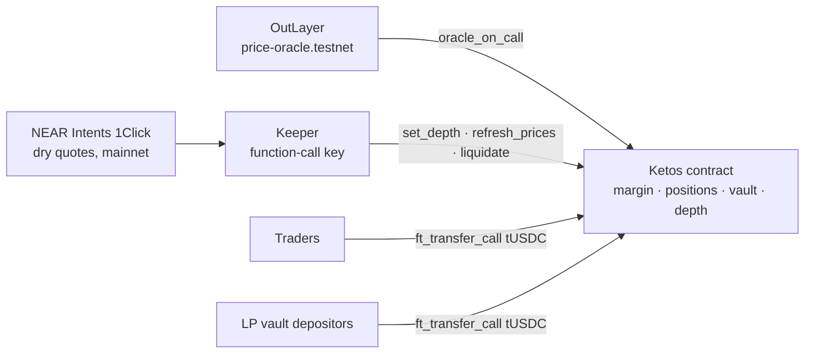

# Ketos — Perps on NEAR, sized by real liquidity

Ketos is a native perps exchange on NEAR testnet for Unstoppable DeFi. An LP vault takes the other side of every trade, and the size of each market (open interest per side, max leverage) is set by a contract rule from the exit liquidity measured on NEAR Intents, not by a listing committee. Margin, positions, liquidations and fees all live in one NEAR contract that has no admin method able to freeze or seize funds.

Live demo: **https://ketos-three.vercel.app** (NEAR testnet, test USDC from a faucet).

## The problem

NEAR has no active native perpetual futures market. The perpetuals on near.com are a front end on Hyperliquid: positions, prices, liquidations and fees settle there. Vault-backed exchanges elsewhere have a known failure mode: the vault holds positions larger than the market can unwind.

- Hyperliquid HLP and JELLY, March 2025: a thin market squeezed the HLP vault in a dispute of about $13M ([CoinDesk](https://www.coindesk.com/markets/2025/03/26/hyperliquid-delists-jellyjelly-after-vault-squeezed-in-usd13m-tussle)).
- GMX and AVAX, September 2022: around $565,000 lost to GLP holders through a market larger than its real liquidity ([Cointelegraph](https://cointelegraph.com/news/decentralized-exchange-gmx-suffers-565k-price-manipulation-exploit)).

How much can actually be sold for USDC on NEAR? Measured on 2026-11-04 at 11:01 UTC with 1Click `dry` quotes on mainnet (`pnpm depth:sample`), net price impact after the 1Click fee:

| Asset | $1k | $10k | $50k | $100k | $250k | $500k | $1M |
|---|---|---|---|---|---|---|---|
| BTC | 12 bps | 16 bps | 18 bps | 12 bps | No liquidity | No liquidity | No liquidity |
| ETH | 3 bps | 4 bps | 8 bps | 8 bps | No liquidity | No liquidity | No liquidity |
| NEAR | 9 bps | 13 bps | 20 bps | 23 bps | No liquidity | No liquidity | No liquidity |
| ZEC | 2 bps | 14 bps | 24 bps | 32 bps | No liquidity | No liquidity | No liquidity |

Above $100k, no solver quotes the trade at all. A market that lets traders open $1M of BTC exposure against a vault on NEAR is offering a position nobody can exit. Ketos reads this table every minute and writes it onchain, and the contract refuses anything bigger.

## Demo

- App: https://ketos-three.vercel.app — `/trade`, `/vault`, `/liquidity`, all reading the testnet contracts live.
- Full journey, replayed on a local chain: `pnpm --dir web exec playwright test` runs the nine steps below on a seeded NEAR sandbox with a test wallet, including a mock price drop and a keeper liquidation.

### Try it (NEAR testnet)

1. Open https://ketos-three.vercel.app - see live exit capacity for BTC, ETH, NEAR and ZEC, with the time of the last measurement.
2. Click **Launch app**, then **Connect** in the top bar and pick a NEAR testnet wallet - see the 4-step onboarding row: Connect wallet, Fund wallet, Deposit margin, Open a position.
3. Click **Fund** in the top bar - 1,000 test USDC land in the wallet (faucet, once per hour; the button then shows when it opens again).
4. Click **Enable trading** in the order panel and deposit 200 as margin - see Available to Trade update.
5. Pick NEAR-USD in the market selector, Buy / Long, size 500 USDC at 5× - see Max OI (set by live exit liquidity) in the market bar, the Exit Liquidity ladder with its 100 bps cap line, then the position with PnL, liquidation price and fees.
6. Pick ZEC-USD, Sell / Short, a size above the cap - the contract refuses the order and the app shows "Exceeds live exit liquidity … (cap $X)"; **Use max size** fits the order under the cap.
7. Open **Vaults** and deposit 500 - see shares minted at the share price, TVL, fee APR, and the vault's net exposure per market next to each market's capacity.
8. Open **Liquidity** - see the impact curve per asset (size against bps, 100 bps line, capacity marked) and the last 48 onchain samples.
9. Back on **Trade**, close the position - see realized PnL return to margin; then open the account menu in the top bar and **Withdraw** margin to the wallet.

The page calls the keeper endpoint at most once a minute while it is open, so depth and prices stay fresh and unhealthy positions get liquidated; liquidations show up as "Liquidated by keeper" in the **Liquidations** tab.

## How it works



1. **Measure.** The keeper asks 1Click for `dry` quotes selling each asset for USDC on NEAR at $1k, $10k, $50k, $100k, $250k, $500k and $1M ([`web/lib/intents/oneclick.ts`](web/lib/intents/oneclick.ts)). Each quote becomes a net impact in bps, `max(0, ⌈(1 − out/in) × 10000⌉ − fee)`, or "No liquidity" when no solver answers ([`web/lib/intents/depth.ts`](web/lib/intents/depth.ts)).
2. **Cap.** `set_depth` stores the samples onchain (48-sample history per asset). The contract then derives, per market:
   - exit capacity = largest sampled size with impact ≤ 100 bps;
   - max open interest per side = `min(hard cap $500,000, exit capacity)`;
   - max leverage: 20× from $1M of capacity, 10× from $250k, 5× from $50k, 2× below;
   - market closed to new positions when capacity is under $10k or the measurement is older than 30 minutes.

   `open_position` panics with `ERR_EXCEEDS_EXIT_LIQUIDITY: cap <amount>` when a trade would push open interest past the cap.
3. **Trade.** Isolated margin in a NEP-141 test USDC. Entry and mark prices come from the OutLayer price oracle (refused if older than 120 s). 0.1% fee to open and to close, plus an hourly borrow fee of 0.001% + 0.009% × utilization of the cap. Maintenance margin = notional / (2 × market max leverage).
4. **Liquidate.** `liquidate` is permissionless. Below maintenance, the position closes at the oracle price; 1% of notional goes to the vault and 0.2% to the liquidator (capped at remaining equity), the rest back to the trader. Negative equity is absorbed by the vault.
5. **Vault.** LPs deposit tUSDC for shares at NAV. NAV = vault USDC − traders' unrealized PnL + borrow fees due. Withdrawals are limited to what is not reserved for the maximum payout of open positions.

### Market registry

Fresh contract deployments initialize 16 markets: BTC, ETH, NEAR, ZEC, SOL, AURORA and RHEA use the existing TEE oracle; DOGE, XRP, LTC, ADA, SUI, TRX, BNB, AVAX and LINK use the pinned multisource worker. Each entry stores its oracle asset id, Intents asset id, price source (`tee`, `signed` or `outlayer_worker`), vault assignment, hard cap, trading fee and leverage ceiling ([`market.rs`](contracts/ketos/src/market.rs)). `id` is the market symbol. Duplicate symbols or assets cannot replace an existing market. The nine worker markets belong to Long-tail and have a 5× ceiling. BNB and AVAX reference NEP-245 Intents assets; the other new routes use NEP-141.

`get_markets({ "from_index": 0, "limit": 100 })` returns markets in listing order (default 50, maximum 100 per page). The client reads every page. A new market has no exit capacity and cannot accept positions until measured; its leverage is the lower of its configured ceiling and the live liquidity tier. Both price adapters match oracle asset ids rather than ticker order and can update only their own source.

The V2 contract is deployed at `ketos.testnet`, with the addresses in [`deployments/testnet.json`](deployments/testnet.json). It was initialized on a fresh account, not migrated over the original four-market state. The hosted website still uses the original deployment until its next release; local configuration now targets V2.

### Permissionless listing on fresh deployments

Anyone can register a market through the configured USDC contract's `ft_transfer_call` with exactly `"5000000"` units and `msg: "list_market:<json>"` ([`listing.rs`](contracts/ketos/src/listing.rs)). The JSON contains `symbol`, `oracle_asset_id`, `intents_asset_id` and `price_source` (`tee`, `signed` or `outlayer_worker`). Symbols are 1–16 uppercase ASCII letters/digits, starting with a letter; permissionless Intents assets use `nep141:<NEAR account id>`. Worker oracle asset ids must be supported uppercase worker symbols, preventing an unsupported listing from breaking the entire price batch. For example:

```json
{"symbol":"NEW","oracle_asset_id":"new.token.near","intents_asset_id":"nep141:new.token.near","price_source":"tee"}
```

The example describes the message format, not a supported live asset. Duplicate symbols, oracle assets or Intents assets, malformed requests, unknown fields and incorrect payments fail and are refunded by the token's transfer resolver. There is no direct unpaid `list_market` endpoint. The 5 USDC becomes Long-tail listing revenue, increasing its NAV without minting shares or margin; Core receives nothing. Listing fees are included in the trailing fee APR.

Listed markets always belong to Long-tail, with a $500,000 hard cap, 0.1% trading fees and a 5× leverage ceiling. Callers cannot override these terms. They start measuring (`depth_measured_at_ms = 0`, zero exit capacity): registration does not attest price or liquidity support. Opening still requires a fresh authenticated oracle price and a keeper depth measurement with at least $10,000 of capacity; no quote means no capacity. Unsupported assets cannot trade merely by paying the fee. The `signed` source is stored but has no active price adapter yet. The hosted demo has no listing UI or multi-market keeper yet.

### Funding on fresh deployments

[`funding.rs`](contracts/ketos/src/funding.rs) adds hourly funding based on open interest:

`rate = 0.05% × (long OI − short OI) / max(total OI, 1)`.

Positive rates charge longs and credit shorts; negative rates reverse the direction. Both sides use the same notional rate, capped at ±0.05%/hour. The unmatched amount accrues to the vault. For example, $300 long and $100 short at unchanged OI produce a +0.025%/hour rate: over 10 hours the long pays $0.75, the short receives $0.25, and the vault earns $0.50 before rounding.

Separate cumulative debit and credit indexes preserve past payments when the imbalance changes direction. Opening, closing and liquidating checkpoint the old OI before changing it; new positions never inherit prior funding. Anyone can call `settle_funding({ "market_id": "NEAR" })`, even with stale prices or depth. This checkpoints indexes, not every account: funding already affects equity and is transferred into free margin at close or liquidation. Repeated checkpoints preserve fractional index growth and do not change borrow accrual.

- `get_market` returns `funding_rate_per_hour` as a signed integer string at 1e12 scale (`"250000000"` = +0.025%/hour).
- `get_position` returns accrued `funding_paid`, `funding_received` and signed `funding_payment` in USDC units; positive payment reduces equity. These amounts also affect liquidation prices.
- `get_vault` includes `funding_net_due` in NAV and reserves gross funding credits in addition to maximum price gains. Funding losses from insolvent positions are borne by the vault, like price losses. The fee APR still covers trading fees, borrow fees and liquidation penalties, not funding.
- `funding_accrued` events report public checkpoints; `funding_settled` events and close/liquidation records report the assessed position debits and credits included in settlement.

Funding is available on the V2 contract. The hosted four-market demo still uses its original contract and does not expose funding; its keeper and funding UI have not been cut over.

### Triggered orders on fresh deployments

[`orders.rs`](contracts/ketos/src/orders.rs) stores Limit and Stop Market entries, plus full-position Take Profit and Stop Loss exits. `place_order({ "request": ... })` uses a `kind` tag: `limit`, `stop_market`, `take_profit` or `stop_loss`. Entry requests contain `market_id`, `side`, `margin`, `leverage`, `trigger_price` and optional `brackets`; exit requests contain `position_id` and `trigger_price`. USDC amounts and 8-decimal prices are integer strings.

- A long limit triggers at or below its price; a short limit at or above. Stop Market entries reverse those conditions. Long TP / short SL trigger at or above; short TP / long SL at or below. Equality counts.
- Entry collateral moves from free `margin` to `reserved_margin` immediately, so it cannot be spent or withdrawn twice. Placement does not consume open interest or charge fees. Owner-only `cancel_order({ "order_id": 0 })` releases the full reservation.
- Anyone can call `execute_orders({ "ids": [0, 1] })`. Execution uses the **current oracle price**, not a guaranteed limit or stop price. Missing ids, duplicate ids after a fill, untriggered orders and prices older than 120 s are skipped. Triggered entries recheck live depth, remaining OI, leverage and bracket validity; rejection releases all reserved collateral without charging an opening fee. Each result is `filled`, `rejected` (with reason), or `skipped`.
- `open_position` and entry orders accept optional `brackets: { "take_profit": "...", "stop_loss": "..." }`. Targets must be on the appropriate side of the entry price. Pending entries create exits only after filling; a price gap past an attached target rejects the entry. Each position allows one TP and one SL. Closing or liquidating a position cancels both; executing either exit cancels its sibling.
- `get_orders({ "account_id": "..." })` returns active orders; `get_open_orders({ "from_index": 0, "limit": 100 })` supports executor discovery. Accounts hold at most 50 active orders, execution batches at most 50 ids. Order placement, cancellation, fill and rejection emit onchain events.

These methods are available on the V2 contract. The hosted demo's order controls and existing keeper have not been switched to them yet.

### Cross margin on fresh deployments

[`cross.rs`](contracts/ketos/src/cross.rs) supports `margin_mode: "isolated" | "cross"` on `open_position` and Limit/Stop Market entry requests. Omission selects isolated. Each entry commits its requested margin from free collateral; cross positions share that committed collateral and their signed settlement cash. Free margin, isolated collateral and reserved entry orders are **not** part of the cross pool.

- `get_cross_account({ "account_id": "..." })` returns signed `cash`, total `equity`, `maintenance_margin`, `health_bps`, `position_count`, `prices_fresh`, `liquidatable` and `debt_by_vault` (Core, Long-tail). Equity is cash plus the sum of position equity after borrow fees and funding. Health is equity divided by total maintenance, in basis points; 10,000 is the threshold, and no positions means `null`. At most 16 cross positions may be open per account.
- `add_cross_margin({ "amount": "..." })` moves free collateral into the pool, paying outstanding vault claims first. It remains available with stale prices. `remove_cross_margin` moves positive settled cash back to free margin only with every cross price fresh and remaining equity strictly above maintenance. Opening or switching into cross also requires fresh prices for every cross peer and sufficient aggregate maintenance coverage.
- Owner-only `switch_to_cross({ "position_id": 0 })` moves an isolated position into the pool without reopening, charging a second fee or replacing its entry indexes or TP/SL. Conversion requires a fresh mark and sufficient combined health. There is no reverse conversion that could extract a position's collateral from shared losses.
- `liquidate_cross({ "account_id": "..." })` is permissionless. All peer prices must be at most 120 seconds old. At or below maintenance it closes whole positions in increasing marked equity/maintenance order (basis-point risk score, then position id), recalculating health after each exit and stopping immediately on recovery. It cancels the closed positions' brackets. Reward and penalty use the remaining aggregate equity and the paying vault's cash, not an insolvent position's equity alone. `liquidate(position_id)` rejects cross positions so callers cannot bypass account health.
- A manual or TP/SL close settles into signed cross cash, not directly into free margin. A loss larger than that position's collateral remains a debt to its assigned vault while other cross positions remain open; closing a profitable peer or adding collateral repays it. `get_vault.cross_receivable` identifies these claims: they remain in accounting `balance` and NAV, but reserve liquidity and cannot finance LP withdrawals or unrelated trader gains. Gains first net claims owed to the same vault, then respect its available cash. Core never funds a Long-tail payout.
- After the final cross exit, positive cash returns to free margin. Remaining debt is written off only by its creditor vaults, reported in `cross_bad_debt` and credited to the final exit's realized PnL so account totals reflect the actual loss. Cross settlement fees and funding are booked with the claim; default is a counterparty PnL adjustment, not collected cash. The fee APR consequently measures assessed fees, not cash collection, when cross claims are outstanding. `balance - cross_receivable` is the vault's cash; snapshots' `tvl` stores accounting assets including those claims.

Position views expose `margin_mode`. Cross `liquidation_price` is zero because a standalone trigger price is not defined; use account health instead. `close_position` returns the positive part of its settlement credit; the close event carries the signed `payout`, and `get_cross_account` is the authoritative pool state. Liquidation records' `returned` likewise reports only a positive credit, not immediately withdrawable free margin.

Cross margin is available on the V2 contract. The hosted demo still uses the older isolated-only contract; cross-aware views, controls and keeper scanning are not yet enabled there. The V2 keeper key includes `liquidate_cross`; the executor must use aggregate account health before calling it.


### Isolated vaults on fresh deployments

[`vault.rs`](contracts/ketos/src/vault.rs) maintains independent balances, LP shares, NAV, reserves and revenue for `core` (BTC, ETH, NEAR, SOL) and `long-tail` (ZEC, AURORA, RHEA). Price gains, losses, borrow fees, funding and liquidation penalties affect only the market's assigned vault. A winning Long-tail position cannot spend Core's funds, even if Long-tail runs out of liquidity.

- Deposit through the configured USDC contract's `ft_transfer_call` with `msg: "deposit_vault:core"` or `"deposit_vault:long-tail"`. The unqualified message is not accepted. Shares are minted at that vault's NAV, rounded down.
- Read `get_vault({ "vault_id": "core" })`, `get_vaults()` (Core, then Long-tail), or `get_vault_account({ "vault_id": "long-tail", "account_id": "..." })`. Every vault view includes settlement `revenue` counters and outstanding `cross_receivable`.
- Withdraw with `withdraw_vault({ "vault_id": "long-tail", "shares": "..." })` and 1 yoctoNEAR. Only shares owned in that vault authorize a withdrawal; only its positions reserve liquidity. A failed token transfer restores shares and funds to the same vault.
- Settlement revenue separates trading/borrow `fees`, net `funding`, counterparty `trader_pnl`, `liquidations` and `listing` fees. Positive signed amounts earn assets for LPs. Isolated settlements exclude uncollectible funding; cross settlements accrue claims as described above. Counterparty PnL includes unpaid-loss and capped-payout adjustments. The components sum exactly to accounting balance changes excluding LP deposits and withdrawals. Paid listings accrue only to Long-tail.
- Anyone can call `snapshot_vaults()` once at least 3,600,000 ms have elapsed since the last snapshot. Earlier calls fail without changing either history. Both vaults are recorded together; each ring keeps 168 observations in chronological order through `get_vault_history({ "vault_id": "core" })`. Snapshots freeze timestamp, NAV, share price, TVL (vault accounting assets, including cross receivables but excluding trader collateral) and cumulative settlement revenue. Missed hours are not backfilled; valuations use the latest stored oracle prices.

The sandbox and V2 deployment seed 10,000 test USDC per vault. On testnet the LP shares belong to the funding account `ketos-dev.testnet`, separate from the receiver contract: NEP-141 forbids self-transfers. The existing single-vault screen and hooks select Core; the vault selector, onchain-history charts and revenue display are not exposed there yet. The hosted demo still uses its original single-vault contract. The current local client requires V2 because the vault deposit message and required `vault_id` arguments have changed.

### Account history and leaderboard on fresh deployments

[`history.rs`](contracts/ketos/src/history.rs) keeps each account's latest 200 trading events in individually stored ring slots. All-time account totals survive event eviction; storage is paid from the contract's NEAR balance, not deducted from trader USDC.

- `get_history({ "account_id": "...", "from": 0, "limit": 200 })` returns chronological events with absolute `sequence` numbers. `from` is inclusive; a cursor older than retention starts at the oldest retained event. Default limit is 50, maximum 200. Continue at the last sequence plus 1; `get_account_stats` exposes `event_count` to detect an expired cursor.
- Event kinds are `open`, `close`, `liquidation`, `order_fill` and `funding`. Rows include position/order identifiers, market, side, oracle execution price, size, timestamp, price PnL, realized PnL and settlement fees. Opening fees are realized immediately. Isolated exit PnL uses actual collateral returned. Cross exits include signed cash changes and the final debt write-off described above; intermediate cross losses can exceed one position's committed collateral. Liquidation fees include the penalty and executor reward; executor reward income is separate from trading PnL.
- Funding rows record settlement at exit, not repeated public index checkpoints. `funding_paid` and `funding_received` report assessed amounts; signed `funding_payment` reports net funding booked in settlement, excluding uncollectible isolated debits but including cross claims. Any final vault payout cap is reflected in the exit's `realized_pnl`. Funding and order-fill rows annotate the corresponding trade: their `realized_pnl` is zero, so summing all rows does not double-count those costs. Cancelled, rejected and untriggered orders are not trades and do not create these rows.
- `get_account_stats({ "account_id": "..." })` returns all-time net `realized_pnl`, `volume`, `trades`, `committed_margin` and `event_count`. Volume sums entry and exit notional; trades count executed entries and exits, including liquidations. Order-fill annotations add neither. Deposits and withdrawals do not change trading totals.
- `get_leaderboard({ "sort": "pnl", "limit": 50 })` reads persistent sorted indexes; `sort` also accepts `volume`. Defaults are PnL and 50 rows, with a maximum of 500. Scores descend, ties break by descending account id. The indexed cohort is the 500 accounts with the most recent executed entry or exit, not every historical trader. New activity evicts the least recently active account without deleting its history or totals; trading again restores eligibility with all-time totals intact. `roi_bps` is net realized PnL divided by cumulative entry collateral, truncated toward zero, not an annualized return.

These views are available on the V2 contract. The hosted demo and its client screens have not been switched to them.

All math is integer (USDC 6 decimals, prices 8 decimals) and rounds in the vault's favour. The contract code is in [the contract crate](contracts/ketos/src/) (`position.rs`, `funding.rs`, `depth.rs`, `liquidation.rs`, `vault.rs`, `oracle.rs`).

The V2 keeper signs with a function-call key limited to `refresh_prices`, `set_depth`, `liquidate`, `liquidate_cross`, `execute_orders`, `settle_funding` and `snapshot_vaults` on `ketos.testnet` ([`scripts/deploy-testnet.ts`](scripts/deploy-testnet.ts)). Integration tests exercise all seven methods and reject other contract methods, receivers, attached deposits and native transfers. The existing [`web keeper`](web/lib/keeper/) still executes only the original three methods until its V2 update.

## Why it matters

The vault is the counterparty, so its worst case is an exposure it cannot hedge or unwind. Here that worst case is bounded by a number anyone can re-measure: each market can hold at most what 1Click solvers can sell within 1% right now, and it shrinks on its own when liquidity leaves. For LPs on NEAR, that is a fee yield whose risk comes with a published, dated limit. For traders, the funds sit in a contract they can always withdraw from: no custodian, no admin key over positions, and every listing parameter is derived from data, not voted. That is what Unstoppable DeFi means here: no committee decides which market is safe, and no key can stop a withdrawal.

The trading fees, borrow fees and liquidation penalties stay on NEAR, with the LPs who carry the risk.

## What's new

- Listing and sizing as a pure function of measured exit liquidity: open interest and leverage caps recomputed onchain from 1Click quotes, with the history kept in the contract and shown on `/liquidity`.
- Refusal at the contract level, not in the UI: the order ticket only warns, so the onchain refusal and its cap are visible.
- A keeper key restricted to seven maintenance methods, unable to move funds; the hosted demo currently executes the original three through a throttled HTTP endpoint.

## Built with

- **NEAR Intents 1Click API** — `dry` quotes on mainnet, read-only, server-side, as the liquidity measurement: [`web/lib/intents/oneclick.ts`](web/lib/intents/oneclick.ts), [`scripts/depth-sample.ts`](scripts/depth-sample.ts).
- **OutLayer price oracle** (`price-oracle.testnet`, a TEE oracle) — `oracle_call` / `oracle_on_call` for BTC, ETH, NEAR and ZEC prices: [`oracle.rs`](contracts/ketos/src/oracle.rs).
- **near-sdk 5.29** and `near-contract-standards` — the trading contract and the NEP-141 test USDC with a faucet: [`contracts/mock-usdc/src/lib.rs`](contracts/mock-usdc/src/lib.rs).
- **@hot-labs/near-connect** — wallet connection and transaction signing in the app: [`web/lib/near/wallet.ts`](web/lib/near/wallet.ts).
- **Coinbase Exchange public candles** (no key, proxied and cached 30 s server-side) and **TradingView Lightweight Charts** (Apache-2.0) — the spot price chart and 24h change on `/trade`: [`web/app/api/candles/route.ts`](web/app/api/candles/route.ts), [`web/components/trade/price-chart.tsx`](web/components/trade/price-chart.tsx).
- near-workspaces (integration tests on a sandbox), Next.js 16, TanStack Query, Tailwind v4, Playwright.

### Testnet contracts

| Contract | Account |
|---|---|
| Trading, margin, Core and Long-tail vaults | [ketos.testnet](https://testnet.nearblocks.io/address/ketos.testnet) |
| Test USDC (tUSDC, NEP-141) | [usdc.ketos.testnet](https://testnet.nearblocks.io/address/usdc.ketos.testnet) |
| Price oracle (OutLayer) | [price-oracle.testnet](https://testnet.nearblocks.io/address/price-oracle.testnet) |

Ids are also in [`deployments/testnet.json`](deployments/testnet.json), under the `ketos`, `usdc`, `oracle`, `outlayer` and `keeper` keys. The keeper account is `keeper.ketos.testnet`. Deployment uses `KETOS_PRIVATE_KEY`; the `owner` field is the separate funding/LP account signed with `NEAR_PRIVATE_KEY`. Full-access deployment keys stay local. Production environment variables are prepared for the next website release, without redeploying or changing the currently hosted version.

## Run locally

Requirements: Node 20.9+, pnpm, Rust stable ≥ 1.95 with `wasm32-unknown-unknown`, `cargo-near` 0.22.

```bash
pnpm install
pnpm contracts:build            # builds the three wasm into contracts/res/
pnpm contracts:test             # unit tests + near-workspaces integration tests
pnpm --dir web exec playwright install chromium
pnpm --dir web exec playwright test   # local sandbox + app in test-wallet mode, full journey
```

The contract crate is `ketos` (`cargo test -p ketos` from `contracts/`), producing `contracts/res/ketos.wasm`. The web package is `ketos-web`; its typed RPC client is `KetosViews`, with `use-ketos-queries` and `use-ketos-mutations` hooks. Configure its contract address with `NEXT_PUBLIC_KETOS_CONTRACT` in `web/.env.local`.

Against testnet:

```bash
cp .env.example .env.local      # KETOS_PRIVATE_KEY for ketos.testnet; optional ONECLICK_JWT
bash scripts/deploy-testnet.sh  # idempotent: ketos.testnet, token/keeper subaccounts, vault seed
pnpm depth:sample               # print today's exit-liquidity table and save it as JSON
pnpm keeper --once              # one keeper tick: depth, prices, liquidations
pnpm --dir web dev
```

The deployment script completes read-only code/state/key compatibility checks before making changes. It refuses to overwrite initialized state with a changed WASM hash. Fresh setup budgets contract code storage, missing child accounts and at least 2 NEAR of free oracle funds, with a 10 NEAR minimum bootstrap preflight; it can top up from the separate burner while retaining 2 NEAR plus transfer gas there. Each vault seed must be fully accepted by the NEP-141 resolver and match the vault balance and LP-share deltas. An unchanged rerun issues no deployment, mint, seed or key transaction. The bootstrap balance target is not reapplied to a completed deployment.

### Multisource price worker

[`workers/ketos-prices`](workers/ketos-prices) is a separate Rust WASI component deployed as [`ketos.testnet/ketos-prices`](https://testnet-api.outlayer.ai/call/ketos.testnet/ketos-prices). Its pinned WASM hash and public endpoint are in [`deployments/worker-testnet.json`](deployments/worker-testnet.json). The V2 trading contract requests it onchain through [`worker_prices.rs`](contracts/ketos/src/worker_prices.rs); the hosted demo still uses the older four-market oracle path.

```bash
rustup target add wasm32-wasip2
cargo test --manifest-path workers/ketos-prices/Cargo.toml --locked
cargo build --manifest-path workers/ketos-prices/Cargo.toml --target wasm32-wasip2 --release --locked
bash scripts/deploy-worker.sh
```

Deployment requires `outlayer-cli` 0.2.1 and `KETOS_PRIVATE_KEY` in the root `.env.local`. The script logs in to testnet through stdin, uploads to FastFS, checks the downloaded SHA-256, and creates or updates the project. CLI credentials live in a private temporary directory removed on exit, not in the developer's profile. The full-access key is never sent to the HTTPS execution API. A newly activated version may briefly fail to resolve while the service catches up.

For an HTTPS call, export `OUTLAYER_PAYMENT_KEY` locally, then use the [API's payment header](https://app.outlayer.ai/docs/https-api); the worker itself needs no API keys:

```bash
curl --fail-with-body https://testnet-api.outlayer.ai/call/ketos.testnet/ketos-prices \
  -H 'Content-Type: application/json' \
  -H "X-Payment-Key: $OUTLAYER_PAYMENT_KEY" \
  -d '{"input":{"assets":["DOGE","XRP","LTC","ADA","SUI","TRX","BNB","AVAX","LINK"]},"resource_limits":{"max_execution_seconds":60}}'
```

Input is 1–12 unique supported uppercase symbols; no caller-supplied URLs. Output is `{"timestamp_ms":…,"prices":{"SYMBOL":["integer_price",["source","source"]]}}`, with USD prices scaled by 100,000,000. Each asset needs two distinct venues agreeing within 1% of the lower price. The median is floored for an even count. Missing venues, invalid prices and disagreement omit the asset; they never create a fallback price. Output over 900 bytes fails rather than truncating JSON. Larger portfolios must be split into batches.

Sources are [Coinbase Exchange](https://api.exchange.coinbase.com/products/BTC-USD/ticker) and [Kraken](https://api.kraken.com/0/public/Ticker?pair=XBTUSD). When exactly one is unavailable, [Binance](https://api.binance.com/api/v3/ticker/price?symbol=TRXUSDT) can replace it; its USDT quote is converted using a real [Kraken USDT/USD quote](https://api.kraken.com/0/public/Ticker?pair=USDTUSD), not an assumed dollar peg. That FX conversion shares a Kraken dependency. A third venue cannot rescue disagreement between the first two.

Measured from the deployed component on November 4, 2026: BTC, ETH, NEAR, ZEC, SOL, DOGE, XRP, LTC, ADA, SUI, BNB, AVAX and LINK had Coinbase/Kraken quorum; TRX had Kraken/Binance quorum. AURORA and RHEA were omitted. The two batches returned 554 and 129 bytes. This is an availability observation, not a guarantee of future coverage.

The timestamp is taken before fetching, not after a slow request finishes. Coinbase's own trade timestamp is checked against 120 seconds; Kraken and Binance tickers provide no trade timestamp, so their last-trade freshness cannot be independently established. Responses are bounded to 16 KiB. The HTTP SDK exposes a 5-second connect timeout but no hard body-read deadline; cooperative budgets reject late responses, while the host's execution limit must terminate blocked I/O. HTTPS responses include an attestation URL that may initially return 404 until uploaded. The recorded hash identifies the deployed component; HTTPS output is not an onchain-verified price feed.

#### Onchain price delivery

Initialization requires `outlayer_id` (`outlayer.testnet` in production configuration; the mock oracle in sandbox), exposed by `get_config`. There is no runtime endpoint to change this trust boundary. `refresh_prices` requests TEE prices and worker prices independently, with worker batches of at most 12 assets. Worker `source.Project` pins both `ketos.testnet/ketos-prices` and its deployed WASM hash; changing the project's active version cannot silently change the feed. A replacement binary requires a reviewed contract deployment.

Attach 300 Tgas for the initial registry. The TEE adapter receives three shares of unused gas versus one for the worker: its nested oracle request and callback need a larger budget than the direct worker call. Each adapter request reserves 0.02 NEAR from the trading contract's free balance: 0.04 NEAR for the initial registry, or 0.06 NEAR with two worker batches. The whole balance requirement is checked before scheduling. OutLayer refunds unused resources to the trading contract; the HTTPS payment key is not used onchain. A final private receipt waits for all adapter callbacks and returns the number of markets whose stored prices are still fresh. Additional batches share the fixed transaction gas ceiling; failed delivery never refreshes old observations.

Live verification on November 4, 2026 returned 16 fresh nonzero prices after both adapters completed, with no failed receipts ([refresh transaction](https://testnet.nearblocks.io/txns/GWHGRdf2MezJJRmW9N2xKziHyGdt2ZAhU2AUuQfFXxos)). Equal gas weighting had starved the nested TEE request even with 300 Tgas attached; the weighted allocation fixes that path without changing stored state.

The worker callback accepts only assets requested in its batch and registered with `outlayer_worker`. It requires a positive integer price at 8 decimals, at least two distinct named venues from Coinbase/Kraken/Binance, a nonzero timestamp no more than 120 seconds old and not in the future, and a timestamp strictly newer than that market's stored observation. Missing assets, malformed entries, `None` and failed requests do not overwrite or refresh the previous observation. Failed worker delivery does not block the separate TEE update. Price agreement is checked by the pinned worker; the callback cannot independently recompute it from the aggregated output.

On November 4, 2026, all nine new assets returned real 1Click `dry` quotes for approximately $1,000 into USDC on NEAR. This establishes route availability at that size, not an open-interest allowance: new markets still start closed until the keeper publishes sufficient measured exit capacity. Local integration tests use `mock-oracle::request_execution` with owner-controlled failure/omission responses, not live exchange data. V2 is deployed on testnet; the hosted website remains on its previous version.


## Limitations

- Testnet only. Margin is a test USDC (tUSDC) minted by a faucet, not real USDC.
- No cross-chain deposits or settlement: everything settles in one NEAR contract. NEAR Intents is used only to measure liquidity.
- Liquidity is measured on mainnet 1Click quotes while trading runs on testnet, so caps reflect real markets but trades do not touch them.
- The local sandbox and the end-to-end tests use a mock oracle with the same interface as the OutLayer one; prices there are set by the test.
- The hosted demo and existing keeper measure four markets (BTC, ETH, NEAR, ZEC); the V2 testnet contract lists 16. Sandbox prices are mocked for all 16, but only the four markets with recorded depth start open. V2 testnet markets require live depth measurements before trading. Capacity uses a fixed size grid ($100k in the recorded sample means "fine at $100k, no quote at $250k"), not interpolation.
- The keeper runs from the app's tick endpoint or `pnpm keeper`; with nobody online, depth goes stale and markets close to new positions after 30 minutes. Closing an existing position needs an oracle price under 120 s old, and `refresh_prices` is open to any account.
