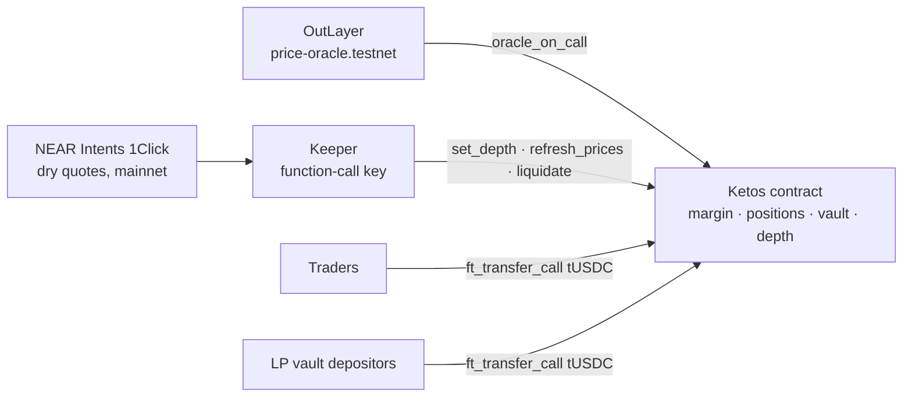

# Ketos — Perps on NEAR, sized by real liquidity

Ketos is a native perps exchange on NEAR testnet for Unstoppable DeFi. An LP vault takes the other side of every trade, and the size of each market (open interest per side, max leverage) is set by a contract rule from the exit liquidity measured on NEAR Intents, not by a listing committee. Margin, positions, liquidations and fees all live in one NEAR contract that has no admin method able to freeze or seize funds.

Live demo: **https://ketos-three.vercel.app** (NEAR testnet, test USDC from a faucet).

## The problem

NEAR has no active native perpetual futures market. The perpetuals on near.com are a front end on Hyperliquid: positions, prices, liquidations and fees settle there. Vault-backed exchanges elsewhere have a known failure mode: the vault holds positions larger than the market can unwind.

- Hyperliquid HLP and JELLY, March 2025: a thin market squeezed the HLP vault in a dispute of about $13M ([CoinDesk](https://www.coindesk.com/markets/2025/03/26/hyperliquid-delists-jellyjelly-after-vault-squeezed-in-usd13m-tussle)).
- GMX and AVAX, September 2022: around $565,000 lost to GLP holders through a market larger than its real liquidity ([Cointelegraph](https://cointelegraph.com/news/decentralized-exchange-gmx-suffers-565k-price-manipulation-exploit)).

How much can actually be sold for USDC on NEAR? Measured on 2026-11-04 at 11:01 UTC with 1Click `dry` quotes on mainnet (`pnpm depth:sample`), net price impact after the 1Click fee:

| Asset | $1k | $10k | $50k | $100k | $250k | $500k | $1M |
|---|---|---|---|---|---|---|---|
| BTC | 12 bps | 16 bps | 18 bps | 12 bps | No liquidity | No liquidity | No liquidity |
| ETH | 3 bps | 4 bps | 8 bps | 8 bps | No liquidity | No liquidity | No liquidity |
| NEAR | 9 bps | 13 bps | 20 bps | 23 bps | No liquidity | No liquidity | No liquidity |
| ZEC | 2 bps | 14 bps | 24 bps | 32 bps | No liquidity | No liquidity | No liquidity |

Above $100k, no solver quotes the trade at all. A market that lets traders open $1M of BTC exposure against a vault on NEAR is offering a position nobody can exit. Ketos reads this table every minute and writes it onchain, and the contract refuses anything bigger.

## Demo

- App: https://ketos-three.vercel.app — `/trade`, `/vault`, `/liquidity`, all reading the testnet contracts live.
- Full journey, replayed on a local chain: `pnpm --dir web exec playwright test` runs the nine steps below on a seeded NEAR sandbox with a test wallet, including a mock price drop and a keeper liquidation.

### Try it (NEAR testnet)

1. Open https://ketos-three.vercel.app - see live exit capacity for BTC, ETH, NEAR and ZEC, with the time of the last measurement.
2. Click **Launch app**, then **Connect** in the top bar and pick a NEAR testnet wallet - see the 4-step onboarding row: Connect wallet, Fund wallet, Deposit margin, Open a position.
3. Click **Fund** in the top bar - 1,000 test USDC land in the wallet (faucet, once per hour; the button then shows when it opens again).
4. Click **Enable trading** in the order panel and deposit 200 as margin - see Available to Trade update.
5. Pick NEAR-USD in the market selector, Buy / Long, size 500 USDC at 5× - see Max OI (set by live exit liquidity) in the market bar, the Exit Liquidity ladder with its 100 bps cap line, then the position with PnL, liquidation price and fees.
6. Pick ZEC-USD, Sell / Short, a size above the cap - the contract refuses the order and the app shows "Exceeds live exit liquidity … (cap $X)"; **Use max size** fits the order under the cap.
7. Open **Vaults** and deposit 500 - see shares minted at the share price, TVL, fee APR, and the vault's net exposure per market next to each market's capacity.
8. Open **Liquidity** - see the impact curve per asset (size against bps, 100 bps line, capacity marked) and the last 48 onchain samples.
9. Back on **Trade**, close the position - see realized PnL return to margin; then open the account menu in the top bar and **Withdraw** margin to the wallet.

The page calls the keeper endpoint at most once a minute while it is open, so depth and prices stay fresh and unhealthy positions get liquidated; liquidations show up as "Liquidated by keeper" in the **Liquidations** tab.

## How it works



1. **Measure.** The keeper asks 1Click for `dry` quotes selling each asset for USDC on NEAR at $1k, $10k, $50k, $100k, $250k, $500k and $1M ([`web/lib/intents/oneclick.ts`](web/lib/intents/oneclick.ts)). Each quote becomes a net impact in bps, `max(0, ⌈(1 − out/in) × 10000⌉ − fee)`, or "No liquidity" when no solver answers ([`web/lib/intents/depth.ts`](web/lib/intents/depth.ts)).
2. **Cap.** `set_depth` stores the samples onchain (48-sample history per asset). The contract then derives, per market:
   - exit capacity = largest sampled size with impact ≤ 100 bps;
   - max open interest per side = `min(hard cap $500,000, exit capacity)`;
   - max leverage: 20× from $1M of capacity, 10× from $250k, 5× from $50k, 2× below;
   - market closed to new positions when capacity is under $10k or the measurement is older than 30 minutes.

   `open_position` panics with `ERR_EXCEEDS_EXIT_LIQUIDITY: cap <amount>` when a trade would push open interest past the cap.
3. **Trade.** Isolated margin in a NEP-141 test USDC. Entry and mark prices come from the OutLayer price oracle (refused if older than 120 s). 0.1% fee to open and to close, plus an hourly borrow fee of 0.001% + 0.009% × utilization of the cap. Maintenance margin = notional / (2 × market max leverage).
4. **Liquidate.** `liquidate` is permissionless. Below maintenance, the position closes at the oracle price; 1% of notional goes to the vault and 0.2% to the liquidator (capped at remaining equity), the rest back to the trader. Negative equity is absorbed by the vault.
5. **Vault.** LPs deposit tUSDC for shares at NAV. NAV = vault USDC − traders' unrealized PnL + borrow fees due. Withdrawals are limited to what is not reserved for the maximum payout of open positions.

All math is integer (USDC 6 decimals, prices 8 decimals) and rounds in the vault's favour. The contract code is in [the contract crate](contracts/perps/src/) (`position.rs`, `depth.rs`, `liquidation.rs`, `vault.rs`, `oracle.rs`).

The keeper signs with a function-call key limited to `refresh_prices`, `set_depth` and `liquidate` ([`scripts/deploy-testnet.ts`](scripts/deploy-testnet.ts), [`web/lib/keeper/`](web/lib/keeper/)); it cannot move funds. The integration tests check that the key is refused on any other method.

## Why it matters

The vault is the counterparty, so its worst case is an exposure it cannot hedge or unwind. Here that worst case is bounded by a number anyone can re-measure: each market can hold at most what 1Click solvers can sell within 1% right now, and it shrinks on its own when liquidity leaves. For LPs on NEAR, that is a fee yield whose risk comes with a published, dated limit. For traders, the funds sit in a contract they can always withdraw from: no custodian, no admin key over positions, and every listing parameter is derived from data, not voted. That is what Unstoppable DeFi means here: no committee decides which market is safe, and no key can stop a withdrawal.

The trading fees, borrow fees and liquidation penalties stay on NEAR, with the LPs who carry the risk.

## What's new

- Listing and sizing as a pure function of measured exit liquidity: open interest and leverage caps recomputed onchain from 1Click quotes, with the history kept in the contract and shown on `/liquidity`.
- Refusal at the contract level, not in the UI: the order ticket only warns, so the onchain refusal and its cap are visible.
- A keeper that is safe to hand out: one function-call key, three methods, throttled HTTP endpoint on the deployment.

## Built with

- **NEAR Intents 1Click API** — `dry` quotes on mainnet, read-only, server-side, as the liquidity measurement: [`web/lib/intents/oneclick.ts`](web/lib/intents/oneclick.ts), [`scripts/depth-sample.ts`](scripts/depth-sample.ts).
- **OutLayer price oracle** (`price-oracle.testnet`, a TEE oracle) — `oracle_call` / `oracle_on_call` for BTC, ETH, NEAR and ZEC prices: [`oracle.rs`](contracts/perps/src/oracle.rs).
- **near-sdk 5.29** and `near-contract-standards` — the trading contract and the NEP-141 test USDC with a faucet: [`contracts/mock-usdc/src/lib.rs`](contracts/mock-usdc/src/lib.rs).
- **@hot-labs/near-connect** — wallet connection and transaction signing in the app: [`web/lib/near/wallet.ts`](web/lib/near/wallet.ts).
- **Coinbase Exchange public candles** (no key, proxied and cached 30 s server-side) and **TradingView Lightweight Charts** (Apache-2.0) — the spot price chart and 24h change on `/trade`: [`web/app/api/candles/route.ts`](web/app/api/candles/route.ts), [`web/components/trade/price-chart.tsx`](web/components/trade/price-chart.tsx).
- near-workspaces (integration tests on a sandbox), Next.js 16, TanStack Query, Tailwind v4, Playwright.

### Testnet contracts

| Contract | Account |
|---|---|
| Trading, margin, vault | [view on NearBlocks](https://testnet.nearblocks.io/address/perps.ketos-dev.testnet) |
| Test USDC (tUSDC, NEP-141) | [usdc.ketos-dev.testnet](https://testnet.nearblocks.io/address/usdc.ketos-dev.testnet) |
| Price oracle (OutLayer) | [price-oracle.testnet](https://testnet.nearblocks.io/address/price-oracle.testnet) |

Ids are also in [`deployments/testnet.json`](deployments/testnet.json).

## Run locally

Requirements: Node 20.9+, pnpm, Rust stable ≥ 1.95 with `wasm32-unknown-unknown`, `cargo-near` 0.22.

```bash
pnpm install
pnpm contracts:build            # builds the three wasm into contracts/res/
pnpm contracts:test             # unit tests + near-workspaces integration tests
pnpm --dir web exec playwright install chromium
pnpm --dir web exec playwright test   # local sandbox + app in test-wallet mode, full journey
```

Against testnet:

```bash
cp .env.example .env.local      # NEAR_PRIVATE_KEY (+ NEAR_ACCOUNT_ID for a first deploy) of a testnet account, optional ONECLICK_JWT
bash scripts/deploy-testnet.sh  # idempotent: subaccounts, contracts, keeper key, vault seed
pnpm depth:sample               # print today's exit-liquidity table and save it as JSON
pnpm keeper --once              # one keeper tick: depth, prices, liquidations
pnpm --dir web dev
```

## Limitations

- Testnet only. Margin is a test USDC (tUSDC) minted by a faucet, not real USDC.
- No cross-chain deposits or settlement: everything settles in one NEAR contract. NEAR Intents is used only to measure liquidity.
- Liquidity is measured on mainnet 1Click quotes while trading runs on testnet, so caps reflect real markets but trades do not touch them.
- The local sandbox and the end-to-end tests use a mock oracle with the same interface as the OutLayer one; prices there are set by the test.
- Four markets (BTC, ETH, NEAR, ZEC) and a fixed size grid; capacity is only as fine as the grid ($100k today means "fine at $100k, no quote at $250k").
- The keeper runs from the app's tick endpoint or `pnpm keeper`; with nobody online, depth goes stale and markets close to new positions after 30 minutes. Closing an existing position needs an oracle price under 120 s old, and `refresh_prices` is open to any account.
