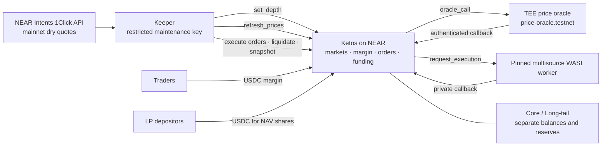

# Ketos — Perps on NEAR, sized by real liquidity

Ketos is a native perps exchange on NEAR testnet, built for Unstoppable DeFi. Two LP vaults take the other side of trades. Each market's open-interest limit and maximum leverage come from measured exit liquidity on [NEAR Intents](web/lib/intents/oneclick.ts), rather than a listing committee. Margin, orders, funding and settlement live in [one Rust contract](contracts/ketos/src/lib.rs).

## Demo

**Live app: https://ketos-three.vercel.app** — testnet contracts, faucet USDC, no real-money trading.

The full transaction journey is reproducible with `pnpm --dir web exec playwright test`. It deploys a local NEAR sandbox, connects a test wallet and runs [12 demo steps](web/e2e/demo.spec.ts), including keeper fills and liquidation. Prices are mocked locally; new depth measurements still use real, read-only mainnet quotes and need internet access.

**Video:** the 12-scene recording is not yet published; there is no public video URL. The local journey above is executable now.

The hosted app shows current onchain state, not a seeded trading session. Markets can be closed, histories empty and the leaderboard unpopulated. Filling a ticket is a preview, not an executed trade. The app never overrides safety checks to reproduce a screenshot.

### Try without a wallet

The current frontend source exposes **From another chain** on the landing page and below `/trade`, before connecting. This redesign is not deployed to the hosted frontend yet; use the [frontend-only quickstart](#run-locally) to inspect it locally.

1. Enter **1 SOL**, **0.1 ETH on Base**, or **0.01 BTC** in the public route card.
2. Read the live 1Click quote: USDC on NEAR, route cost, estimated time and quote timestamp. Unavailable liquidity or a failed request is shown explicitly.
3. Change the origin asset with the arrow keys or select another amount. No connection, signature, deposit address or transfer is requested.

This is a read-only mainnet route preview, not a way to fund the testnet trading account. The landing also shows four onchain markets and a selectable impact-versus-size curve with a 100 bps threshold. Measured liquidity, ramp-limited admission and vault-backed effective caps are distinct; timestamps identify old observations.

### Try it — 12 steps

Steps 1–9 and 11–12 can be explored on the hosted app. You need an existing NEAR testnet wallet, fresh prices and an open market. The current build's **Fund** action needs no NEAR or wallet signature: it sponsors USDC and, when needed, gas. The hosted frontend still uses its earlier wallet-signed funding flow until its next deployment. The local journey also drives the controlled price moves in steps 5 and 10 and supplies extra test collateral for the cap-refusal scene.

1. **Open the landing page** — see measured capacity, open/listed markets, total open interest, vault TVL and 24-hour volume, with observation times. Use the main trading action to enter the app.
2. **Connect, Fund, Deposit** — connect a testnet wallet, request **1,000 USDC** from the hourly faucet, then deposit **500 USDC** as margin. In the gasless build, Fund also sends **0.5 NEAR** when your available balance is below **0.1 NEAR**; you do not need NEAR to start. See the onboarding checklist advance and Available to Trade update. In the Deposit dialog, **From another chain** previews an ETH (Base), SOL or BTC route; it does not transfer funds.
3. **Open Markets and search ETH** — see price, spot 24-hour change where available, funding per hour, open interest/cap, leverage and vault. Click its row to open ETH-USD. If it is Measuring or Closed, wait for a qualifying measurement or choose an open market; a keeper tick does not guarantee liquidity.
4. **Open an ETH long at 5× with TP/SL** — when the live leverage limit permits, enter a 500 USDC position size (100 USDC margin), add take-profit and stop-loss prices, then sign. See the position, PnL and liquidation price; the two exits appear in **Open Orders**. Local prices start at 2,292.595, with targets 2,750 and 2,000.
5. **Place a BTC Limit short above the current mark** — see reserved collateral and a resting order. A sell limit below the mark would already be triggered. The local journey places it at 78,000, moves the mock price to 78,200, then observes the keeper fill in **Trade History**. Execution uses the current oracle price, not a guaranteed limit price.
6. **Try a ZEC order above its displayed cap** — with sufficient collateral, sign and see the contract refuse excess open interest with the live cap. **Use max size** adjusts the ticket without submitting it. The local journey adds test collateral so insufficient margin cannot mask this refusal; the hosted faucet alone may not cover it.
7. **Markets → List a market** — select an offered asset and pay 25 USDC. See it start **Measuring**, then become Open only after adequate depth and a fresh supported price. The local journey lists UNI through the multisource worker; hosted candidates depend on actual oracle/token availability. Paying the fee is not a guarantee that a market can open.
8. **Vaults → Core → deposit 500 USDC** — see shares minted at NAV, your holding, hourly NAV/share-price observations, the revenue breakdown and exposure against market capacity. Core covers BTC/ETH/NEAR/SOL; Long-tail covers the rest. Deposits in one do not mint shares in the other. The local journey tops up test funds after the listing fee.
9. **Open Risk and select ETH** — move the shock slider from −10% to −50%. See affected positions, liquidatable notional and estimated bad debt per vault beside the last measured capacity. Inspect the heatmap, retained 24-hour observations and any **Market tightened** alert. This calculation sends no transaction and does not predict post-shock liquidity.
10. **Observe stop loss and liquidation on Trade** — the local journey opens two NEAR longs, then moves the mock oracle below the onchain liquidation threshold. The keeper closes one through its stop and liquidates the other; history distinguishes the outcomes. There is no public price-control button, and this scene cannot be forced on the hosted app.
11. **Open Portfolio** — inspect equity, realized/unrealized PnL, positions, orders, trade/funding history and confirmed margin transfers. Switch the BTC position from Isolated to Cross after the risk confirmation, close positions and withdraw free margin. Cross shares committed collateral, not all wallet or free-margin funds; conversion cannot be reversed.
12. **Open Leaderboard** — see the trading account highlighted with all-time realized PnL, ROI, volume and executed trades. Sort by volume, then return home to see the trades reflected in 24-hour volume. With no executed trades, the live leaderboard correctly stays empty.

## The problem

A vault can inherit more exposure than the underlying market can absorb. In March 2025, Hyperliquid's HLP temporarily showed about $13.5M of unrealized losses during the JELLY squeeze before forced settlement ([CoinDesk](https://www.coindesk.com/markets/2025/03/26/hyperliquid-delists-jellyjelly-after-vault-squeezed-in-usd13m-tussle)). In September 2022, a reference-market manipulation extracted about $565,000 from GMX's AVAX market at GLP holders' expense ([Cointelegraph](https://cointelegraph.com/news/decentralized-exchange-gmx-suffers-565k-price-manipulation-exploit)). An oracle price alone does not establish executable depth.

Here is the [recorded 1Click measurement](web/e2e/fixtures/depth-2026-11-03.json) from **November 3, 2026, 17:05:47 UTC**: selling into USDC on NEAR, `dry: true`, impact net of the recorded 20 bps partner fee.

| Asset | $1,000 | $10,000 | $50,000 | $100,000 | $250,000 | $500,000 | $1,000,000 |
|---|---|---|---|---|---|---|---|
| BTC | 20 bps | 20 bps | 20 bps | 20 bps | No quote | No quote | No quote |
| ETH | 19 bps | 19 bps | 20 bps | 20 bps | No quote | No quote | No quote |
| NEAR | 25 bps | 25 bps | 28 bps | 31 bps | No quote | No quote | No quote |
| ZEC | 15 bps | 34 bps | 25 bps | 26 bps | No quote | No quote | No quote |

This observation supported $100,000 of exit capacity per asset **at that time**, not a permanent ceiling or today's liquidity. Missing smaller quotes can also coexist with larger successful quotes; Ketos stops at the first gap rather than jumping over it. Re-measure with `pnpm depth:sample` and inspect current curves on `/risk`.

## How it works



### Liquidity rules

The rules below are deployed on `ketos.testnet` as storage schema 3. The [atomic V2 migration](https://testnet.nearblocks.io/txns/DgbiruHsdajRaPDjGbRCYmqzoR6M5BR9Y5VfZTpyycAA) preserved all 16 markets, both 10,000-USDC vault seeds, LP claims, margin accounts and histories without resetting balances. The frontend release is separate: the hosted browser ticket has not yet been updated to the wallet-funded flow.

The [sampler](web/lib/intents/depth.ts) requests seven sizes: $1k, $10k, $50k, $100k, $250k, $500k and $1M. It subtracts the configured platform fee from gross quoted impact: 20 bps with the current partner configuration, 25 bps without a key. These are implementation settings, not a guarantee that an external fee schedule never changes.

The [contract](contracts/ketos/src/depth.rs) enforces:

- **Measured capacity:** the last size in the contiguous acceptable prefix, with every sample up to it quoted at ≤100 bps net impact. The first missing quote or impact above 100 bps ends the prefix. Submitted impacts must be nondecreasing across all quoted sizes, including after a missing quote. The sampler publishes a running-maximum envelope and preserves the unmodified quotes separately in `details`.
- **Admission capacity:** `exit_capacity` falls to the measurement immediately but rises by at most 2× its previous value per accepted update. From zero it can bootstrap only to `min(measured, $10k)`; subsequent nonzero reports obey the doubling rule. This exception lets a new or closed market recover without granting an unmeasured allowance. History records and the depth event's `exit_capacity_usd` report the smoothed limit; `measured_exit_capacity_usd` in the event reports the raw curve's capacity.
- **Open interest per side:** `min(market hard cap, exit capacity, vault-backed cap)`. The default hard cap is $500,000. With `L = k × NAV` and `E = Σ max(long OI, short OI)` across a vault's markets, a market's vault-backed ceiling is its current largest side plus `max(L − E, 0)`. Core uses `k = 2`; Long-tail uses `k = 1`. Every entry must leave total exposure at or below `L`, including cross and triggered entries. Upcoming entry fees do not count toward admission.
- **Leverage:** target tiers are 20× at admission capacity ≥$1M, 10× at ≥$250k, 5× at ≥$50k, otherwise 2×, further limited by the market's configured ceiling. Every Long-tail market, including ZEC, is capped at 5×. Increases advance at most one tier per hour of block time; the first increase starts that clock, unused hours do not accumulate, and decreases do not reset it. Decreases apply immediately.
- **Entry admission:** capacity below $10k or depth older than 30 minutes closes the market. Execution requires a price no older than 30 seconds; an action with a cache older than 15 seconds first requests a new observation.
- **Enforcement at execution:** market entries and triggered entries recheck remaining capacity. Lower caps constrain new entries; they do not forcibly resize existing positions.

Market views expose `vault_backed_cap_usd` and `effective_max_oi_per_side` in micro-USDC, like `exit_capacity`. The existing `max_oi_per_side` is the hard/depth ceiling. `is_open` reports depth/capital eligibility to request a trade, not a guarantee that its subsequent price pull succeeds; `close_only` identifies a cached mark too old for entry. `measured_cap_is_grid_max` identifies a raw measured capacity equal to the largest probed size, even while admission is still ramping; that observation is a lower bound, not proof of deeper liquidity.

Every keeper pass measures the complete registry, with at most six assets sampled concurrently and one retry for an unavailable quote at each size. A default curve passing through $1M also probes $2.5M and $5M. Exhausted request errors leave that market's previous depth untouched; genuine missing liquidity is published as a missing sample. Raw quotes remain separate from the nondecreasing impact envelope.

Price surveillance covers only markets with open interest or pending orders, at most once every 5 minutes; idle markets cost no periodic oracle request. The keeper executes triggered orders, re-reads positions, liquidates unhealthy isolated positions/cross accounts, then settles funding only for markets with open interest and more than one hour since their funding checkpoint. Hourly snapshots finish the pass. Failed refreshes or registry re-reads retain the earlier market view and do not abort order/liquidation processing; failed position reads are reported and do not reuse a pre-execution liquidation list.

The [HTTP endpoint](web/app/api/keeper/tick/route.ts) accepts `Authorization: Bearer $CRON_SECRET` for scheduled callers. An explicitly invalid credential is rejected. Browser fallback has no secret and checks the latest on-chain depth timestamp against a 60-second interval; all callers also share a process-local running/minute gate. A throttled request returns HTTP 200 with `{state:"throttled"}` and `Retry-After`, not an HTTP error. The [executor](web/lib/keeper/tick.ts) refuses ticks below 2 NEAR of spendable contract funds. Its restricted keeper key attaches no deposit to payable `refresh_prices`: the contract explicitly allows that account to fund adapters from reserves.

When any active market is due for price surveillance, the request includes all active markets. This keeps staggered price timestamps within the same five-minute billing window rather than postponing younger feeds to a later pass.

### Trading, funding and orders

[Positions](contracts/ketos/src/position.rs) support long/short and isolated/cross margin. Opening and closing each cost 0.1% of notional **plus measured impact** paid to the assigned vault. The latest depth curve is linearly interpolated at the actual position size, rounding the USDC fee up. Sizes below the first sample pay its impact; missing depth, a quote hole or sizes beyond the supported curve use at least 100 bps, without blocking exits. Older nonmonotone samples use a nondecreasing envelope; effective impact is bounded at 100%. Hourly borrow fees are 0.001% + 0.009% × utilization. Maintenance is notional divided by twice the market maximum leverage at entry; that requirement stays locked for the position. Integer math uses 6-decimal USDC and 8-decimal prices, rounding in the vault's favour.

[Funding](contracts/ketos/src/funding.rs) is `0.05% × (long OI − short OI) / max(total OI, 1)` per hour, bounded at ±0.05%. The majority side pays, the minority receives and the unmatched amount accrues to its vault. Cumulative indexes checkpoint before OI changes, so new positions do not inherit earlier funding.

[Limit, Stop Market, Take Profit and Stop Loss orders](contracts/ketos/src/orders.rs) are stored onchain. Every order separately reserves an executor reward of 0.05% of notional, rounded up, with a 0.1 USDC minimum, from free margin; entry orders also reserve their full position margin. Attaching TP and SL reserves two rewards without changing position size. Cancellation, rejected entry and sibling cleanup refund the unused reservation. A successful fill pays its reward once to the executor's withdrawable margin. Reward costs enter account history and realized PnL without adding trade volume or trade count; executor income is excluded from trading PnL. Any executor can fill a triggered entry at the **current oracle price**, at most 30 seconds old. TP/SL closes the full position; either exit cancels its sibling. There is no order book or guaranteed stop/limit execution price.

[Cross margin](contracts/ketos/src/cross.rs) pools committed collateral and signed settlement cash, excluding free margin, isolated positions and pending entry reservations. Health includes all cross legs. Permissionless liquidation closes the riskiest whole positions until health recovers. An underwater leg of a healthy account is not independently liquidatable. Closing a leg settles into the pool; free collateral is released after the last leg exits. [Isolated liquidation](contracts/ketos/src/liquidation.rs) charges up to 1% of notional to the vault and 0.2% to the executor, limited by remaining equity.

[Trading actions pull their own prices](contracts/ketos/src/pull_prices.rs). A cache at most 15 seconds old executes immediately; otherwise the contract requests only the affected markets, grouping TEE assets and worker batches. A successful pull must acknowledge every requested price, observed no earlier than the request and at most 30 seconds old. The callback rechecks balances, caps and ownership against current state. Failed entries leave collateral untouched; failed LP deposits return the full unused USDC through the token resolver.

The [signed-price path](contracts/ketos/src/signed_prices.rs) can replace that pull with an exact-byte Ed25519 batch. The worker signs sorted, domain-separated prices with a key generated inside the enclave, never on a developer machine. The contract pins its public key once through a private deployment call; each required market needs a strictly newer observation no older than 15 seconds and at least two distinct supported venues. Verification and coverage are atomic: invalid, replayed, incomplete or expired batches update no prices and retain the original pull path. The reserved registry source `signed` remains unused; signed batches supplement the existing market adapters.

The [server route](web/app/api/signed-prices/route.ts) and keeper obtain batches through the payment-key API, pinned to the recorded worker version, with a five-second bounded cache. Wallet builders retain the maximum oracle deposit because approval can outlive a signed batch; valid signed execution consumes no oracle deposit and refunds that funding. A direct caller with a valid fresh batch can attach zero. This is not a promise of zero gas or free offchain execution.

After a failed pull, owners can still close isolated or cross positions at the last known price with an adverse spread: 50 bps per started 10 minutes of age, capped at 300 bps. There is no additional outage grace period. Existing exit orders may use this fallback only if the last observed price already crossed their trigger; the spread cannot invent a trigger. Entries, liquidations and LP writes never use fallback prices.

The [oracle adapter](contracts/ketos/src/oracle.rs) timestamps TEE prices conservatively as reply time minus `recency_duration_sec`, capped at the current block time. A 300-second oracle window cannot qualify for an entry, liquidation or LP pull: a new reply does not make an insufficiently bounded observation safe. `refresh_prices` is payable and globally limited to one request per 30 seconds. Non-keeper callers fund adapter deposits: currently 0.02 NEAR per TEE request and per worker batch of 12. Only the keeper may draw on unreserved contract funds. Deposit views quote a cache-independent upper bound so wallet approval cannot underfund an expired cache; execution refunds the unused excess.

NEP-141 forwards no NEAR to its receiver. The test USDC contract therefore extends `ft_transfer_call`: attach 1 yoctoNEAR plus oracle funding, and it first credits the sender through `fund_transfer_price_requests`, then invokes the standard USDC receiver/resolver chain. The token resolver runs even if the intermediate funding callback fails. Exactly 1 yocto retains the standard NEP-141 behavior. Without this token extension, callers must prepay sender-owned `fund_price_requests` credits separately; the current LP builder still does so. Ketos accepts only its configured USDC contract. Credits cannot subsidize keeper requests and can be reclaimed with `withdraw_price_deposit` if a transfer is abandoned or rejected before consuming them. Adapter fees already spent are not refundable.

#### Wallet-funded trading API

The [USDC receiver](contracts/ketos/src/wallet_trading.rs) accepts `open:<json>` for immediate entries and `order:<json>` for `limit` or `stop_market` entries. Both support `market_id`, `side`, `leverage`, optional `margin_mode`, `brackets` and `signed_prices`; orders also require `kind` and `trigger_price`. USDC amounts use 6 decimals, trigger prices 8. For example, send 60 USDC with:

```json
{
  "market_id": "NEAR",
  "side": "long",
  "margin": "50000000",
  "leverage": 2,
  "brackets": { "take_profit": "500000000", "stop_loss": "300000000" }
}
```

Prefix that JSON with `open:`. This commits 50 USDC plus two execution rewards and returns the unused transfer directly to the wallet. If `margin` is omitted, the contract derives the largest collateral covered by the transfer after reserving all rewards. A resting wallet order also reserves the rewards for its future TP/SL, so filling it does not depend on a later margin deposit. Existing free margin never subsidizes an underfunded wallet entry. Signed prices can execute with only the token's 1 yocto deposit; otherwise attach oracle funding or prepay a price credit.

Pending oracle funds are not credited as spendable USDC margin. Price failures and admission refusals return the full unused USDC through the token resolver; rejected wallet-funded resting entries return their margin and all unused rewards by token transfer. `close_position(position_id, to_wallet?, signed_prices?)` and `cancel_order(order_id, to_wallet?)` default to wallet settlement. Explicit `to_wallet: false` retains proceeds in free margin. Only funds released by that action are sent, including unused bracket rewards; cross settlement cash remains committed until the last cross leg closes. Failed outgoing token transfers restore the released amount to withdrawable margin. Successful wallet entries and exits are recorded as actual collateral transfers in account history.

The current browser ticket continues to use deposited free margin and explicitly retains close/cancel proceeds there. The wallet-funded API is deployed and covered by [sandbox integration](contracts/tests/src/wallet_flow.rs), but is not yet wired into that ticket. A [live 5-USDC wallet entry](https://testnet.nearblocks.io/txns/623JM31hEiD944Jmu8q3bo2XBp4c97qm9imxcT6131oh) and [wallet settlement](https://testnet.nearblocks.io/txns/4F4dMxk4GGwoCFhyXDK6LubumgDHRDzy1KHMwbBD5GMC) exercised the migrated contract without consuming preexisting free margin; these are transactions from the project's test account, not external-user activity.

### Markets, vaults and account records

The [registry](contracts/ketos/src/market.rs) initializes 16 markets: BTC, ETH, NEAR, ZEC, SOL, AURORA, RHEA, DOGE, XRP, LTC, ADA, SUI, TRX, BNB, AVAX and LINK, with at most 32 active entries. The [listing flow](contracts/ketos/src/listing.rs) takes exactly 25 USDC through `ft_transfer_call`; unique new assets start Measuring in Long-tail. TEE listings must bind `intents_asset_id` to `nep141:${oracle_asset_id}`. Worker listings must use the same ticker and oracle symbol and its fixed Intents route; the reserved `signed` source is refused. The creator funds a separate `pull_market_price` for the initial mark, independent of the keeper's bulk refresh lease. Registration is already committed if that price request fails; it establishes neither price support nor depth.

The pinned worker also supports UNI, AAVE, BCH, APT and ARB. The listing picker matches their exact token routes against `get_worker_assets` from the deployed contract, so a new worker upload alone cannot advertise unsupported onchain assets. Origin-chain labels in the token catalog do not exclude these NEAR token representations.

Anyone can call `delist_dead_market(market_id)` after 7 days without a depth observation, measured from creation if no report exists, with zero open interest on both sides. The fee stays in Long-tail; the symbol, oracle index and depth storage are released for reuse. Resting entry orders remain cancellable and are rejected with their margin and executor reward refunded on execution, including after the same symbol is relisted. Delisting never scans the global order book.

[Core and Long-tail](contracts/ketos/src/vault.rs) have independent shares, NAV, reserves and revenue counters. Trader results affect only the assigned vault. NAV marks each position separately: losses and collectible funding/borrow charges cannot exceed that position's collateral, while winning claims remain liabilities. Settled cross receivables are excluded until collected. This conservative calculation scans open positions rather than valuing uncollectible debt as LP capital.

Reserves cover each market's largest side plus 10%, outstanding funding credits and cross receivables, rather than adding both gross sides. `available_to_withdraw` (also returned as `available`) is capped by cash less reserves and by the NAV left after retaining `ceil(E / k)` capital. LP deposits and withdrawals require prices no older than 120 seconds for **every** market assigned to that vault, including inactive markets.

A zero-NAV recapitalization invalidates the old share epoch; former shares cannot regain a claim on new deposits. Positive ownerless NAV receives protocol-owned shares before the next LP deposit. If an earlier withdrawal transfer fails after an epoch change, its cash is returned as the claimant's free margin, not resurrected shares. Hourly snapshot rings retain up to 168 actual observations; missed hours are not invented.

[Account history](contracts/ketos/src/history.rs) retains 200 events per account; all-time trading aggregates survive eviction. Portfolio uses confirmed margin transfers and trading records. The all-time leaderboard indexes at most 500 recently trading accounts; ROI is realized PnL divided by cumulative entry collateral. Landing 24-hour volume is a lower bound when the retained cohort/history cannot cover the window.

Every margin and LP deposit must be at least 1 USDC, including repeat deposits. Smaller transfers are refunded before account, share or history writes. Withdrawals and genuine trade settlements can still return dust; the minimum does not trap an existing balance.

The [risk model](web/components/risk/stress.ts) reprices actual positions for a single-asset shock, including shared cross health and creditor-vault debt. It freezes fees/funding at the read and excludes pending orders, future quotes and accrual. Capacity history retains at most 48 samples, which may cover much less than 24 hours.

## Design

The app separates explanation on `/` from trading on `/trade`. A visible checklist guides connection, faucet funding, margin deposit and the first position. The order ticket shows size, liquidation risk and remaining capacity before signing; errors offer a concrete next action. Markets, Portfolio, Vaults, Risk and Leaderboard share the same account controls and responsive layout. The [journey test](web/e2e/demo.spec.ts) checks the visible primary action through the flow.

Market rows and open counts share one status rule: depth must be within 30 minutes, vault backing must admit entry, and the displayed mark must be within 30 seconds with no close-only flag. A cold stored mark is labelled for refresh, not treated as a permanent market closure: a trading action requests its execution price. Thin depth or unavailable backing disables Market, Limit and Stop entry; those markets remain inspectable in a collapsed group. Voluntary closes retain the contract's conservative stale-price fallback.

Displayed per-side allowances use `effective_max_oi_per_side`, not the deeper quote ceiling alone, and identify vault, liquidity or protocol limits. Admission depth can rise more slowly than measured liquidity. A raw curve that passes its entire grid shows `≥` and “largest size probed”; registry-only values instead disclose the potentially ramp-limited admission depth. Market capacities are never summed into a protocol liquidity total. Each observation carries its own timestamp; the app footer explicitly labels its newest observation as “latest of N markets.” A completed browser-requested pass gets its own keeper timestamp; a recent depth update is not claimed as proof that a whole pass completed.

The landing uses a read-only provider and shared cached activity statistics. Wallet code loads only in the trading app; browsing the landing does not fetch every trader's history. These frontend changes are verified locally and do not imply that the hosted release has been redeployed.

## Why it matters

For traders, native perps keep positions, collateral and fees on NEAR. For LPs, a market's entry allowance is a dated, reproducible measurement rather than an opaque risk limit. It is not a promise that all positions can be hedged during a crash: dry quotes are nonbinding and no hedge is executed.

Unstoppable DeFi here means [permissionless listing](contracts/ketos/src/listing.rs), [order execution](contracts/ketos/src/orders.rs) and liquidation, with no contract method that lets an administrator freeze or seize positions. Fresh prices, available collateral and reserves still constrain closes and withdrawals. The testnet accounts retain deployment keys; this is not a claim of immutable code.

## What's new

- Market sizing is a contract calculation from an observable exit curve, with enforcement both at entry and delayed-order execution.
- Permissionless listings enter a measuring state rather than inheriting an arbitrary trading allowance.
- Two independent counterparties, cross-aware liquidation and a read-only stress view make the link between market exposure and LP risk inspectable in one app.

## Business model

Trading fees, borrow fees and liquidation penalties accrue to the LP capital taking counterparty risk; listing fees go to Long-tail. Funding transfers between trader sides, with the unmatched amount going to the vault. There is no separate protocol treasury fee or revenue claim. Fee APR is backward-looking and can include assessed cross claims; it is neither cash yield nor a forecast.

## Built with

- **NEAR Intents 1Click API** — server-only, read-only liquidity quotes and ETH (Base)/SOL/BTC route previews: [client](web/lib/intents/oneclick.ts), [preview endpoint](web/app/api/route-preview/route.ts).
- **OutLayer** — the TEE oracle and pinned multisource WASI worker provide authenticated callbacks; the deployed contract also accepts enclave-signed batches: [oracle adapter](contracts/ketos/src/oracle.rs), [signature verifier](contracts/ketos/src/signed_prices.rs), [worker](workers/ketos-prices/src/). Its [attested price key is pinned onchain](https://testnet.nearblocks.io/txns/DmeMToBNdVhbgazy89LFMmGimbbhRBeP9zB2d99xTmhq).
- **near-sdk 5.29.1** and `near-contract-standards` — the trading contract and NEP-141 faucet token: [contract](contracts/ketos/src/lib.rs), [token](contracts/mock-usdc/src/lib.rs).
- **@hot-labs/near-connect** — wallet discovery and transaction signing: [wallet](web/lib/near/wallet.ts).
- **Coinbase Exchange + TradingView Lightweight Charts** — spot candles and 24-hour changes for context, not the settlement mark: [candles endpoint](web/app/api/candles/route.ts), [chart](web/components/trade/price-chart.tsx).
- **Next.js 16, React 19, Tailwind v4, shadcn/ui, TanStack Query and Zod** — app and typed data layer: [web package](web/package.json). Rust/near-workspaces, Vitest and Playwright cover contract math, local-chain integration and the browser journey.

### Testnet contracts

| Component | Account / evidence |
|---|---|
| Trading, margin and both LP pools | [ketos.testnet](https://testnet.nearblocks.io/address/ketos.testnet) |
| Faucet USDC | [usdc.ketos.testnet](https://testnet.nearblocks.io/address/usdc.ketos.testnet) |
| TEE oracle | [price-oracle.testnet](https://testnet.nearblocks.io/address/price-oracle.testnet) |
| Worker execution host | [outlayer.testnet](https://testnet.nearblocks.io/address/outlayer.testnet) |
| Keeper signer | [keeper.ketos.testnet](https://testnet.nearblocks.io/address/keeper.ketos.testnet) |
| Funding sponsor | [faucet.ketos.testnet](https://testnet.nearblocks.io/address/faucet.ketos.testnet) |

Addresses are in [the deployment manifest](deployments/testnet.json); the worker project and pinned hash are in [its manifest](deployments/worker-testnet.json). A [November 4, 2026 refresh](https://testnet.nearblocks.io/txns/GWHGRdf2MezJJRmW9N2xKziHyGdt2ZAhU2AUuQfFXxos) returned 16 fresh prices after both adapters completed. This is a past execution, not an uptime claim.

## Run locally

Use Node 24, the pnpm version in `package.json`, Rust stable ≥1.95, the `wasm32-unknown-unknown` target and `cargo-near` 0.22. The worker additionally needs `wasm32-wasip2`. The project engine guard is Node ≥20.12 (`process.loadEnvFile`); `near-api-js` 7.4 declares Node ≥22.22.2, so the complete toolchain needs the newer runtime.

```bash
pnpm install --frozen-lockfile
pnpm contracts:build
pnpm --dir web exec playwright install chromium
pnpm --dir web exec playwright test
```

Without `BASE_URL`, Playwright starts the sandbox, deploys all three contracts, seeds both pools with 10,000 test USDC, starts the app at port 3100 with a local signer, then stops both processes. Five reports of the four recorded curves exercise the admission ramp; their impacts are conservatively enveloped without changing the recorded source file. Other markets await real quotes. The journey supplies extra test USDC where the initial faucet claim is insufficient. Do not enable the E2E signer outside the local sandbox.

### Use the hosted testnet contracts locally

No deployment key is needed just to run the frontend. Create `web/.env.local` with these public settings:

```dotenv
NEXT_PUBLIC_NEAR_NETWORK=testnet
NEXT_PUBLIC_RPC_URL=https://test.rpc.fastnear.com
NEXT_PUBLIC_KETOS_CONTRACT=ketos.testnet
NEXT_PUBLIC_USDC_CONTRACT=usdc.ketos.testnet
```

Run `pnpm --dir web dev` and open `http://localhost:3000`. With the funding sponsor configured, Fund needs neither existing NEAR nor a wallet signature; subsequent trading actions still spend gas. Local funding needs server-only `FAUCET_PRIVATE_KEY` in `web/.env.local`. Local maintenance additionally needs `KEEPER_PRIVATE_KEY`, authorized on the configured contract; never copy someone else's key. `ONECLICK_JWT` is optional. `pnpm keeper --once` runs one tick; `pnpm keeper` repeats at most once a minute. `pnpm depth:sample` only measures and saves a dated JSON under `scripts/out/`; it does not publish depth or trade.

### Gasless funding

[`POST /api/faucet`](web/app/api/faucet/route.ts) accepts `{"accountId":"your-account.testnet"}`. The dedicated sponsor pays for [`faucet_for`](contracts/mock-usdc/src/lib.rs), which registers the token account, mints 1,000 test USDC and optionally transfers 0.5 NEAR in the same transaction. The response contains `usdc_tx` and, for a gas grant, `gas_tx` with that same hash. A [zero-NEAR test account received both assets](https://testnet.nearblocks.io/txns/A5vnjvHreovzKKu5vrtcZi5vbBhaGi3hVq7bxqd4NL7U); this is project-funded test activity, not an external user.

The token enforces one claim per recipient per hour, shared with the wallet-paid faucet, five sponsored claims per IP per sliding hour, and at most 20 NEAR of gas grants per UTC day. Only a secret-keyed IP hash is published. IP accounting requires trusted ingress headers; Vercel uses its overwritten header, while other hosting needs an equivalent proxy. Changing the sponsor key changes IP buckets, not recipient cooldowns or the global gas budget. Requests without an IP share one bucket. The server refuses funding when the sponsor has less than 2 NEAR available. These limits do not prevent Sybil abuse; the dedicated full-access key must never hold production funds.

The server sends once, waits for final receipts and does not retry an uncertain transaction. Cooldown/quota responses are HTTP 429 with `Retry-After`; an unavailable sponsor returns 503. A failed gas receipt after a successful mint is reported explicitly with its transaction hash, not as a complete success. Attempted gas grants still consume the daily budget if a later transfer fails. No response is cached.

Provision or upgrade just the funding token and sponsor, without redeploying the exchange:

```bash
bash scripts/deploy-testnet.sh --faucet
```

The [provisioner](scripts/deploy-faucet.ts) privately generates `FAUCET_PRIVATE_KEY`, saves it to root/web `.env.local`, creates `faucet.ketos.testnet` with 3 NEAR and preserves every existing token balance and cooldown through an atomic code/state migration. It rejects unknown layouts or mismatched keys and keeps the burner's 2-NEAR reserve. A healthy rerun sends no transaction. Only this dedicated faucet key belongs on the server; funding and contract-deployment keys stay local.


### Keep maintenance running

The [scheduled workflow](.github/workflows/keeper.yml) posts to the keeper every 5 minutes and supports manual dispatch. Configure GitHub repository secrets `KETOS_TICK_URL` (the full HTTPS URL ending in `/api/keeper/tick`) and `CRON_SECRET`, and deploy the same `CRON_SECRET` as a server-only Vercel variable. Generate it locally without displaying its value:

```bash
bash scripts/keeper-launchd.sh ensure-secret
```

On macOS, the [launch agent helper](scripts/keeper-launchd.sh) runs `pnpm keeper --once` every 60 seconds while logged in:

```bash
bash scripts/keeper-launchd.sh install
bash scripts/keeper-launchd.sh uninstall
```

The helper captures Node/pnpm paths, keeps output under ignored `out/keeper/`, and waits for each one-shot process to finish before launchd can start another. `install --dry-run` writes the plist without registering it; `KEEPER_LAUNCHD_DIR` overrides its destination. Installing a local agent does not configure GitHub or deploy Vercel credentials. Choose one scheduled runner for routine use; the local command is useful during demos. GitHub schedules can be delayed and are not a one-minute liquidation guarantee.

### Verification

```bash
pnpm -r typecheck
pnpm -r lint
pnpm -r test
pnpm -r build
pnpm contracts:test
cargo test --manifest-path workers/ketos-prices/Cargo.toml --locked
BASE_URL=https://ketos-three.vercel.app pnpm --dir web exec playwright test --grep @smoke
```

The six hosted smoke cases are read-only: they block browser keeper calls. Normal app browsing can trigger maintenance. To check it separately, `POST /api/keeper/tick` returns transaction hashes, measurements and step failures; HTTP 200 with `state: "throttled"` means its gate is active.

The [CI workflow](.github/workflows/ci.yml) runs frontend typecheck, lint, Vitest and production build on Node 24, plus the native contract-workspace and worker tests on Rust stable. Sandbox integration and hosted smoke are the separate commands above. The repository is licensed under [MIT](LICENSE).

### Public read APIs

- [`GET /api/stats`](web/app/api/stats/route.ts) computes 24-hour volume, trade and active-trader counts, both sides of open interest, vault NAV and open-market counts once per server instance per minute, with `s-maxage=60`. Monetary totals are decimal strings in micro-USDC. Opens, closes and liquidations count as trades; order-fill annotations do not count twice. Open counts use the same depth, capital and 30-second entry-mark policy as market rows. [`fetchStats`](web/lib/stats.ts) supplies the landing's activity/vault totals with their original snapshot timestamp; live registry and curve reads remain separate, without browser leaderboard/history fanout.
- Stats carry `fetchedAtMs` and coverage flags. The contract retains only 200 events per account and indexes at most 500 accounts; saturated recent histories or a full index make observed activity a lower bound. RPC failures return an unavailable response, not invented zero totals. Separate chain reads are not an atomic snapshot.
- [`GET /api/market-stats?symbols=BTC,ETH`](web/app/api/market-stats/route.ts) accepts only onchain or currently listable tickers. Its 60-second cache holds at most 500 entries, with four concurrent venue requests and at most 100 queued/in-flight symbols. Registry tickers remain usable if the listing providers fail.
- [`GET /api/route-preview?asset=SOL&amount=1.23456`](web/app/api/route-preview/route.ts) quotes **1.23 SOL**, rounded half-up to three significant figures with integer arithmetic before requesting 1Click. The returned amount is the normalized amount, not the exact typed amount. Quotes have `s-maxage=20`, a 500-entry cache and at most 20 in-flight amounts. The per-IP bucket allows a burst of 10 requests and refills one every six seconds; refusals return HTTP 429 with `Retry-After`.
- [`GET /api/listable-markets`](web/app/api/listable-markets/route.ts) omits known stablecoins and wrapped duplicates of listed/candidate assets. Symbol identity tables are explicit, not inferred from a price near $1, and need maintenance when supported assets expand.
- [`GET /api/worker-prices?symbols=ETH,NEAR`](web/app/api/worker-prices/route.ts) executes the pinned OutLayer worker with server-only `OUTLAYER_PAYMENT_KEY`, verifies the pinned Ed25519 price signature, and returns integer prices, source names, publication times and that execution's `attestation_url`. Up to 12 supported symbols are canonicalized into one request. Five-second caches coalesce requests; four attempts per ten seconds and four concurrent executions bound paid work, including failures. The evidence URL is checked against the returned call ID and API origin; clients must verify the TDX attestation separately. A newly uploaded attestation can briefly return 404.

All quotas, queues and caches above are **per server instance**, not distributed rate limits. IP accounting requires an ingress that overwrites forwarded-IP headers; direct requests without one share an anonymous bucket. Cache hits preserve source timestamps and report their age. Unavailable/error responses are not CDN-cached.

Production metadata uses `NEXT_PUBLIC_SITE_URL`, or Vercel's production hostname when unset. The [response policy](web/next.config.ts) denies framing, disables MIME sniffing and restricts referrers. CSP permits inline application/wallet code and HTTPS wallet modules/connections, but not production `unsafe-eval`; it is not a nonce-based XSS boundary. Zod uses interpreted validators before hydration. Next's browser `util` shim can still report a caught generator-syntax eval feature probe, then falls back without enabling eval. `/vaults/longtail` permanently redirects to `/vaults/long-tail`.

These API/configuration changes are verified locally; they do not redeploy the hosted frontend.

### Deployment and worker

[`scripts/deploy-testnet.sh`](scripts/deploy-testnet.sh) uses the dedicated testnet keys described in `.env.example`. Before any transaction it pins a final-block code/state/key snapshot, checks configuration and LP ownership, and rejects unknown code hashes. Only the reviewed V2 hash can upgrade through atomic `deploy_contract` plus private [`migrate`](contracts/ketos/src/migration.rs); missing or duplicate LP holders revert the entire batch. The token's sponsored-faucet upgrade uses its own private `migrate_faucet`, preserving the legacy root fields and token records without reinitializing. Preserved vaults are never reseeded, existing orders receive no retroactive executor charge, and every LP claim plus unchanged storage and token balances are compared after migration. The [offline migration regression](contracts/tests/src/migration_flow.rs) exercises the public V2 snapshot and rollback. A fresh setup requires at least 10 NEAR for its bootstrap preflight; upgrades budget only code growth, migration storage and operating reserves. An unchanged completed rerun makes no deployment or seed transaction. Full-access funding/deployment keys stay local.

The [multisource worker](workers/ketos-prices/) builds with `cargo build --manifest-path workers/ketos-prices/Cargo.toml --target wasm32-wasip2 --release --locked`; `bash scripts/deploy-worker.sh` deploys it using `outlayer-cli`. Onchain requests pin its WASM hash; a changed binary requires a reviewed contract deployment. Direct HTTPS calls use a server-only `OUTLAYER_PAYMENT_KEY`, not a deployment key; the contract's onchain requests instead pay NEAR from its balance.

The price-signing secret is `PROTECTED_KETOS_PRICE_KEY`, generated by the keystore as `ed25519_seed` under `ketos.testnet/ketos-prices`, profile `price-signing`. It is readable only by the two project test accounts and locked to the approved worker build. Never create this key locally or upload a manually generated replacement. The manifest records its public key and [key-returning TDX attestation](https://testnet-api.outlayer.ai/attestations/by-call/1a689502-67f1-4c9c-91e3-696d47fd1a62); the [signed ETH/NEAR/UNI execution](https://testnet-api.outlayer.ai/attestations/by-call/98f59267-81f3-47fb-90c8-d9bc0c82d55b) binds the same binary, profile and exact output. Both were independently verified against Intel's certificate root and the onchain approved measurements.

After a worker rebuild, independently verify its key-returning execution and update the manifest evidence before deploying the trading contract. Move the protected profile's build lock only after reviewing the new binary; do not regenerate the secret. The contract deployment pins the attested key once and refuses a different existing key. TEE origin does not establish market truth: source quality, agreement and observation-age checks remain separate assumptions.

The existing Vercel project uses `web/` as Root Directory. Deploy from the repository root with `vercel deploy --prod --yes`. Configure only the four public settings above and server-only `FAUCET_PRIVATE_KEY` plus maintenance/quote/payment credentials as needed. The dedicated faucet key is a server secret; it is not a contract-deployment key. Never upload `NEAR_PRIVATE_KEY`, `KETOS_PRIVATE_KEY` or E2E signer settings. Updating an environment variable alone does not redeploy the hosted frontend.

## Limitations

- Testnet only, unaudited. Faucet USDC is not real USDC. No real-money use.
- No cross-chain deposits: the Deposit route preview only requests a quote. Trading and collateral settlement stay in one NEAR contract; no swap or hedge is sent to mainnet.
- Mainnet quotes are nonbinding observations, not reserved liquidity. The keeper is trusted to report depth honestly; the contract does not verify solver quotes. Asymmetric ramping limits a single report and leverage increases, but repeated dishonest reports can still grow capacity. Stale checks and caps do not eliminate manipulation, price gaps or LP losses.
- Existing exposure can exceed a newly lowered depth cap or capital budget after a price move. Such positions are not forcibly resized; new entries are refused when the vault-wide budget is exceeded. Maximum trader price profit is bounded by position notional; available counterparty cash can further cap payouts. Capital limits and the reserve buffer are not a solvency guarantee through arbitrary price gaps.
- The deployed contract accepts enclave-signed prices as well as authenticated TEE/worker callbacks. The signing key and output are attested, but TEE origin does not prove market truth. The worker checks venue agreement within 1%; Kraken/Binance tickers lack independent trade timestamps. Source outages prevent entries and liquidations, including signed batches without every required market. The close-only fallback permits voluntary exits after a failed pull, but an outdated mark plus a capped spread is not a current executable market price. The production TEE's observed 300-second recency bound cannot satisfy the action policy; the unsigned path fails closed rather than retimestamping it. The hosted frontend has not been redeployed with the new price-funding and wallet-entry builders.
- Local prices are mock-controlled. The 12-step demo requires live quote availability for ETH and its new UNI listing; an external outage can prevent those markets opening rather than silently substituting data.
- Triggered orders execute at the oracle price when an executor runs, not necessarily at the trigger. No guaranteed fills, latency or stop-loss protection through gaps.
- Cross losses can consume other committed cross collateral. Outstanding creditor-vault claims cannot fund withdrawals or back new exposure until collected. LP withdrawals remain reserve- and capital-limited. An unpriced or stale market, even without positions, blocks LP deposits and withdrawals in its assigned vault until prices recover.
- Maintenance needs a configured/enabled scheduled workflow, an installed local launch agent, app visits or a running CLI, plus sufficient contract NEAR. Merely checking out the repository starts none of these. The serverless gate is not a distributed lease: separate instances can race when no recent depth update is available, including during quote outages. Workflow concurrency and a launchd job each prevent their own overlapping runs, not races between independent runners. The onchain price-request interval bounds oracle spending, not every keeper transaction. The restricted key cannot transfer tokens arbitrarily, but its authorized methods change depth, settle orders and liquidate.
- Histories are bounded, snapshots are not backfilled, spot chart prices can differ from oracle marks, and separate RPC reads are not an atomic snapshot. Stress results are estimates, not execution guarantees.
- No administrator freeze/seizure method is implemented, but full-access testnet deployment keys remain. The code is not immutable.
