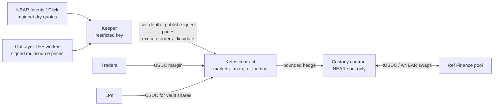

# Ketos — Perps on NEAR, sized by real liquidity

**Every perp exchange has the same blind spot: it lets LP vaults take on positions the market could never absorb.** When a crash comes, the oracle still shows a price, but nobody can actually sell at it. That gap left Hyperliquid's HLP vault facing ~$13.5M of unrealized losses during the JELLY squeeze ([CoinDesk](https://www.coindesk.com/markets/2025/03/26/hyperliquid-delists-jellyjelly-after-vault-squeezed-in-usd13m-tussle)) and cost GMX's LPs ~$565k on AVAX ([Cointelegraph](https://cointelegraph.com/news/decentralized-exchange-gmx-suffers-565k-price-manipulation-exploit)).

**Ketos fixes it at the root.** It is a perpetual futures exchange on NEAR where every market's size limit and leverage come from **real exit liquidity measured with [NEAR Intents](web/lib/intents/depth.ts)**, not from a listing committee. Liquidity becomes an onchain risk limit, enforced on every trade by [one Rust contract](contracts/ketos/src/lib.rs).

**Live on NEAR testnet: https://ketos-three.vercel.app**

## Why it matters

- **For LPs:** risk limits follow the market's real depth, re-measured every 10 minutes, so a thin market can never be loaded like a deep one.
- **For traders:** every order carries a signed price ceiling or floor and an expiry; you never fill at a price you did not authorize.
- **For NEAR:** Intents turns liquidity spread across chains into a measurable, verifiable signal, and a single fast, cheap NEAR contract enforces it for every trade.

### What's live today on NEAR testnet

- **Liquidity-sized markets:** a keeper probes NEAR Intents with live 1Click quotes from $1k to $1M; the contract lets open interest grow only up to what the market can genuinely unwind, expands slowly, tightens instantly, and never beyond LP capital.
- **Permissionless listing:** anyone can launch a new market with its own isolated LP vault.
- **Tamper-proof prices:** OutLayer TEE workers sign multi-exchange prices; the contract verifies the pinned enclave key, source agreement and a 15-second freshness window.
- **Real hedging:** the vault offsets NEAR exposure with actual Ref Finance swaps through a dedicated custody contract, reconciled from onchain receipts.
- **A pro trading terminal:** wallet-funded one-click entries, TP/SL dragged on the chart, partial closes, LP deposits and a live stress-test view.
- **Proven end to end:** ~300 contract tests, 5 sandbox integration suites, 500+ frontend tests, a 12-step browser journey, and public testnet transactions linked below.

## Demo

Try it on the hosted app (3 minutes, no wallet needed for steps 1–3):

1. **Open [/markets](https://ketos-three.vercel.app/markets)**: each row shows measured capacity, effective (vault-limited) cap, leverage and the observation time.
2. **Open [/risk](https://ketos-three.vercel.app/risk)**: drag the shock slider to see liquidatable notional and estimated bad debt per vault; scroll to **Executed protection** for the real Ref hedge fills with checkable receipts.
3. **On the landing page, enter 1 SOL in "From another chain"**: a live NEAR Intents quote (USDC on NEAR, route cost, ETA).
4. **Trade:** [/trade](https://ketos-three.vercel.app/trade) → **Connect** (NEAR testnet wallet) → **Fund** (1,000 test USDC, gas sponsored) → **Long 2× 20 USDC** → sign once → close.

**Why "get signed price" first:** Ketos never trades on a stale mark. Each market order fetches a fresh TEE-signed price (a live counter shows progress), then **Confirm Long** opens your wallet with a bounded execution price. Verified on the hosted app: [NEAR 2× long opened](https://testnet.nearblocks.io/txns/Ae59CaR6CZNZDyvsH49QCyebhG6rgJVYenENCQBY8d1L) and [closed](https://testnet.nearblocks.io/txns/GD1z1wtu5GB3Y7WbHaSjCecwUxLvZw9hwrhTn5HX1tLX). The [complete 12-step journey](#run-locally) also runs locally against a NEAR sandbox.

## How it works



- **Liquidity-sized admission** — [depth.rs](contracts/ketos/src/depth.rs), [market.rs](contracts/ketos/src/market.rs): capacity from the contiguous quote prefix under 100 bps net impact; leverage tiers 20× at ≥$1M, 10× at ≥$250k, 5× at ≥$50k, otherwise 2×; markets close below $10k or when depth is older than 30 minutes; exits are never blocked.
- **Fees from measured impact** — [position.rs](contracts/ketos/src/position.rs): 0.1% open/close plus impact interpolated at the actual size, paid to the market's vault.
- **Isolated market vaults + permissionless listing** — [listing.rs](contracts/ketos/src/listing.rs), [vault.rs](contracts/ketos/src/vault.rs): 25 USDC listing fee, route-bound assets, separate LP capital per market.
- **Bounded execution** — [orders.rs](contracts/ketos/src/orders.rs): every market order, TP/SL and limit carries a signed price ceiling/floor and an expiry.
- **Executed hedge** — [hedge.rs](contracts/ketos/src/hedge.rs), [custody](contracts/hedge-custody/src/lib.rs): 10 tUSDC capital, 1 tUSDC per trade, minimum output enforced on Ref, nothing counted in NAV before the receipt is reconciled. The live round trip ([buy](https://testnet.nearblocks.io/txns/5Vmvt2VidkipJsyAHJGUs5Equzkf3dghXN2N4aX2hH2h), [sell](https://testnet.nearblocks.io/txns/5rhnbrf4GafLomLMkP1iRKrgyhxhXrfGDiJyrHy3TJZp)) committed 1 tUSDC and returned 0.998767: a 0.001233 tUSDC realized loss plus gas, zero residual inventory.

## Business model

| Flow | Rule | Goes to |
|---|---|---|
| Open / close | 0.1% of notional + measured impact | Market vault |
| Borrow | 0.001% + 0.009% × utilization per hour | Market vault |
| Funding | up to ±0.05% per hour | Opposite side |
| Liquidation | up to 1% + 0.2% executor reward | Vault / liquidator |
| Listing | 25 USDC | Long-tail vault |

No protocol treasury fee. Measured operating cost: about $0.09/hour of OutLayer credit and 0.074 test NEAR/hour of keeper gas (November 13), paid by the operator.

## Built with

- **NEAR Intents 1Click API** — server-only quotes and route previews: [client](web/lib/intents/oneclick.ts).
- **OutLayer** — attested price worker and signature verification: [worker](workers/ketos-prices/src/), [verifier](contracts/ketos/src/signed_prices.rs).
- **Ref Finance testnet** — hedge venue: [hedge flow test against pinned Ref bytecode](contracts/tests/src/hedge_flow.rs).
- **near-sdk 5.29.1**, **@hot-labs/near-connect**, Next.js 16, React 19, Tailwind v4, TanStack Query, Zod.

Contracts: [ketos.testnet](https://testnet.nearblocks.io/address/ketos.testnet), [usdc.ketos.testnet](https://testnet.nearblocks.io/address/usdc.ketos.testnet), [keeper.ketos.testnet](https://testnet.nearblocks.io/address/keeper.ketos.testnet), hedge custody [ketos-hedge-2951de72.testnet](https://testnet.nearblocks.io/address/ketos-hedge-2951de72.testnet). Manifests: [deployments/](deployments/).

## Run locally

Node 24, pnpm, Rust ≥1.95 with `wasm32-unknown-unknown`, `cargo-near` 0.22.

```bash
pnpm install --frozen-lockfile
pnpm contracts:build
pnpm --dir web exec playwright install chromium
pnpm --dir web exec playwright test   # local NEAR sandbox, 12-step journey
```

The journey deploys the contracts to a local sandbox, funds a test wallet, and runs [12 steps](web/e2e/demo.spec.ts): ETH long with TP/SL, BTC limit fill, refused oversized order, new market listing, LP deposit, stress view, stop-loss fill and liquidation, portfolio, leaderboard. Local prices are controlled; depth quotes stay real.

Other checks: `pnpm -r typecheck`, `pnpm -r test`, `pnpm contracts:test`.

## Limitations

Ketos is a hackathon build on NEAR testnet (unaudited, faucet USDC). Next steps toward mainnet:

- **Decentralized depth reporting:** today one restricted keeper ([`render.yaml`](render.yaml)) publishes the measured curves; the contract already bounds their shape, freshness and ramp.
- **Faster price delivery:** entries wait for a fresh OutLayer signature rather than trading on an old mark; a second signed source would cut that wait.
- **Security hardening:** an internal review identified gas-scaling and hedge-valuation hardening work, planned before any mainnet launch.

License: [MIT](LICENSE).
