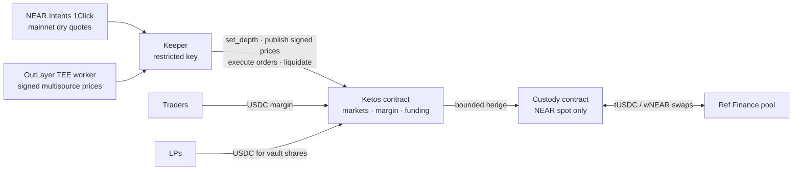

# Ketos — Perps on NEAR, sized by real liquidity

Ketos is a perpetual futures exchange on **NEAR testnet**, built for **Unstoppable DeFi**. Each market's open-interest limit and leverage come from **exit liquidity measured on [NEAR Intents](web/lib/intents/depth.ts)** (1Click dry quotes), not from a listing committee. LPs back traders through vaults; every new market gets its own isolated vault. Margin, orders, funding, liquidation and settlement live in [one Rust contract](contracts/ketos/src/lib.rs).

**Live app: https://ketos-three.vercel.app** · testnet contracts, faucet USDC, no real money.

## Why it matters

| Question | Answer |
|---|---|
| Problem | A vault can carry more exposure than the market can absorb (Hyperliquid HLP / JELLY, March 2025; GMX AVAX, September 2022). An oracle price says nothing about exit depth. |
| Mechanism | A keeper samples 1Click quotes from $1k to $1M; the contract admits new open interest only up to the largest contiguous size with acceptable impact, ramps capacity up slowly, cuts it immediately, and also caps it by vault capital. |
| Prices | OutLayer TEE: an attested multisource WASI worker signs prices; the contract verifies the pinned key, freshness (≤15 s) and source agreement. |
| Protection | A bounded NEAR spot hedge on Ref Finance testnet, executed by a controller-bound custody contract with receipt-verified accounting. |
| Evidence | Deployed contracts, public testnet transactions, ~300 contract tests, 5 sandbox integration suites, 500+ frontend tests, a 12-step browser journey. |

## Demo

Try it on the hosted app (3 minutes, no wallet needed for steps 1–3):

1. **Open [/markets](https://ketos-three.vercel.app/markets)**: each row shows measured capacity, effective (vault-limited) cap, leverage and the observation time.
2. **Open [/risk](https://ketos-three.vercel.app/risk)**: drag the shock slider to see liquidatable notional and estimated bad debt per vault; scroll to **Executed protection** for the real Ref hedge fills with checkable receipts.
3. **On the landing page, enter 1 SOL in "From another chain"**: a live NEAR Intents quote (USDC on NEAR, route cost, ETA).
4. **Trade:** [/trade](https://ketos-three.vercel.app/trade) → **Connect** (NEAR testnet wallet) → **Fund** (1,000 test USDC, gas sponsored) → **Long 2× 20 USDC** → sign once → close.

**If the ticket shows "Refresh on trade" or "Fresh price unavailable":** the contract refuses entries without a price observed in the last 15–30 s, and the OutLayer testnet price service is currently slow (calls taking 1–2 minutes, executors restarting on November 14). Ketos does not loosen that check to make a demo work. The [complete journey](#run-locally) runs locally with controlled prices.

## How it works



- **Liquidity-sized admission** — [depth.rs](contracts/ketos/src/depth.rs), [market.rs](contracts/ketos/src/market.rs): capacity from the contiguous quote prefix under 100 bps net impact; leverage tiers 20× at ≥$1M, 10× at ≥$250k, 5× at ≥$50k, otherwise 2×; markets close below $10k or when depth is older than 30 minutes; exits are never blocked.
- **Fees from measured impact** — [position.rs](contracts/ketos/src/position.rs): 0.1% open/close plus impact interpolated at the actual size, paid to the market's vault.
- **Isolated market vaults + permissionless listing** — [listing.rs](contracts/ketos/src/listing.rs), [vault.rs](contracts/ketos/src/vault.rs): 25 USDC listing fee, route-bound assets, separate LP capital per market.
- **Bounded execution** — [orders.rs](contracts/ketos/src/orders.rs): every market order, TP/SL and limit carries a signed price ceiling/floor and an expiry.
- **Executed hedge** — [hedge.rs](contracts/ketos/src/hedge.rs), [custody](contracts/hedge-custody/src/lib.rs): 10 tUSDC capital, 1 tUSDC per trade, minimum output enforced on Ref, nothing counted in NAV before the receipt is reconciled. The live round trip ([buy](https://testnet.nearblocks.io/txns/5Vmvt2VidkipJsyAHJGUs5Equzkf3dghXN2N4aX2hH2h), [sell](https://testnet.nearblocks.io/txns/5rhnbrf4GafLomLMkP1iRKrgyhxhXrfGDiJyrHy3TJZp)) committed 1 tUSDC and returned 0.998767: a 0.001233 tUSDC realized loss plus gas, zero residual inventory.

## Business model

| Flow | Rule | Goes to |
|---|---|---|
| Open / close | 0.1% of notional + measured impact | Market vault |
| Borrow | 0.001% + 0.009% × utilization per hour | Market vault |
| Funding | up to ±0.05% per hour | Opposite side |
| Liquidation | up to 1% + 0.2% executor reward | Vault / liquidator |
| Listing | 25 USDC | Long-tail vault |

No protocol treasury fee. Measured operating cost: about $0.09/hour of OutLayer credit and 0.074 test NEAR/hour of keeper gas (November 13), paid by the operator.

## Built with

- **NEAR Intents 1Click API** — server-only quotes and route previews: [client](web/lib/intents/oneclick.ts).
- **OutLayer** — attested price worker and signature verification: [worker](workers/ketos-prices/src/), [verifier](contracts/ketos/src/signed_prices.rs).
- **Ref Finance testnet** — hedge venue: [hedge flow test against pinned Ref bytecode](contracts/tests/src/hedge_flow.rs).
- **near-sdk 5.29.1**, **@hot-labs/near-connect**, Next.js 16, React 19, Tailwind v4, TanStack Query, Zod.

Contracts: [ketos.testnet](https://testnet.nearblocks.io/address/ketos.testnet), [usdc.ketos.testnet](https://testnet.nearblocks.io/address/usdc.ketos.testnet), [keeper.ketos.testnet](https://testnet.nearblocks.io/address/keeper.ketos.testnet), hedge custody [ketos-hedge-2951de72.testnet](https://testnet.nearblocks.io/address/ketos-hedge-2951de72.testnet). Manifests: [deployments/](deployments/).

## Run locally

Node 24, pnpm, Rust ≥1.95 with `wasm32-unknown-unknown`, `cargo-near` 0.22.

```bash
pnpm install --frozen-lockfile
pnpm contracts:build
pnpm --dir web exec playwright install chromium
pnpm --dir web exec playwright test   # local NEAR sandbox, 12-step journey
```

The journey deploys the contracts to a local sandbox, funds a test wallet, and runs [12 steps](web/e2e/demo.spec.ts): ETH long with TP/SL, BTC limit fill, refused oversized order, new market listing, LP deposit, stress view, stop-loss fill and liquidation, portfolio, leaderboard. Local prices are controlled; depth quotes stay real.

Other checks: `pnpm -r typecheck`, `pnpm -r test`, `pnpm contracts:test`.

## Limitations

- **Testnet only, unaudited.** Faucet USDC is not real. Activity on the hosted app comes from our own test accounts.
- **Price availability depends on OutLayer.** Entries need a ≤15–30 s observation; during provider slowdowns markets show stale prices and refuse entries rather than trading on old marks.
- **Trusted keeper, single machine.** It reports depth honestly by assumption (the contract checks shape, freshness and caps, not solver quotes) and runs on one Mac.
- **Known contract risks from our internal review (November 14), not fixed before submission:**
  - every vault read scans all open positions, so a flood of tiny positions can exhaust gas for LP deposits and opens;
  - hedge inventory is valued at the oracle mark, and the thin project-funded Ref pool can be pushed to inflate Core NAV;
  - an unfinished hedge operation blocks Core LP actions until the keeper reconciles it;
  - a trader can choose between two signed prices inside the 15 s window;
  - depth impact reported by the keeper has no upper bound.
- **Upgradeable code:** no freeze/seize method exists, but testnet deployment keys can upgrade the contract.

Full mechanism, evidence and operations notes: [DETAILS.md](DETAILS.md). License: [MIT](LICENSE).
