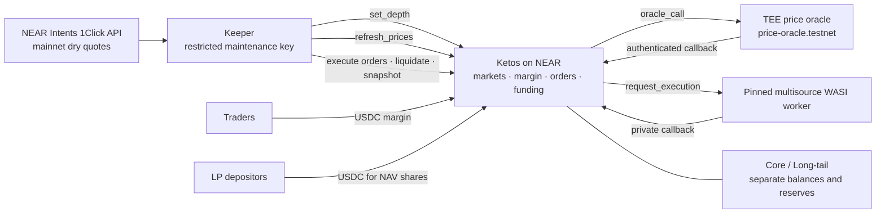

# Ketos — Perps on NEAR, sized by real liquidity

Ketos is a native perps exchange on NEAR testnet, built for Unstoppable DeFi. Two LP vaults take the other side of trades. Each market's open-interest limit and maximum leverage come from measured exit liquidity on [NEAR Intents](web/lib/intents/oneclick.ts), rather than a listing committee. Margin, orders, funding and settlement live in [one Rust contract](contracts/ketos/src/lib.rs).

## Demo

**Live app: https://ketos-three.vercel.app** — testnet contracts, faucet USDC, no real-money trading.

The full transaction journey is reproducible with `pnpm --dir web exec playwright test`. It deploys a local NEAR sandbox, connects a test wallet and runs [12 demo steps](web/e2e/demo.spec.ts), including keeper fills and liquidation. Prices are mocked locally; new depth measurements still use real, read-only mainnet quotes and need internet access.

**Video:** the 12-scene recording is not yet published; there is no public video URL. The local journey above is executable now.

The hosted app shows current onchain state, not a seeded trading session. Markets can be closed, histories empty and the leaderboard unpopulated. Filling a ticket is a preview, not an executed trade. The app never overrides safety checks to reproduce a screenshot.

### Try it — 12 steps

Steps 1–9 and 11–12 can be explored on the hosted app. Trading needs a NEAR testnet wallet with gas, fresh prices and an open market. The local journey also drives the controlled price moves in steps 5 and 10 and supplies extra test collateral for the cap-refusal scene.

1. **Open the landing page** — see measured capacity, open/listed markets, total open interest, vault TVL and 24-hour volume, with observation times. Click **Launch app**.
2. **Connect, Fund, Deposit** — connect a testnet wallet, claim **1,000 USDC** from the hourly faucet, then deposit **500 USDC** as margin. See the onboarding checklist advance and Available to Trade update. In the Deposit dialog, **From another chain** previews an ETH (Base), SOL or BTC route; it does not transfer funds.
3. **Open Markets and search SOL** — see price, spot 24-hour change where available, funding per hour, open interest/cap, leverage and vault. Click its row to open SOL-USD. If it is Measuring or Closed, wait for a qualifying measurement or choose an open market; a keeper tick does not guarantee liquidity.
4. **Open a SOL long at 5× with TP/SL** — when the live leverage limit permits, enter a 500 USDC position size (100 USDC margin), add take-profit and stop-loss prices, then sign. See the position, PnL and liquidation price; the two exits appear in **Open Orders**. Local prices start at 150, with targets 180 and 130.
5. **Place a BTC Limit short above the current mark** — see reserved collateral and a resting order. A sell limit below the mark would already be triggered. The local journey places it at 78,000, moves the mock price to 78,200, then observes the keeper fill in **Trade History**. Execution uses the current oracle price, not a guaranteed limit price.
6. **Try a ZEC order above its displayed cap** — with sufficient collateral, sign and see the contract refuse excess open interest with the live cap. **Use max size** adjusts the ticket without submitting it. The local journey adds test collateral so insufficient margin cannot mask this refusal; the hosted faucet alone may not cover it.
7. **Markets → List a market** — select an offered asset and pay 5 USDC. See it start **Measuring**, then become Open only after adequate depth and a fresh supported price. The local journey lists cNEAR; hosted candidates depend on actual oracle/token availability. Paying the fee is not a guarantee that a market can open.
8. **Vaults → Core → deposit 500 USDC** — see shares minted at NAV, your holding, hourly NAV/share-price observations, the revenue breakdown and exposure against market capacity. Core covers BTC/ETH/NEAR/SOL; Long-tail covers the rest. Deposits in one do not mint shares in the other. The local journey tops up test funds after the listing fee.
9. **Open Risk and select SOL** — move the shock slider from −10% to −50%. See affected positions, liquidatable notional and estimated bad debt per vault beside the last measured capacity. Inspect the heatmap, retained 24-hour observations and any **Market tightened** alert. This calculation sends no transaction and does not predict post-shock liquidity.
10. **Observe stop loss and liquidation on Trade** — the local journey opens two NEAR longs, then moves the mock oracle below the onchain liquidation threshold. The keeper closes one through its stop and liquidates the other; history distinguishes the outcomes. There is no public price-control button, and this scene cannot be forced on the hosted app.
11. **Open Portfolio** — inspect equity, realized/unrealized PnL, positions, orders, trade/funding history and confirmed margin transfers. Switch the BTC position from Isolated to Cross after the risk confirmation, close positions and withdraw free margin. Cross shares committed collateral, not all wallet or free-margin funds; conversion cannot be reversed.
12. **Open Leaderboard** — see the trading account highlighted with all-time realized PnL, ROI, volume and executed trades. Sort by volume, then return home to see the trades reflected in 24-hour volume. With no executed trades, the live leaderboard correctly stays empty.

## The problem

A vault can inherit more exposure than the underlying market can absorb. In March 2025, Hyperliquid's HLP temporarily showed about $13.5M of unrealized losses during the JELLY squeeze before forced settlement ([CoinDesk](https://www.coindesk.com/markets/2025/03/26/hyperliquid-delists-jellyjelly-after-vault-squeezed-in-usd13m-tussle)). In September 2022, a reference-market manipulation extracted about $565,000 from GMX's AVAX market at GLP holders' expense ([Cointelegraph](https://cointelegraph.com/news/decentralized-exchange-gmx-suffers-565k-price-manipulation-exploit)). An oracle price alone does not establish executable depth.

Here is the [recorded 1Click measurement](web/e2e/fixtures/depth-2026-11-03.json) from **November 3, 2026, 17:05:47 UTC**: selling into USDC on NEAR, `dry: true`, impact net of the recorded 20 bps partner fee.

| Asset | $1,000 | $10,000 | $50,000 | $100,000 | $250,000 | $500,000 | $1,000,000 |
|---|---|---|---|---|---|---|---|
| BTC | 20 bps | 20 bps | 20 bps | 20 bps | No quote | No quote | No quote |
| ETH | 19 bps | 19 bps | 20 bps | 20 bps | No quote | No quote | No quote |
| NEAR | 25 bps | 25 bps | 28 bps | 31 bps | No quote | No quote | No quote |
| ZEC | 15 bps | 34 bps | 25 bps | 26 bps | No quote | No quote | No quote |

This observation supported $100,000 of exit capacity per asset **at that time**, not a permanent ceiling or today's liquidity. Missing smaller quotes can also coexist with larger successful quotes; Ketos stops at the first gap rather than jumping over it. Re-measure with `pnpm depth:sample` and inspect current curves on `/risk`.

## How it works



### Liquidity rules

The [sampler](web/lib/intents/depth.ts) requests seven sizes: $1k, $10k, $50k, $100k, $250k, $500k and $1M. It subtracts the configured platform fee from gross quoted impact: 20 bps with the current partner configuration, 25 bps without a key. These are implementation settings, not a guarantee that an external fee schedule never changes.

The [contract](contracts/ketos/src/depth.rs) enforces:

- **Exit capacity:** the last size in the contiguous acceptable prefix, with every sample up to it quoted at ≤100 bps net impact. The first missing quote or impact above 100 bps ends the prefix.
- **Open interest per side:** `min(market hard cap, exit capacity)`. The current default hard cap is $500,000. Long and short caps are separate, not a bound on their combined notional.
- **Leverage:** 20× at capacity ≥$1M, 10× at ≥$250k, 5× at ≥$50k, otherwise 2×, further limited by the market's configured ceiling. Permissionless and worker-market ceilings are 5×.
- **Entry closed:** capacity below $10k or depth older than 30 minutes. Entries also require an oracle price no older than 120 seconds.
- **Enforcement at execution:** market entries and triggered entries recheck remaining capacity. Lower caps constrain new entries; they do not forcibly resize existing positions.

The keeper rotates batches of 8 markets, plus up to 4 never-measured markets outside the slot. A tick refreshes only that depth batch, but checkpoints funding and requests prices for the full registry. It then executes triggered orders, re-reads positions, liquidates unhealthy isolated positions/cross accounts and takes hourly snapshots. The [HTTP endpoint](web/app/api/keeper/tick/route.ts) has a 60-second gate; the [executor](web/lib/keeper/tick.ts) refuses ticks below 2 NEAR of spendable contract funds.

### Trading, funding and orders

[Positions](contracts/ketos/src/position.rs) support long/short and isolated/cross margin. Opening and closing each cost 0.1% of notional. Hourly borrow fees are 0.001% + 0.009% × utilization. Maintenance is notional divided by twice the market maximum leverage at entry; that requirement stays locked for the position. Integer math uses 6-decimal USDC and 8-decimal prices, rounding in the vault's favour.

[Funding](contracts/ketos/src/funding.rs) is `0.05% × (long OI − short OI) / max(total OI, 1)` per hour, bounded at ±0.05%. The majority side pays, the minority receives and the unmatched amount accrues to its vault. Cumulative indexes checkpoint before OI changes, so new positions do not inherit earlier funding.

[Limit, Stop Market, Take Profit and Stop Loss orders](contracts/ketos/src/orders.rs) are stored onchain. Entry orders reserve margin immediately; cancellation releases it. Any executor can fill a triggered order at the fresh **current oracle price**. Rejected triggered entries release their reservation. TP/SL closes the full position; either exit cancels its sibling. There is no order book or guaranteed stop/limit execution price.

[Cross margin](contracts/ketos/src/cross.rs) pools committed collateral and signed settlement cash, excluding free margin, isolated positions and pending entry reservations. Health includes all cross legs. Permissionless liquidation closes the riskiest whole positions until health recovers. An underwater leg of a healthy account is not independently liquidatable. Closing a leg settles into the pool; free collateral is released after the last leg exits. [Isolated liquidation](contracts/ketos/src/liquidation.rs) charges up to 1% of notional to the vault and 0.2% to the executor, limited by remaining equity.

### Markets, vaults and account records

The [registry](contracts/ketos/src/market.rs) initializes 16 markets: BTC, ETH, NEAR, ZEC, SOL, AURORA, RHEA, DOGE, XRP, LTC, ADA, SUI, TRX, BNB, AVAX and LINK. The [listing flow](contracts/ketos/src/listing.rs) takes 5 USDC through `ft_transfer_call`; unique new assets start Measuring in Long-tail. Registration alone establishes neither price support nor depth.

[Core and Long-tail](contracts/ketos/src/vault.rs) have independent shares, NAV, reserves and revenue counters. Trader results affect only the assigned vault. LPs earn trading/borrow fees, net funding, trader losses and liquidation/listing fees, and bear trader gains and bad debt. Withdrawals are limited by reserves. Hourly snapshot rings retain up to 168 actual observations; missed hours are not invented. Outstanding cross claims count in accounting NAV but are not spendable cash.

[Account history](contracts/ketos/src/history.rs) retains 200 events per account; all-time trading aggregates survive eviction. Portfolio uses confirmed margin transfers and trading records. The all-time leaderboard indexes at most 500 recently trading accounts; ROI is realized PnL divided by cumulative entry collateral. Landing 24-hour volume is a lower bound when the retained cohort/history cannot cover the window.

The [risk model](web/components/risk/stress.ts) reprices actual positions for a single-asset shock, including shared cross health and creditor-vault debt. It freezes fees/funding at the read and excludes pending orders, future quotes and accrual. Capacity history retains at most 48 samples, which may cover much less than 24 hours.

## Design

The app separates explanation on `/` from trading on `/trade`. A visible checklist guides connection, faucet funding, margin deposit and the first position. The order ticket shows size, liquidation risk and remaining capacity before signing; errors offer a concrete next action. Markets, Portfolio, Vaults, Risk and Leaderboard share the same account controls and responsive layout. The [journey test](web/e2e/demo.spec.ts) checks the visible primary action through the flow.

## Why it matters

For traders, native perps keep positions, collateral and fees on NEAR. For LPs, a market's entry allowance is a dated, reproducible measurement rather than an opaque risk limit. It is not a promise that all positions can be hedged during a crash: dry quotes are nonbinding and no hedge is executed.

Unstoppable DeFi here means [permissionless listing](contracts/ketos/src/listing.rs), [order execution](contracts/ketos/src/orders.rs) and liquidation, with no contract method that lets an administrator freeze or seize positions. Fresh prices, available collateral and reserves still constrain closes and withdrawals. The testnet accounts retain deployment keys; this is not a claim of immutable code.

## What's new

- Market sizing is a contract calculation from an observable exit curve, with enforcement both at entry and delayed-order execution.
- Permissionless listings enter a measuring state rather than inheriting an arbitrary trading allowance.
- Two independent counterparties, cross-aware liquidation and a read-only stress view make the link between market exposure and LP risk inspectable in one app.

## Business model

Trading fees, borrow fees and liquidation penalties accrue to the LP capital taking counterparty risk; listing fees go to Long-tail. Funding transfers between trader sides, with the unmatched amount going to the vault. There is no separate protocol treasury fee or revenue claim. Fee APR is backward-looking and can include assessed cross claims; it is neither cash yield nor a forecast.

## Built with

- **NEAR Intents 1Click API** — server-only, read-only liquidity quotes and ETH (Base)/SOL/BTC route previews: [client](web/lib/intents/oneclick.ts), [preview endpoint](web/app/api/route-preview/route.ts).
- **OutLayer** — the TEE price oracle prices the first seven markets; a pinned WASI worker aggregates at least two public venues for the other nine: [oracle adapter](contracts/ketos/src/oracle.rs), [onchain worker callback](contracts/ketos/src/worker_prices.rs), [worker](workers/ketos-prices/src/). Delivery uses authenticated callbacks, not a signed-price fallback; `signed` is a reserved registry source with no active adapter.
- **near-sdk 5.29.1** and `near-contract-standards` — the trading contract and NEP-141 faucet token: [contract](contracts/ketos/src/lib.rs), [token](contracts/mock-usdc/src/lib.rs).
- **@hot-labs/near-connect** — wallet discovery and transaction signing: [wallet](web/lib/near/wallet.ts).
- **Coinbase Exchange + TradingView Lightweight Charts** — spot candles and 24-hour changes for context, not the settlement mark: [candles endpoint](web/app/api/candles/route.ts), [chart](web/components/trade/price-chart.tsx).
- **Next.js 16, React 19, Tailwind v4, shadcn/ui, TanStack Query and Zod** — app and typed data layer: [web package](web/package.json). Rust/near-workspaces, Vitest and Playwright cover contract math, local-chain integration and the browser journey.

### Testnet contracts

| Component | Account / evidence |
|---|---|
| Trading, margin and both LP pools | [ketos.testnet](https://testnet.nearblocks.io/address/ketos.testnet) |
| Faucet USDC | [usdc.ketos.testnet](https://testnet.nearblocks.io/address/usdc.ketos.testnet) |
| TEE oracle | [price-oracle.testnet](https://testnet.nearblocks.io/address/price-oracle.testnet) |
| Worker execution host | [outlayer.testnet](https://testnet.nearblocks.io/address/outlayer.testnet) |
| Keeper signer | [keeper.ketos.testnet](https://testnet.nearblocks.io/address/keeper.ketos.testnet) |

Addresses are in [the deployment manifest](deployments/testnet.json); the worker project and pinned hash are in [its manifest](deployments/worker-testnet.json). A [November 4, 2026 refresh](https://testnet.nearblocks.io/txns/GWHGRdf2MezJJRmW9N2xKziHyGdt2ZAhU2AUuQfFXxos) returned 16 fresh prices after both adapters completed. This is a past execution, not an uptime claim.

## Run locally

Requirements: Node ≥20.9, the pnpm version in `package.json`, Rust stable ≥1.95, the `wasm32-unknown-unknown` target and `cargo-near` 0.22. The worker additionally needs `wasm32-wasip2`.

```bash
pnpm install --frozen-lockfile
pnpm contracts:build
pnpm --dir web exec playwright install chromium
pnpm --dir web exec playwright test
```

Without `BASE_URL`, Playwright starts the sandbox, deploys all three contracts, seeds both pools with 10,000 test USDC, starts the app at port 3100 with a local signer, then stops both processes. The four recorded depth curves seed initial state; other markets await real quotes. The journey supplies extra test USDC where the initial faucet claim is insufficient. Do not enable the E2E signer outside the local sandbox.

### Use the hosted testnet contracts locally

No deployment key is needed just to run the frontend. Create `web/.env.local` with these public settings:

```dotenv
NEXT_PUBLIC_NEAR_NETWORK=testnet
NEXT_PUBLIC_RPC_URL=https://test.rpc.fastnear.com
NEXT_PUBLIC_KETOS_CONTRACT=ketos.testnet
NEXT_PUBLIC_USDC_CONTRACT=usdc.ketos.testnet
```

Run `pnpm --dir web dev` and open `http://localhost:3000`. Wallet actions need testnet NEAR for gas. Local maintenance additionally needs `KEEPER_PRIVATE_KEY` in the root `.env.local`, authorized on the configured contract; never copy someone else's key. `ONECLICK_JWT` is optional. `pnpm keeper --once` runs one tick; `pnpm keeper` repeats at most once a minute. `pnpm depth:sample` only measures and saves a dated JSON under `scripts/out/`; it does not publish depth or trade.

### Verification

```bash
pnpm -r typecheck
pnpm -r lint
pnpm -r test
pnpm -r build
pnpm contracts:test
cargo test --manifest-path workers/ketos-prices/Cargo.toml --locked
BASE_URL=https://ketos-three.vercel.app pnpm --dir web exec playwright test --grep @smoke
```

The six hosted smoke cases are read-only: they block browser keeper calls. Normal app browsing can trigger maintenance. To check it separately, `POST /api/keeper/tick` returns transaction hashes, measurements and failures; HTTP 429 means its 60-second gate is active.

### Deployment and worker

[`scripts/deploy-testnet.sh`](scripts/deploy-testnet.sh) uses the dedicated testnet keys described in `.env.example`. It checks code/state/key compatibility, refuses changed WASM over initialized state, creates missing accounts, restricts the maintenance key to seven methods and seeds both pools. A fresh setup requires at least 10 NEAR for its bootstrap preflight. An unchanged completed rerun makes no deployment or seed transaction. Full-access funding/deployment keys stay local.

The [multisource worker](workers/ketos-prices/) builds with `cargo build --manifest-path workers/ketos-prices/Cargo.toml --target wasm32-wasip2 --release --locked`; `bash scripts/deploy-worker.sh` deploys it using `outlayer-cli`. Onchain requests pin its WASM hash; a changed binary requires a reviewed contract deployment. Direct HTTPS calls use a server-only `OUTLAYER_PAYMENT_KEY`, not a deployment key; the contract's onchain requests instead pay NEAR from its balance.

The existing Vercel project uses `web/` as Root Directory. Deploy from the repository root with `vercel deploy --prod --yes`. Configure only the four public settings above and server-only maintenance/quote/payment credentials as needed. Never upload `NEAR_PRIVATE_KEY`, `KETOS_PRIVATE_KEY` or E2E signer settings.

## Limitations

- Testnet only, unaudited. Faucet USDC is not real USDC. No real-money use.
- No cross-chain deposits: the Deposit route preview only requests a quote. Trading and collateral settlement stay in one NEAR contract; no swap or hedge is sent to mainnet.
- Mainnet quotes are nonbinding observations, not reserved liquidity. The keeper is trusted to report depth honestly; the contract does not verify solver quotes. Stale checks and caps do not eliminate manipulation, price gaps or LP losses.
- Existing exposure can exceed a newly lowered cap. The cap applies per side, not to combined long/short exposure, and does not force deleveraging. Maximum trader price profit is bounded by position notional; available counterparty cash can further cap payouts.
- The deployed price paths are the TEE oracle and pinned multisource worker, not signed prices. The worker checks venue agreement within 1%; Kraken/Binance tickers lack independent trade timestamps. Source outages can leave prices stale, preventing entries, closes and liquidations until refreshed.
- Local prices are mock-controlled. The 12-step demo requires live quote availability for SOL and its new listing; an external outage can prevent those markets opening rather than silently substituting data.
- Triggered orders execute at the oracle price when an executor runs, not necessarily at the trigger. No guaranteed fills, latency or stop-loss protection through gaps.
- Cross losses can consume other committed cross collateral. Outstanding creditor-vault claims affect NAV but cannot fund withdrawals. LP withdrawals remain reserve-limited; fresh marks and adequate health constrain collateral release.
- Maintenance depends on app visits or a running CLI and sufficient contract NEAR. The serverless gate is not a distributed lease: duplicate requests can race and spend oracle funds. The restricted key cannot transfer tokens arbitrarily, but its authorized methods change depth, settle orders and liquidate.
- Histories are bounded, snapshots are not backfilled, spot chart prices can differ from oracle marks, and separate RPC reads are not an atomic snapshot. Stress results are estimates, not execution guarantees.
- No administrator freeze/seizure method is implemented, but full-access testnet deployment keys remain. The code is not immutable.
